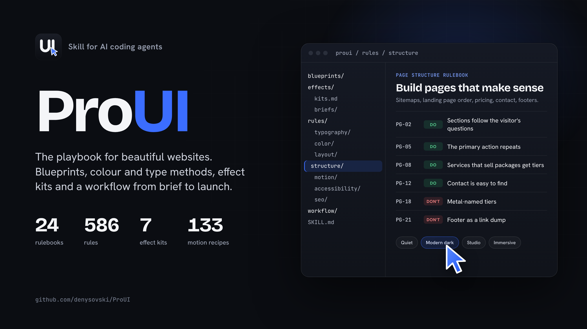

<div align="center">



### The playbook for beautiful websites: blueprints, colour and type methods, effect kits, a workflow from brief to launch, and the rules that keep it looking designed

Published on [Agensi as ProUI](https://agensi.io/skills/proui). This repository keeps its original name, ProUI; both names work in requests and commands.

[What it is](#what-proui-is) · [Contents](#contents) · [How rules work](#how-the-rules-work) · [Rulebooks](#rulebooks) · [Workflow](#how-the-workflow-works) · [Blueprints](#blueprints) · [Effects](#effects-library) · [Commands](#commands) · [Websites](#websites-used-in-the-workflow) · [Tools](#design-tools) · [Licence](#licence) · [Quick start](#quick-start)

</div>

---

## What ProUI is

ProUI is a skill for AI coding agents such as Claude Code, Codex or Cursor, and a cheat sheet for making
beautiful websites with ease. It tells the agent which pages and sections a site needs, how to pick colours and
type, which ready-made effects fit the chosen style and how many to use, and walks it step by step from the
first brief to a live site. Quality rulebooks then keep the result looking designed by a careful person, not
generated.

> [!NOTE]
> ProUI is an **add-on**. It is loaded next to your project's own brief, brand and code. Your instructions come
> first, then the project's own rules, then ProUI.

## Contents

| Folder | What's inside |
| --- | --- |
| [`rules/`](rules/README.md) | the rulebooks, one folder per subject, each with Do and Don't tables |
| [`workflow/`](workflow/README.md) | the step-by-step process and the GitHub guide |
| [`blueprints/`](blueprints/README.md) | how websites are put together: sitemaps, landing page order, sections, pricing, contact, footers, legal and trust pages, colour and type methods |
| [`typography/`](typography/README.md) | which fonts modern sites use (32 brands measured), free matches, 24 grotesks, pixel labels, serifs, pairings by kind of site, as specimen sheets |
| [`effects/`](effects/README.md) | the effects library: kits, effect budget, Motion Primitives (saved here), Aceternity, React Bits and 21st.dev catalogues |
| [`modes/`](modes/README.md) | four kinds of pages: persuade, operate, read, experience |
| [`commands/`](commands/README.md) | short commands like `ProUI critique` or `ProUI ship` |
| [`templates/`](templates/README.md) | files the agent fills in: brief, decisions, reports, GitHub setup |
| [`inspiration/`](inspiration/README.md) | galleries to research, 17 studied sites with build prompts, their animations and palettes |
| [`toolkit/`](toolkit/README.md) | libraries, gradient and shape tools, design tools by stage |
| [`recipes/`](recipes/README.md) | ready code for motion, components, gradients and dashboards |
| [`style/`](style/README.md) | named styles to use in prompts, and my personal taste |
| [`references/`](references/README.md) | Apple and Microsoft guidelines, Impeccable, OpenDesign, source checklists |
| [`scripts/`](scripts/README.md) | the slop scanner and the rulebook and catalogue builders |
| [`SKILL.md`](SKILL.md) | the entry point the agent reads first |

## How the rules work

Every rule has an ID. The letters say which rulebook it belongs to; the number is its fixed place in that
rulebook. You use IDs in prompts to switch rules on or off.

```text
ST-02
│  └── number: the rule's fixed place in its rulebook (not a priority, never reused)
└───── prefix: the rulebook (ST = States Rulebook)
```

| Type | Meaning | Example |
| --- | --- | --- |
| Do | a positive rule: what a finished site does | `ST-02` Loading state: skeletons that match the final layout |
| Don't | a negative rule: what never ships | `SL-01` Purple-to-blue gradients |
| SOFT | a don't that is allowed when it is a deliberate part of the style | `SL-25` Excessive mono fonts |
| HARD RULE | a don't that can never be switched back on | `SL-17` Decorative counting (01 / 02 / 03) |

## Rulebooks

| Area | Rulebook | Prefix | Covers |
| --- | --- | --- | --- |
| Design | [Anti-Slop Rulebook](rules/anti-slop/README.md) | `SL` | patterns that make a site look AI-generated |
| Design | [Design Craft Rulebook](rules/craft/README.md) | `DC` | small decisions that make a design feel considered |
| Design | [Typography Rulebook](rules/typography/README.md) | `TY` | fonts, scale, line length, spacing, loading |
| Design | [Colour Rulebook](rules/color/README.md) | `CL` | colour strategy, roles, contrast, dark mode |
| Design | [Gradients and Backgrounds Rulebook](rules/gradients/README.md) | `GR` | gradients and background patterns that look intentional |
| Design | [Effects and 3D Rulebook](rules/effects/README.md) | `EF` | modern effects, shaders and 3D at the level the user chose |
| Design | [Layout and Spacing Rulebook](rules/layout/README.md) | `LY` | hierarchy, spacing, grid, responsive structure |
| Design | [Page Structure Rulebook](rules/structure/README.md) | `PG` | sitemaps, landing page order, pricing tiers, contact pages, footers |
| Design | [Images and Media Rulebook](rules/images/README.md) | `IM` | photos, video, icons and how to prepare them |
| Interaction | [Navigation Rulebook](rules/navigation/README.md) | `NV` | menus, wayfinding, search, footer, URLs |
| Interaction | [Components and Interaction Rulebook](rules/components/README.md) | `IX` | controls, overlays, feedback, behaviour |
| Interaction | [Forms and Checkout Rulebook](rules/forms/README.md) | `FO` | forms, validation, errors, checkout |
| Interaction | [States Rulebook](rules/states/README.md) | `ST` | empty, loading, error, offline and other states |
| Interaction | [Motion Rulebook](rules/motion/README.md) | `MO` | timing, easing, transitions, reduced motion |
| Interaction | [Accessibility Rulebook](rules/accessibility/README.md) | `AX` | WCAG 2.2 AA, keyboard, screen readers, the EU Accessibility Act |
| Interaction | [Platform Conventions Rulebook](rules/platform/README.md) | `PL` | Apple HIG and Microsoft Fluent principles for the web |
| Product | [Dashboards and Product UI Rulebook](rules/dashboards/README.md) | `DB` | dashboards, admin panels, tables and charts |
| Content | [Copy and UX Writing Rulebook](rules/copy/README.md) | `CP` | headlines, buttons, errors, honest claims |
| Content | [Localisation Rulebook](rules/localization/README.md) | `LO` | languages, formats, currencies |
| Production | [Launch Essentials Rulebook](rules/launch/README.md) | `PE` | system pages, legal pages, contact, monitoring |
| Production | [SEO Rulebook](rules/seo/README.md) | `SEO` | technical SEO, structured data, search penalties |
| Production | [Performance Rulebook](rules/performance/README.md) | `PF` | Core Web Vitals, images, scripts, caching |
| Production | [Security Rulebook](rules/security/README.md) | `SEC` | headers, secrets, validation, authentication |
| Production | [GitHub Workflow Rulebook](rules/github/README.md) | `GH` | repository, CI, quality gates, deploys |

Every rulebook folder has a `README.md` you can read on GitHub and a `rulebook.json` it is built from.
See [how to add a rule](rules/README.md#adding-or-changing-a-rule).

## How the workflow works


| Step | What happens | You decide |
| --- | --- | --- |
| Intake questions | the agent asks what kind of site you imagine | type of site, feel (modern, classic, old-school…), effect level, colours, action, tech, content |
| Brief | what the site is, for whom, the one main action | answer what is still missing |
| Research | the agent collects real designs from the websites below | |
| Direction | three or four directions with screenshots | pick one or combine |
| Design system | fonts and colours by the [type](blueprints/type-pairing.md) and [colour](blueprints/colour-schemes.md) methods, one effect kit | pick type, colour and kit |
| Structure | sitemap and sections from the [blueprints](blueprints/README.md): landing page, pricing, contact, footer, with the planned effects | confirm the outline |
| First screen | the hero built for real | approve the look |
| Build | every page, with real content | |
| Passes | design, behaviour and production rulebooks, one by one | |
| Quality and GitHub | scored review, CI checks, deploy | approve publishing |
| Handoff | live link and what still needs your content | |

Every decision is saved in `proui/DECISIONS.md`, so a new session continues with `ProUI continue`.
Full details: [workflow/WORKFLOW.md](workflow/WORKFLOW.md).

## Blueprints

How the pages are put together, so the site makes sense before it looks good.

| Blueprint | Answers |
| --- | --- |
| [Sitemaps](blueprints/site-types.md) | which pages a service business, company, SaaS, shop, portfolio or restaurant needs |
| [Landing page](blueprints/landing-page.md) | which sections, in which order, where the button repeats, what comes after the landing page |
| [Sections](blueprints/sections.md) | what each section needs and which component fits each effect level |
| [Pricing](blueprints/pricing.md) | three named packages for services, tiers and comparison tables for products |
| [Contact](blueprints/contact.md) | contact pages for companies and local businesses |
| [Footers](blueprints/footer.md) | slim, standard or fat, by the amount of information |
| [Legal and trust](blueprints/legal-and-trust.md) | cookie consent done right, privacy, personal data, uploaded files, security.txt, status page |
| [Colour schemes](blueprints/colour-schemes.md) and [type pairing](blueprints/type-pairing.md) | a method and starter options for each feel |

## Effects library

When you ask for a **modern web** or a **website with 3D effects**, ProUI asks how much effect you want, picks
one **kit** (a family of components that look alike) and keeps to an **effect budget**: ask for "a couple of
3D effects" and you get two, not one per section. See [kits](effects/kits.md).

| Effect level | You get |
| --- | --- |
| None | a calm, fast site with hover and focus feedback only |
| Subtle | gentle motion, tilt and spotlight cards |
| Modern | an animated headline, gradients or one shader background, one interactive section |
| Immersive 3D | a 3D hero scene, 3D galleries, scroll-driven sequences |

| Catalogue | What's in it |
| --- | --- |
| [Motion Primitives](effects/catalog/motion-primitives.md) | all 33 components of [motion-primitives.com](https://motion-primitives.com), source saved in the repository (MIT): text effects, reveals, spotlight, tilt, accordion, morphing dialogs |
| [ProUI fx](effects/fx/README.md) | 11 effects written for ProUI in plain HTML, CSS and JS, no library: progressive blur, expanding panels, stack scroll, coverflow, theme toggle and more, with a demo page |
| [Motion briefs](effects/briefs/README.md) | 20 detailed build briefs for signature effects: stacking cards, curtain slider, pricing roll, process rail, two-panel drawer and more |
| [Skiper UI](effects/catalog/skiper-ui.md) | the 37 free components of [skiper-ui.com](https://skiper-ui.com/components?source=free): scroll stacks, coverflow carousels, expanding panels, theme toggles, progressive blur (credit Skiper UI when used) |
| [Motion recipes](effects/catalog/motion-recipes.md) | 133 GSAP build prompts for studio-style motion (text reveals, pinned chapters, sliders, menus, buttons, shaders), studied from [Annnimate](https://annnimate.com/animations) and written in our own words |
| [Aceternity UI](effects/catalog/aceternity.md) | the 114 free components of [ui.aceternity.com](https://ui.aceternity.com/components) with registry names: beams, spotlights, aurora, bento grids, 3D cards, globes, parallax heroes |
| [React Bits](effects/catalog/react-bits.md) | all 217 components of [reactbits.dev](https://reactbits.dev/get-started/index): shader backgrounds, cursor and reveal animations, animated text, galleries, cards, micro-interactions |
| [21st.dev 3D](effects/catalog/21st-3d.md) | all 169 components of the [21st.dev 3D collection](https://21st.dev/community/components/s/3d): 3D heroes, backgrounds, globes, 3D objects, cards, 3D carousels, scroll stories, with author and licence |

Components are installed into your project from their official registries with one command, then restyled to
your colours and fonts. See [presets](effects/presets.md) and the [install guide](effects/install.md).

## Modes

| Mode | The visitor came to | Examples |
| --- | --- | --- |
| Persuade | decide and act | landing page, shop, service business |
| Operate | get a job done | dashboard, admin, tool, settings |
| Read | understand | docs, blog, case study |
| Experience | explore | portfolio, campaign, gallery |

## Commands

| Command | What it does |
| --- | --- |
| `ProUI workflow: <request>` | builds a new site with checkpoints |
| `ProUI critique` | design review with scores and prioritised issues |
| `ProUI audit` | technical review: accessibility, performance, theming, responsive |
| `ProUI effects` | picks and installs effects at the chosen level |
| `ProUI polish` | refines an existing page without redesigning it |
| `ProUI dashboard` | builds or reviews product UI |
| `ProUI ship` | production checks, GitHub, deploy |
| `ProUI continue` | resumes a project from its decisions file |

All commands: [commands/README.md](commands/README.md).

## Websites used in the workflow

### Guidelines

| Website | Good for |
| --- | --- |
| [Apple Human Interface Guidelines](https://developer.apple.com/design/human-interface-guidelines) | design principles, typography, colour, layout, accessibility |
| [Microsoft Fluent 2](https://fluent2.microsoft.design) | spacing system, type ramp, tokens, elevation for product UI |
| [Impeccable](https://github.com/pbakaus/impeccable) | the open-source design skill ProUI takes the most inspiration from |
| [OpenDesign](https://open-design.ai) | one design-system file per brand, design as code |

### Inspiration (research step)

| Website | Good for |
| --- | --- |
| [Mobbin](https://mobbin.com) | real app and website screens, flows, dashboards (paid login) |
| [Dribbble](https://dribbble.com) | concepts for 3D, scroll and product reveals |
| [Dark](https://dark.design) | dark websites by category |
| [Recent](https://recent.design) | current brand, web and motion work |
| [Saved](https://saved.design) | interface, 3D and typography details |
| [Designeer](https://designeer.xyz) | components, motion, 3D |
| [Godly](https://godly.website), [Awwwards](https://www.awwwards.com), [Land-book](https://land-book.com), [SiteInspire](https://www.siteinspire.com), [Lapa Ninja](https://www.lapa.ninja), [httpster](https://httpster.net) | extra galleries when the main ones are thin |

### Building (design system and build steps)

| Website | Good for |
| --- | --- |
| [Fontshare](https://fontshare.com) | free quality fonts |
| [Made With GSAP](https://madewithgsap.com), [GSAP](https://gsap.com), [Lenis](https://lenis.dev) | animation and smooth scroll |
| [Motion Primitives](https://motion-primitives.com) | quiet Motion components (source saved in the effects library) |
| [Aceternity UI](https://ui.aceternity.com/components) | free animated sections and effects (catalogue in the effects library) |
| [React Bits](https://reactbits.dev/get-started/index) | animated React components (full catalogue in the effects library) |
| [21st.dev 3D components](https://21st.dev/community/components/s/3d) | community 3D components (catalogue in the effects library) |
| [Codrops](https://tympanus.net/codrops) | creative effect tutorials |
| [Spline](https://spline.design), [three.js](https://threejs.org) | 3D |
| [SVGL](https://svgl.app), [SVG Doodles](https://svgdoodles.com) | brand logos and hand-drawn accents |
| [Balsa UI Gradient Studio](https://balsa-ui.com/tools/gradient-studio) | signature gradients |
| [Balsa UI Design Studio](https://balsa-ui.com/tools/design-studio) | tokens and components for dashboards |
| [Pryzm Studio](https://pryzm.design/studio) | backgrounds from a gradient, photo and pattern |
| [Book of Shapes](https://bookofshapes.com) | generative SVG patterns |
| [minitools.design](https://minitools.design) | directory of small design tools |

## Design tools

<details>
<summary><b>Brand, typography, colour</b></summary>

| Tool | Use it for |
| --- | --- |
| GeoLogo, Logo Lattice | geometric logo sketches (never an invented brand mark without asking) |
| Symbl | testing a logo at every size before making favicons |
| [Google Fonts](https://fonts.google.com) | free font families |
| [Typewolf](https://www.typewolf.com) | what real sites use, alternatives to overused fonts |
| [Type Scale](https://typescale.com) | modular type scales |
| [Fontjoy](https://fontjoy.com) | font pairing ideas |
| [Wakamai Fondue](https://wakamaifondue.com) | what a font file supports |
| [OKLCH](https://oklch.com) | picking colours in OKLCH |
| [Realtime Colors](https://www.realtimecolors.com) | palettes previewed on a page |
| [Huemint](https://huemint.com), [Coolors](https://coolors.co), [Color Hunt](https://colorhunt.co) | palette ideas |
| [Who Can Use](https://www.whocanuse.com) | contrast for real people |

</details>

<details>
<summary><b>Gradients, shapes, icons, 3D</b></summary>

| Tool | Use it for |
| --- | --- |
| [ShaderGradient](https://shadergradient.co) | animated 3D mesh gradients |
| Gradlab, Gradientool, Background Studio, mmeshy | mesh and multi-stop gradients |
| [Hero Patterns](https://heropatterns.com), [Get Waves](https://getwaves.io), [Blobmaker](https://www.blobmaker.app) | patterns, dividers, organic shapes |
| [Phosphor](https://phosphoricons.com), [Tabler Icons](https://tabler.io/icons), [Iconoir](https://iconoir.com) | icon sets beyond the default |
| Morflax Studio, Valessa | 3D product and device shots |
| [Poly Haven](https://polyhaven.com) | free HDRIs, textures and models |
| [glTF Report](https://gltf.report) | compressing 3D models |

</details>

<details>
<summary><b>Mockups and utilities for the final stage</b></summary>

| Tool | Use it for |
| --- | --- |
| [shots.so](https://shots.so), Presenta, Ultramock, Sliick | real screenshots in device frames |
| Frametic | a mockup video of the site for launch posts |
| [ray.so](https://ray.so) | code snippets as images |
| [Squoosh](https://squoosh.app) | image compression |
| [SVGOMG](https://jakearchibald.github.io/svgomg/) | SVG optimisation |
| [tldraw](https://tldraw.com) | quick wireframes |

Tools without a link are listed on [minitools.design](https://minitools.design). More: [toolkit/design-tools.md](toolkit/design-tools.md).

</details>

## Licence

> [!IMPORTANT]
> ProUI is **not free to use**. This repository is public so you can see what it contains, but there is no open
> licence. A licence is sold on [Agensi](https://agensi.io/skills/proui) for $9.99; only after buying it may
> you use ProUI, for your own and your clients' projects. Copying, sharing or reselling ProUI or any part of it needs the
> author's written permission. Full terms: [LICENSE.md](LICENSE.md). Third-party parts keep their own licences
> ([NOTICE](NOTICE)).

## Quick start

After buying ProUI on [Agensi](https://agensi.io/skills/proui), install the copy you get there in your agent
(for Claude Code: `~/.claude/skills/proui/`). Then ask:

```text
Build a website for a coffee shop using ProUI.
Make me a modern web with 3D effects for my design studio.
ProUI workflow, direction BLACK COAL: portfolio for a photographer.
ProUI dashboard: analytics for a small e-shop.
Use ProUI, but keep SL-25. Skip PE-10.
ProUI critique
```

```bash
# scan any project for slop and hard-rule violations
node ~/.claude/skills/proui/scripts/proui-scan.mjs ./src
```

## Credits

Strongly inspired by [Impeccable](https://github.com/pbakaus/impeccable) by Paul Bakaus (Apache-2.0), see
[NOTICE](NOTICE). Apple HIG and Microsoft Fluent 2 are summarised in my own words with links. Pinterest pins
belong to their authors and are linked, not copied. Motion Primitives by ibelick is included under its MIT
licence; Aceternity UI, React Bits and 21st.dev are linked and installed from their registries. Started from a set of
[screenshot checklists](references/source-checklists.md).
