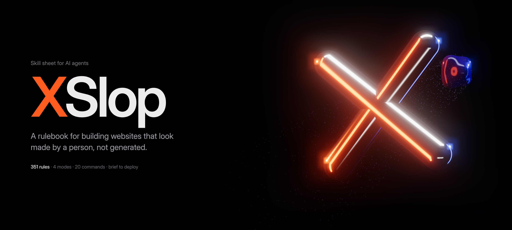

# XSlop



A skill for AI agents (Claude Code, Claude, Codex, Cursor…) that teaches them what a website must not look like
if it should not look AI-generated, and what a professional site, landing page or dashboard needs instead.
It is a rulebook of 351 rules, four visitor modes, twenty commands, a step-by-step workflow with checkpoints,
and a path from the first brief to a live site in a GitHub repository.

Every rule has an ID (for example `SL-14`, `TY-06`, `GH-10`), so I can tell the agent exactly what to include
and what to leave out.

## How it fits into a project

XSlop is an add-on skillset. Load it next to a project's own instructions (brief, `PRODUCT.md`, `DESIGN.md`,
brand guidelines, README, CLAUDE.md / AGENTS.md). Order of precedence: my instructions in the chat first, then
the project's own rules and design system, then XSlop. If a project's brand deliberately uses something XSlop
calls slop, the project wins, except for the hard rules.

As a skill: put the repository folder among the agent's skills (for Claude Code, `~/.claude/skills/xslop/` or
`.claude/skills/xslop/` in a project). `SKILL.md` is the entry point; the agent loads the other files when a
task needs them.

## Repository structure

```
SKILL.md                     entry point: map, rule groups, defaults, overrides, final checklist
rules/
  README.md                  index of all 18 groups, hard rules, which rules load for which task
  design/                    slop, craft, typography, colour, gradients, layout
  interaction/               motion, states, components, accessibility, platform conventions
  product/                   dashboards and product UI, copy and UX writing
  production/                essentials, SEO, performance, security, GitHub workflow
modes/                       persuade, operate, read, experience
commands/                    twenty commands: init, document, shape, critique, audit, scan, polish, harden,
                             bolder, quieter, distill, typeset, colorize, layout, animate, clarify,
                             dashboard, ship, continue
workflow/
  WORKFLOW.md                brief → research → checkpoints → build → passes → quality → GitHub → handoff
  GITHUB.md                  repository, branches, commits, PRs, CI, quality gates, deploy, releases
templates/
  context/                   PRODUCT.md and DESIGN.md for projects
  workflow/                  brief, direction board, decisions record
  reports/                   critique and audit report formats
  github/                    CI, quality and Pages workflows, Lighthouse budgets, Dependabot, PR and
                             issue templates, .gitignore, .editorconfig, .env.example, security.txt
references/                  Apple HIG, Fluent 2, Impeccable, OpenDesign, critique rubric, screenshots
inspiration/                 galleries and how to analyse them; what good dashboards and business sites share
toolkit/                     libraries and fonts; gradient tools; shapes and backgrounds; design tools by stage
recipes/                     code for motion and components, gradients, dashboards
style/                       style keywords and my personal style (MY-STYLE.md and PINS.md are personal)
scripts/
  xslop-scan.mjs             scans a project for slop patterns and hard-rule violations (CI-ready)
  check-rules.mjs            checks this repository: rule IDs unique, sequential and consistent
assets/                      banner image and its three.js source
NOTICE, CHANGELOG.md
```

## The workflow

`workflow/WORKFLOW.md` is the order my agent follows when it builds a new site. It stops four times to let me
choose:

- **Brief**: what the site is, for whom, the one main action, the mode of each surface, `PRODUCT.md`.
- **Research**: real designs from galleries, Mobbin, Dribbble and my Pinterest board, with screenshots.
- **Checkpoint, direction**: three or four directions named after style keywords; I pick or combine.
- **Design system** and **checkpoint, type and colour**: type pairings as specimens, a colour strategy and
  OKLCH roles, a signature gradient or background if the direction uses one.
- **Structure** and **checkpoint, outline**.
- **First screen** and **checkpoint**: the hero and next section built for real.
- **Build the rest**, then **passes** over the whole site: slop and craft, type and colour, layout,
  components and copy, product UI (dashboards only), states, motion, accessibility, SEO, performance,
  security, production and legal.
- **Quality check** with a scored critique and audit, then **GitHub and deploy**, then **handoff** with
  `DESIGN.md` written from the build.

All decisions go into `xslop/DECISIONS.md` in the project so another session can continue with
`XSlop continue`.

## How to use it

- `Build a website for a coffee shop using XSlop.` applies every rule and runs the workflow.
- `XSlop workflow, direction BLACK COAL: portfolio for a photographer.` skips the direction checkpoint.
- `XSlop dashboard: analytics for a small e-shop.` builds product UI in operate mode.
- `XSlop critique` / `XSlop audit` reviews without building, with scores and P0–P3 issues.
- `XSlop polish`, `XSlop harden`, `XSlop bolder`, `XSlop quieter`, `XSlop typeset`, `XSlop colorize`,
  `XSlop layout`, `XSlop animate`, `XSlop clarify` improve one aspect of an existing site.
- `XSlop ship` takes a finished site through the production passes to GitHub and a live deploy.
- `Use XSlop, but keep SL-25 (mono fonts).` allows a soft pattern, used sparingly.
- `Use XSlop, skip PE-10.` skips a rule. `XSlop, only SEO and PF.` applies only those groups.
- `node scripts/xslop-scan.mjs ./src` scans any project; `--ci` fails the build on hard rules.

## Modes

| Mode | The visitor came to | The style may |
| --- | --- | --- |
| Persuade | decide and act (landing page, shop, service) | own the page, as long as the offer and action are clear |
| Operate | get a job done (dashboard, admin, tool) | lend only type, palette, density and one signature move |
| Read | understand (docs, blog, case study) | stay quiet; measure and wayfinding come first |
| Experience | explore (portfolio, campaign) | lead completely, with performance and accessibility kept |

## Rule groups

| Group | IDs | Contents |
| --- | --- | --- |
| Slop to avoid | `SL-01` to `SL-72` | visual and copy patterns that make a site look generated, detector patterns, the four default "AI looks" |
| Design craft | `DC-01` to `DC-20` | small decisions that make a design feel considered |
| Typography | `TY-01` to `TY-20` | choosing faces, scale, body size, measure, leading, tracking, loading fonts, languages |
| Colour | `CL-01` to `CL-16` | colour strategy, roles, OKLCH, tinted neutrals, contrast, dark mode |
| Gradients and backgrounds | `GR-01` to `GR-14` | when a gradient has a job, OKLCH interpolation, mesh, banding, patterns and shapes |
| Layout and spacing | `LY-01` to `LY-16` | hierarchy, squint test, 4 px spacing, rhythm, grid, container queries, safe areas |
| Motion | `MO-01` to `MO-20` | timing, easing, popovers, gestures, reduced motion |
| States | `ST-01` to `ST-10` | empty, loading, error, offline, slow network, zero results, permission, session, validation, success |
| Components and interaction | `IX-01` to `IX-18` | control states, standard controls, dialogs, forms, undo, feedback, keyboard |
| Accessibility | `AX-01` to `AX-16` | semantics, contrast, focus, keyboard, zoom, motion, announcements, testing |
| Platform conventions | `PL-01` to `PL-12` | Apple HIG and Microsoft Fluent 2 principles applied to the web |
| Dashboards and product UI | `DB-01` to `DB-18` | shell, answer-first data, charts, tables, filters, widget states |
| Copy and UX writing | `CP-01` to `CP-14` | voice, buzzwords, buttons, errors, honest claims |
| Production essentials | `PE-01` to `PE-14` | 404, CTA, favicon, OG image, thank-you page, legal pages, cookies, analytics, contact, Git |
| SEO | `SEO-01` to `SEO-16` | sitemap, robots.txt, canonical, titles, descriptions, headings, alt text, schema, llms.txt |
| Performance | `PF-01` to `PF-21` | images, lazy loading, Core Web Vitals, code splitting, caching, database, Lighthouse, heavy visuals |
| Security | `SEC-01` to `SEC-18` | HTTPS, CSP, headers, secrets, validation, escaping, auth, uploads, CORS, dependencies |
| GitHub workflow | `GH-01` to `GH-16` | repository, README, branches, conventional commits, PRs, CI, quality gates, deploys, releases |

Hard rules that can never be switched back on: `SL-17` decorative counting (01 / 02 / 03), `SL-43` fake
testimonials, `SL-44` placeholder business info, `SL-49` side-stripe borders, `CP-14` invented claims.

## What I want to avoid

The `SL` rules in short. "Soft" ones are fine only as a deliberate part of the style.

Colour and surfaces: purple-to-blue gradients; gradient backgrounds as filler (soft); glowing orbs; glass
everywhere (soft); pointless shadows; low-contrast dark mode; too many shades; grain as decoration (soft);
glows on dark backgrounds; radial halos behind the hero; graph-paper and stripe backgrounds; thin border plus
wide shadow; hard offset shadows by reflex (soft).

Layout and components: three feature cards in a row; icon tile stacks; empty bento grids; generic three-tier
pricing; boxes inside boxes; nested cards; dividers everywhere; pills everywhere; badges and chips above
headlines; eyebrows on every heading (soft); counting labels of any kind (never); side-stripe borders (never);
squircles everywhere; untouched shadcn/ui; fake detailed dashboards; needless diagrams; marquees as filler;
shapes assembled from CSS instead of real images.

Type: Instrument Serif and the overused display faces (Inter, Geist, Space Grotesk, Plus Jakarta Sans, DM
Sans, Fraunces, Playfair…) chosen by reflex; random italics; one italic serif word in a sans headline;
negative tracking on body text or extreme tracking anywhere; flat hierarchy; oversized H1 by reflex; mono
everywhere (soft); all caps everywhere (soft); periods in titles (soft); gradient-filled headlines.

The four default "AI looks", unless asked for: cream and terracotta with a serif; near-black with one neon;
broadsheet costume on a site that isn't a publication; neo-brutalist kit.

Icons and decoration: Lucide on every line; emojis in headings and buttons; sparkles; code chrome on a site
that isn't about code; ASCII art; cursor-following beams; pulsing "live" dots and blinking cursors.

Motion: everything fading in on scroll; content invisible until an animation fires; bouncy everyday UI.

Copy: em dashes everywhere; "It's not X, it's Y"; generic hero copy; wordy text; vague buttons; claims without
proof; slogan rhythm and buzzwords (seamless, unlock, elevate, empower).

Trust: fake testimonials (never); placeholder business info (never); no real product demo; broken embeds;
forms asking for too much; keyboard-unfriendly forms.

## Pages and resources used in this project

Every page mentioned anywhere in XSlop, what it is, and how Claude Code uses it. The agent opens these with a
browser tool or web fetch when the workflow or a command says so; some need my login.

### Guidelines and design systems

| Page | What it is | How the agent uses it |
| --- | --- | --- |
| [Apple Human Interface Guidelines](https://developer.apple.com/design/human-interface-guidelines) | Apple's design principles and guidance for typography, colour, layout, materials, accessibility, components | source of `PL`, parts of `TY`, `CL`, `LY`, `AX`; summary in `references/apple-hig.md`; every page also has a `.md` version agents can read |
| [Microsoft Fluent 2](https://fluent2.microsoft.design) | Microsoft's design system: 4 px spacing, type ramp, tokens, elevation, motion, content | reference for product UI and tokens; summary in `references/fluent-2.md` |
| [Impeccable](https://github.com/pbakaus/impeccable) | open-source design skill for AI agents (Apache-2.0) | the main inspiration for modes, commands, critique and audit scoring, the detector rules; see `references/impeccable.md` and `NOTICE` |
| [OpenDesign](https://open-design.ai) | open-source, local-first design workspace for coding agents | idea of one `DESIGN.md` per brand and design systems as references; see `references/opendesign.md` |

### Inspiration galleries

| Page | What it is | How the agent uses it |
| --- | --- | --- |
| [Mobbin](https://mobbin.com) | library of real app and website screens, flows and sections | research for flows, dashboards and business-site sections; needs my paid login (browser or Mobbin connector) |
| [Dribbble](https://dribbble.com) | designers' shots | mood and concepts for 3D, scroll and product reveals; treated as inspiration, not as buildable specs |
| [Dark](https://dark.design) | gallery of dark websites by category | research for dark directions |
| [Recent](https://recent.design) | feed of current brand, web and motion work | research for fresh directions |
| [Saved](https://saved.design) | interface, 3D and typography work | research for interface detail and type |
| [Designeer](https://designeer.xyz) | interface craft, motion, 3D, components | research for components and motion |
| My Pinterest `web-design` board | 878 pins I saved, sorted in `style/PINS.md` | my own taste; always part of research (`style/MY-STYLE.md`) |
| [Godly](https://godly.website), [Awwwards](https://www.awwwards.com), [Land-book](https://land-book.com), [SiteInspire](https://www.siteinspire.com), [Lapa Ninja](https://www.lapa.ninja), [httpster](https://httpster.net) | more galleries | optional extra research when the main sources are thin |

### Build toolkit

| Page | What it is | How the agent uses it |
| --- | --- | --- |
| [Made With GSAP](https://madewithgsap.com) | GSAP effect examples | finding a signature interaction; `toolkit/TOOLKIT.md`, `recipes/RECIPES.md` |
| [GSAP](https://gsap.com) | animation library | motion implementation |
| [Lenis](https://lenis.dev) | smooth scroll library | smooth scroll when a direction needs it |
| [React Bits](https://reactbits.dev) | animated React components | components installed via its registry, then restyled |
| [21st.dev](https://21st.dev) | community React/Tailwind components | components to adapt, never used untouched (`SL-19`) |
| [Codrops](https://tympanus.net/codrops) | tutorials and demos of creative effects | techniques for one signature moment |
| [Spline](https://spline.design) | 3D design tool with web export | interactive 3D scenes when a style asks for 3D |
| [three.js](https://threejs.org) | WebGL library | light 3D heroes (`PF-21`), also used for the banner above |
| [SVGL](https://svgl.app) | official SVG logos of brands | real "works with" logos via its API |
| [SVG Doodles](https://svgdoodles.com) | hand-drawn SVG accents | underlines, arrows, scribbles |
| [Fontshare](https://fontshare.com) | free quality fonts | type pairings at the design-system checkpoint |

### Gradients, shapes and backgrounds

| Page | What it is | How the agent uses it |
| --- | --- | --- |
| [Balsa UI Gradient Studio](https://balsa-ui.com/tools/gradient-studio) | gradient builder from Balsa UI, an open-code component system for Vue and React | the signature gradient at the type-and-colour checkpoint; `toolkit/gradients.md`, `GR` |
| [Balsa UI Design Studio](https://balsa-ui.com/tools/design-studio) | design-system and component studio | setting up tokens and components for dashboards (`DB`, `DC-05`) |
| [Pryzm Studio](https://pryzm.design/studio) | blends a gradient, a photo and a pattern into one high-resolution background | hero, section and OG backgrounds; `toolkit/gradients.md` |
| [Book of Shapes](https://bookofshapes.com) | free generative SVG patterns (grid, radial, flow, noise, isometric, organic…) | background patterns tuned to the palette; `toolkit/shapes-and-backgrounds.md` |
| [minitools.design](https://minitools.design) | directory of small design tools by category | the design tools list below; `toolkit/design-tools.md` |

## Design tools

Useful tools for each stage of a web project, mostly from [minitools.design](https://minitools.design).
`toolkit/design-tools.md` says when the agent suggests each one.

Brand and logos
- GeoLogo, Logo Lattice: geometric logo marks on grids (a starting sketch only, never an invented brand mark)
- Gridcraft: presenting logo work with construction grids
- Symbl: testing how a mark reads at every size, before making favicons
- [SVGL](https://svgl.app): real brand logos for "works with" rows

Typography
- [Fontshare](https://fontshare.com), [Google Fonts](https://fonts.google.com): free families
- [Typewolf](https://www.typewolf.com): what real sites use, and alternatives to overused faces
- [Type Scale](https://typescale.com), Typescale AI: modular type scales and tokens
- The Good Line-Height: line heights on a baseline grid
- [Fontjoy](https://fontjoy.com): pairing ideas
- [Wakamai Fondue](https://wakamaifondue.com): what a font file supports (languages, figures, features)
- FontFreezer: freezing variable fonts into smaller static files

Colour and gradients
- [OKLCH](https://oklch.com): picking colours in OKLCH
- [Realtime Colors](https://www.realtimecolors.com): palettes previewed on a real layout
- [Huemint](https://huemint.com), [Coolors](https://coolors.co), [Color Hunt](https://colorhunt.co): palette ideas
- [Balsa UI Gradient Studio](https://balsa-ui.com/tools/gradient-studio), [Pryzm](https://pryzm.design/studio),
  [ShaderGradient](https://shadergradient.co), Gradlab, Gradientool, Background Studio, mmeshy, Ramps Studio
- [Who Can Use](https://www.whocanuse.com), Colorable: contrast checks for real people

Shapes, patterns and icons
- [Book of Shapes](https://bookofshapes.com), [Hero Patterns](https://heropatterns.com),
  [Get Waves](https://getwaves.io), [Blobmaker](https://www.blobmaker.app), Dot Grid Builder, Durves
- [Phosphor](https://phosphoricons.com), [Tabler Icons](https://tabler.io/icons), [Iconoir](https://iconoir.com):
  icon sets beyond the default

3D
- [Spline](https://spline.design), Morflax Studio, Valessa: 3D scenes and product shots
- [Poly Haven](https://polyhaven.com): free HDRIs, textures and models
- [glTF Report](https://gltf.report): inspecting and compressing GLB files
- Sticky, Liquid Metal, Glass: chrome, glass and foil looks for one hero object

Motion
- Easing editors and Springs Studio: curves and motion tokens
- [Animista](https://animista.net): CSS animation ideas, adapted to the `MO` rules

Mockups for the final stage
- [shots.so](https://shots.so), Presenta, Tokokino, Ultramock, Sliick, mckp.live: real screenshots in device
  frames for the README, case study and OG image
- Frametic: a website URL turned into a mockup video for launch posts
- [ray.so](https://ray.so): code snippets as images

Utilities
- [Squoosh](https://squoosh.app): image compression
- [SVGOMG](https://jakearchibald.github.io/svgomg/): SVG optimisation
- Triim: trimming transparent edges
- [tldraw](https://tldraw.com): quick wireframes at the outline checkpoint

## Source checklists

XSlop was built from these checklists, which I collected as screenshots. The texts are copied here as they
appeared, with the XSlop rule that covers each item.

### Design polish (In under 40 seconds)

| # | Text from the screenshot | XSlop rule |
| --- | --- | --- |
| 1 | Delete filler badges | `DC-01` |
| 2 | Drop redundant labels | `DC-02` |
| 3 | Unitalicize random words | `DC-03` |
| 4 | Mono only where needed | `DC-04` |
| 5 | Use a design system | `DC-05` |
| 6 | Show the actual product | `DC-06` |
| 7 | Enlarge the main feature | `DC-07` |
| 8 | Group with spacing | `DC-08` |
| 9 | Make headlines specific | `DC-09` |
| 10 | Emphasize the CTA | `DC-10` |
| 11 | Add an accent colour | `DC-11` |
| 12 | Keep icons consistent | `DC-12` |
| 13 | Remove embellishments | `DC-13` |
| 14 | Inner radius = outer − padding | `DC-14` |
| 15 | Improve text contrast | `DC-15` |
| 16 | Wrap headlines properly | `DC-16` |
| 17 | Align by eye, not pixels | `DC-17` |
| 18 | Use tabular nums | `DC-18` |
| 19 | Add loading states | `DC-19` |
| 20 | Animate useful feedback | `DC-20` |

### 20 Ways to Make Beautiful AI Animations (In under 60 seconds)

| # | Text from the screenshot | XSlop rule |
| --- | --- | --- |
| 1 | Ease-out for entrances | `MO-01` |
| 2 | Dropdowns at 150–250ms | `MO-02` |
| 3 | Stagger list rows by 30ms | `MO-03` |
| 4 | Scale to 0.97 on press | `MO-04` |
| 5 | Stretch moving knobs 12% | `MO-05` |
| 6 | Stagger as details settle | `MO-06` |
| 7 | Arcs for object movement | `MO-07` |
| 8 | Pulse to confirm success | `MO-08` |
| 9 | Ease-in-out for moves | `MO-09` |
| 10 | Start popovers at 0.95 | `MO-10` |
| 11 | Enter from the trigger | `MO-11` |
| 12 | Exit to the trigger | `MO-12` |
| 13 | No bounce on everyday UI | `MO-13` |
| 14 | Don't tween while held | `MO-14` |
| 15 | Make exits 20% shorter | `MO-15` |
| 16 | Overlap old & new states | `MO-16` |
| 17 | Masks for reveals & colour | `MO-17` |
| 18 | Crossfade icons + blur | `MO-18` |
| 19 | Rubber band past bounds | `MO-19` |
| 20 | Reuse the same layoutId | `MO-20` |

### Performance checklist

Marked in the screenshot as things to do or things to avoid.

| # | Text from the screenshot | XSlop rule |
| --- | --- | --- |
| 1 | Do: Cache API responses | ``PF-12`` |
| 2 | Do: Load balancer | ``PF-19`` |
| 3 | Do: Index the Database | ``PF-15`` |
| 4 | Do: Compress images | ``PF-01`` |
| 5 | Do: Loading skeletons | ``ST-02`` |
| 6 | Do: Cache expensive queries | ``PF-14`` |
| 7 | Avoid: N+1 database queries | ``PF-16`` |
| 8 | Do: Debounce input handlers | ``PF-09`` |
| 9 | Do: Split code into chunks | ``PF-04`` |
| 10 | Do: add CDN | ``PF-11`` |
| 11 | Do: Server-side caching | ``PF-13`` |
| 12 | Do: Paginate large lists | ``PF-10`` |
| 13 | Do: Lighthouse audit | ``PF-20`` |
| 14 | Do: Compress API payloads | ``PF-17`` |
| 15 | Avoid: Unnecessary re-renders | ``PF-08`` |
| 16 | Do: Minify JS and CSS | ``PF-05`` |
| 17 | Do: Add Lazy Loading | ``PF-02`` |
| 18 | Do: Defer non-critical scripts | ``PF-06`` |
| 19 | Avoid: Unused dependencies | ``PF-07`` |
| 20 | Do: Database connection pooling | ``PF-18`` |

### 20 SEO checks for your vibecoded website (Give this checklist to Claude)

| # | Text from the screenshot | XSlop rule |
| --- | --- | --- |
| 1 | Build sitemap.xml | `SEO-01` |
| 2 | Add robots.txt | `SEO-02` |
| 3 | Remove noindex tags | `SEO-03` |
| 4 | Add canonical tags | `SEO-04` |
| 5 | Add meta titles | `SEO-05` |
| 6 | Meta descriptions | `SEO-06` |
| 7 | One H1 per page | `SEO-07` |
| 8 | Fix heading order | `SEO-08` |
| 9 | Add alt text | `SEO-09` |
| 10 | Add schema markup | `SEO-10` |
| 11 | Add internal links | `SEO-11` |
| 12 | Fix broken links | `SEO-12` |
| 13 | Compress images | `PF-01` |
| 14 | Core Web Vitals | `PF-03` |
| 15 | Fix mobile layout | `PE-04` |
| 16 | Enforce HTTPS | `SEO-14` |
| 17 | Clean up URL slugs | `SEO-13` |
| 18 | Add an og:image | `PE-06` |
| 19 | Verify Search Console | `SEO-15` |
| 20 | Add llms.txt | `SEO-16` |

### UI states

| # | Text from the screenshot | XSlop rule |
| --- | --- | --- |
| 1 | Empty State: Guide user before data exists. | `ST-01` |
| 2 | Loading State: Perceived speed matters; keep wait active. | `ST-02` |
| 3 | Error State: Clear cause plus actionable recovery. | `ST-03` |
| 4 | Offline State: Inform state; prevent blank views. | `ST-04` |
| 5 | Slow Network: Show incremental progress, avoid frozen spinners. | `ST-05` |
| 6 | Zero Search Results: Provide suggestions/alternatives, avoid dead ends. | `ST-06` |
| 7 | Permission Denied: Explain rationale and recovery route. | `ST-07` |
| 8 | Session Expiry: Persist draft state before auth teardown. | `ST-08` |
| 9 | Form Validation: Inline error placement at exact input field. | `ST-09` |
| 10 | Success State: Acknowledge completion, provide clear next step. | `ST-10` |

### 30 reasons your site looks vibecoded (give this to claude/chatgpt)

Items 4–9 were partly covered in the screenshot; the visible letters are kept and the likely full text is in brackets.

| # | Text from the screenshot | XSlop rule |
| --- | --- | --- |
| 1 | Purple-to-blue gradients | `SL-01` |
| 2 | 3 feature cards in a row | `SL-09` |
| 3 | Fake testimonials | `SL-43` |
| 4 | Sp… [Sparkles] | `SL-31` |
| 5 | “It… [“It's not X, it's Y” copy] | `SL-38` |
| 6 | Gr… [Gradient text] | `SL-28` |
| 7 | Gl… …here [Glassmorphism everywhere] | `SL-04` |
| 8 | Po… …ows [Pointless shadows] | `SL-05` |
| 9 | Ge… [Generic copy] | `SL-39` |
| 10 | Untouched shadcn/ui | `SL-19` |
| 11 | Glowing background orbs | `SL-03` |
| 12 | Emojis in every heading | `SL-30` |
| 13 | Badges above headlines | `SL-15` |
| 14 | Em dashes everywhere | `SL-37` |
| 15 | Lucid icons everywhere | `SL-29` |
| 16 | Empty bento grids | `SL-10` |
| 17 | Generic 3-tier pricing | `SL-11` |
| 18 | Everything fades on scroll | `SL-35` |
| 19 | Cursor-following beams | `SL-34` |
| 20 | Low-contrast dark mode | `SL-06` |
| 21 | Inconsistent spacing | `DC-05` |
| 22 | Vague button labels | `SL-41` |
| 23 | No real product demos | `SL-45` |
| 24 | Claims without proof | `SL-42` |
| 25 | Forms asking for too much | `SL-47` |
| 26 | Keyboard-unfriendly forms | `SL-48` |
| 27 | Broken third-party embeds | `SL-46` |
| 28 | Placeholder business info | `SL-44` |
| 29 | No privacy policy | `PE-08` |
| 30 | No terms and conditions | `PE-09` |

### Your vibe coded site is fake. It's missing 20 things that make it real

Item 20 is an advert for a paid service in the original; XSlop only asks for the code to be in a Git repository.

| # | Text from the screenshot | XSlop rule |
| --- | --- | --- |
| 1 | Custom 404 page | `PE-01` |
| 2 | CTA above the fold | `PE-02` |
| 3 | Meta title per page | `SEO-05` |
| 4 | Meta description per page | `SEO-06` |
| 5 | Open Graph image | `PE-06` |
| 6 | Favicon set | `PE-05` |
| 7 | robots.txt | `SEO-02` |
| 8 | sitemap.xml | `SEO-01` |
| 9 | Alt text on every image | `SEO-09` |
| 10 | Mobile breakpoints | `PE-04` |
| 11 | Sticky mobile CTA | `PE-03` |
| 12 | Loading states | `ST-02` |
| 13 | Form error states | `ST-09` |
| 14 | Thank-you page | `PE-07` |
| 15 | Privacy policy page | `PE-08` |
| 16 | Terms page | `PE-09` |
| 17 | Cookie banner | `PE-10` |
| 18 | Analytics installed | `PE-11` |
| 19 | Real contact address | `PE-12` |
| 20 | A GitHub repo connected to vayahq.com (20 fixes = 20 paid commits) | `PE-13` |

### 20 AI Design Slop Indicators (In under 30 seconds)

| # | Text from the screenshot | XSlop rule |
| --- | --- | --- |
| 1 | Tags & pills | `SL-14` |
| 2 | Excessive italics | `SL-23` |
| 3 | Instrument Serif | `SL-22` |
| 4 | Negative kerning | `SL-24` |
| 5 | Over-the-top detailed UI | `SL-20` |
| 6 | Overusing dividers | `SL-13` |
| 7 | Color shades & opacities | `SL-07` |
| 8 | Containers with borders | `SL-12` |
| 9 | Overly detailed diagrams | `SL-21` |
| 10 | Verbose, redundant text | `SL-40` |
| 11 | Code breadcrumbs | `SL-32` |
| 12 | Section numbering | `SL-17` |
| 13 | Eyebrows | `SL-16` |
| 14 | Dithering | `SL-08` |
| 15 | ASCII images | `SL-33` |
| 16 | Squircles | `SL-18` |
| 17 | Excessive mono fonts | `SL-25` |
| 18 | ALL CAPS subtitles | `SL-26` |
| 19 | Gradient backgrounds | `SL-02` |
| 20 | Periods in titles | `SL-27` |

## Credits

XSlop takes strong inspiration from [Impeccable](https://github.com/pbakaus/impeccable) by Paul Bakaus
(Apache-2.0); see `NOTICE`. Apple HIG and Microsoft Fluent 2 are summarised in my own words with links to the
originals. Pinterest pins belong to their authors and are linked, not copied.
