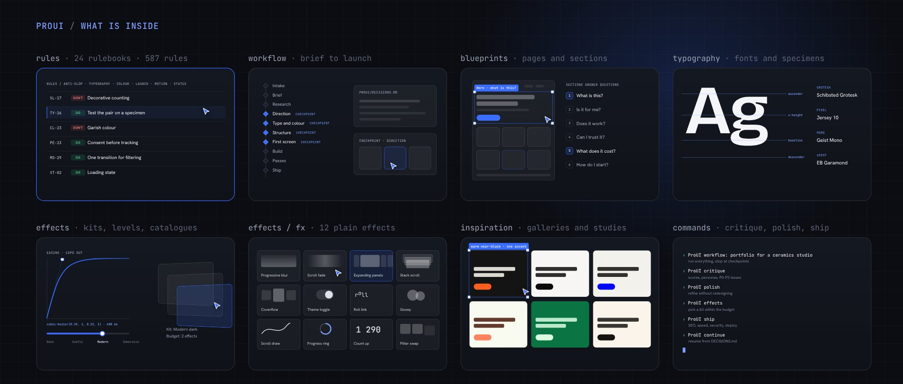
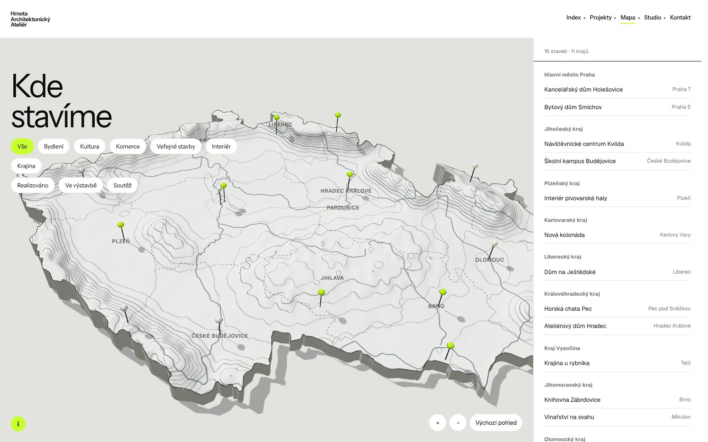

<div align="center">


**The playbook for beautiful websites, for AI coding agents.** Blueprints, type and colour methods, effect kits, a workflow from brief to launch, and the rules that keep a site looking designed instead of generated.

[Get ProUI on Agensi](https://agensi.io/skills/proui) · [What's inside](#whats-inside) · [How it works](#how-it-works) · [Rules](#the-rules) · [Quick start](#quick-start) · [Licence](#licence)

</div>

---

## What ProUI is

ProUI is a skill for AI coding agents such as Claude Code, Codex or Cursor. Load it next to your project and ask for a website: the agent knows which pages and sections the site needs, how to pick fonts and colours, which effects fit and how many to use, and how to get from the first brief to a live site. Then it checks its own work against 597 rules.

- **Structure first.** Sitemaps, landing page order, pricing, contact, footers and legal pages for real kinds of business.
- **Taste you can name.** Fonts measured on 32 brand sites, palettes measured on real sites, style keywords like `EDITORIAL CREAM`.
- **Effects with a budget.** One kit per site, an effect level you choose, and "a couple of 3D effects" means two.
- **A workflow with checkpoints.** You pick the direction, the type and colour, the outline and the first screen.

> [!NOTE]
> ProUI is an add-on. Your instructions come first, then your project's own rules, then ProUI.

## What's inside



| Folder | What's inside |
| --- | --- |
| [`rules/`](rules/README.md) | 24 rulebooks of Do and Don't rules, each with its own page |
| [`workflow/`](workflow/README.md) | the step-by-step process from brief to launch, and the GitHub guide |
| [`blueprints/`](blueprints/README.md) | how websites are put together: pages, sections, pricing, contact, footers, legal pages, colour and type methods |
| [`typography/`](typography/README.md) | which fonts modern sites use, free matches, specimen sheets, pairings by kind of site |
| [`effects/`](effects/README.md) | effect levels, kits and budget, 12 plain effects, 20 motion briefs, catalogues of ready components |
| [`inspiration/`](inspiration/README.md) | galleries to research, 17 studied sites with build prompts, their animations and palettes |
| [`style/`](style/README.md) | style keywords to use in prompts |
| [`modes/`](modes/README.md) | persuade, operate, read, experience: what the visitor came to do |
| [`commands/`](commands/README.md) | short commands like `ProUI critique` or `ProUI ship` |
| [`templates/`](templates/README.md) | files the agent fills in: brief, decisions, reports, GitHub setup |
| [`recipes/`](recipes/README.md) | tested code for motion, components, gradients and dashboards |
| [`toolkit/`](toolkit/README.md) | libraries, design tools and the websites used in each stage |
| [`references/`](references/README.md) | Apple HIG, Fluent 2, Impeccable and OpenDesign, distilled |
| [`scripts/`](scripts/README.md) | the slop scanner and the builders that keep the repository consistent |
| [`SKILL.md`](SKILL.md) | the entry point the agent reads first |

## How it works


1. **Intake.** The agent asks what kind of site you imagine: type of business, feel, effect level, colours, the one main action.
2. **Research and direction.** It collects real designs and shows three or four directions. You pick one.
3. **Design system and structure.** Fonts, palette and effect kit, then every page and section. You approve both.
4. **Build and passes.** The first screen for your approval, then the rest, checked rulebook by rulebook.
5. **Ship.** Scored review, CI, deploy and a handoff list of what still needs your content.

Every decision is saved in `proui/DECISIONS.md`, so a new session continues with `ProUI continue`. Details: [workflow/WORKFLOW.md](workflow/WORKFLOW.md).

## The rules

Every rule has a fixed ID, so you can name it in a prompt, switch it off for one project or point at it in a review.

```text
ST-02
│  └── number: the rule's fixed place in its rulebook (never reused)
└───── prefix: the rulebook (ST = States)
```

| Area | Rulebooks |
| --- | --- |
| Design | [Anti-Slop](rules/anti-slop/README.md) · [Design Craft](rules/craft/README.md) · [Typography](rules/typography/README.md) · [Colour](rules/color/README.md) · [Gradients](rules/gradients/README.md) · [Effects and 3D](rules/effects/README.md) · [Layout](rules/layout/README.md) · [Page Structure](rules/structure/README.md) · [Images](rules/images/README.md) |
| Interaction | [Navigation](rules/navigation/README.md) · [Components](rules/components/README.md) · [Forms](rules/forms/README.md) · [States](rules/states/README.md) · [Motion](rules/motion/README.md) · [Accessibility](rules/accessibility/README.md) · [Platform](rules/platform/README.md) |
| Product | [Dashboards](rules/dashboards/README.md) |
| Content | [Copy](rules/copy/README.md) · [Localisation](rules/localization/README.md) |
| Production | [Launch Essentials](rules/launch/README.md) · [SEO](rules/seo/README.md) · [Performance](rules/performance/README.md) · [Security](rules/security/README.md) · [GitHub](rules/github/README.md) |

A **Do** says what a finished site does; a **Don't** says what never ships. A SOFT don't may be used on purpose as part of a style; a HARD RULE can never be switched back on. All rulebooks: [rules/README.md](rules/README.md).

## Type, colour and effects


- **[Typography](typography/README.md):** what Apple, Google, Zalando, Nike, Hermès and 27 more sites use, a free font for each, and 76 free fonts as specimen sheets.
- **[Colour](blueprints/colour-schemes.md):** a method for a palette and palettes measured on real sites: warm grounds, deep inks, one accent.
- **[Effects](effects/README.md):** four levels from none to immersive 3D, seven kits, and an effect budget the agent keeps to.

## Commands

| Command | Does |
| --- | --- |
| `ProUI workflow: <request>` | builds a new site with checkpoints |
| `ProUI critique` | design review with scores and prioritised issues |
| `ProUI audit` | technical review: accessibility, performance, theming, responsive |
| `ProUI polish` | refines a page without redesigning it |
| `ProUI effects` | picks and installs effects at the chosen level |
| `ProUI ship` | production checks, GitHub, deploy |
| `ProUI continue` | resumes a project from its decisions file |

All 21 commands: [commands/README.md](commands/README.md).

## Quick start

After buying ProUI on [Agensi](https://agensi.io/skills/proui), install the copy you get there in your agent (for Claude Code: `~/.claude/skills/proui/`). Then ask:

```text
Build a website for a coffee shop using ProUI.
Make me a modern web with 3D effects for my design studio.
ProUI workflow, direction BLACK COAL: portfolio for a photographer.
ProUI dashboard: analytics for a small e-shop.
Use ProUI, but keep SL-25. Skip PE-10.
ProUI critique
```

```bash
# scan any project for slop and hard-rule violations
node ~/.claude/skills/proui/scripts/proui-scan.mjs ./src
```

## Licence

> [!IMPORTANT]
> ProUI is **not free to use**. This repository is public so you can see what it contains, but there is no open licence. A licence is sold on [Agensi](https://agensi.io/skills/proui) for $9.99; only after buying it may you use ProUI, for your own and your clients' projects. Copying, sharing or reselling ProUI or any part of it needs the author's written permission. Full terms: [LICENSE.md](LICENSE.md). Third-party parts keep their own licences ([NOTICE](NOTICE)).

## Credits

Strongly inspired by [Impeccable](https://github.com/pbakaus/impeccable) by Paul Bakaus (Apache-2.0), see [NOTICE](NOTICE). Apple HIG and Microsoft Fluent 2 are summarised in our own words with links. Motion Primitives by ibelick is included under its MIT licence; Aceternity UI, React Bits, Skiper UI and 21st.dev are linked and installed from their registries. Pinterest pins belong to their authors and are linked, not copied. Started from a set of [screenshot checklists](references/source-checklists.md).

---

## Built with ProUI

<a href="https://denysovski.github.io/HMOTA/"></a>

<table>
<tr>
<td width="50%"><a href="https://denysovski.github.io/HMOTA/mapa/"></a></td>
<td width="50%"><a href="https://denysovski.github.io/HMOTA/studio/"></a></td>
</tr>
</table>

**[HMOTA](https://denysovski.github.io/HMOTA/)**, the website of an invented architecture studio, was made
with this repository from the first brief to the live site. ProUI set its rules for spacing and layout,
motion and the intro loader, 3D performance, SEO, accessibility and phones; the style it defined became the
keyword [`CONCRETE LIME`](style/STYLES.md#concrete-lime), and what we learned building it is written up in
[the HMOTA study](inspiration/site-studies/hmota.md) so the next site starts from there.
[Live site](https://denysovski.github.io/HMOTA/) · [Source](https://github.com/denysovski/HMOTA)
