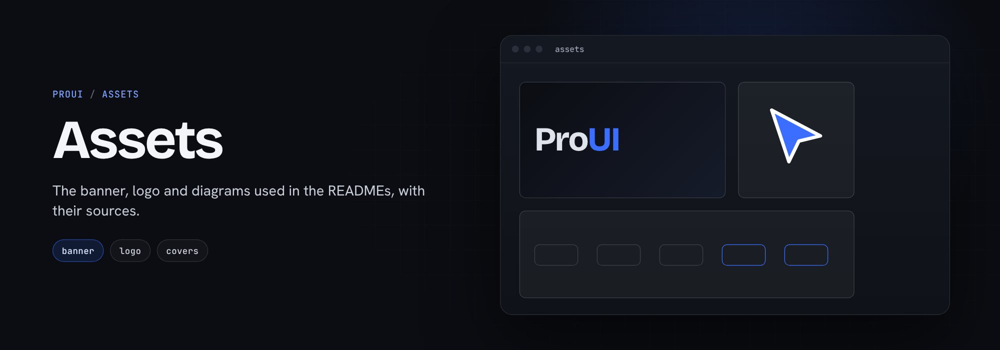

[Back to ProUI](../README.md)

**The images used in the READMEs, and how to make them again.** Everything here is drawn by us: rendered from HTML with Playwright, so text, colours and numbers can be changed and re-rendered. No image of another site or brand is stored in this folder.

| File | What it is | Source |
| --- | --- | --- |
| `proui-banner.png` | the main README and marketplace banner | [src/proui-banner.html](src/proui-banner.html) |
| `proui-logo.svg`, `proui-logo.png` | the logo: "UI" with a blue cursor | drawn as SVG; the PNG is 1024 px |
| `map.jpg` | the "what is inside" board on the main README | [src/covers/build.py](src/covers/build.py) |
| `workflow-v2.jpg` | the workflow diagram | [src/workflow.html](src/workflow.html) |
| `xslop-banner-v3.jpg` | the earlier banner from when the project was called XSlop | [src/banner.html](src/banner.html) |
| `*/cover.jpg` in every folder | the README covers with their wireframe sketches | [src/covers/build.py](src/covers/build.py) |
| `typography/specimens/*.jpg` | the type specimen sheets | [typography/specimens/src](../typography/specimens/src/) |

## Re-render

```bash
# covers for every folder and rulebook (needs Playwright, Chrome and the Fontsource packages)
python3 assets/src/covers/build.py <node_modules>

# one cover, or all rulebook covers
python3 assets/src/covers/build.py <node_modules> blueprints/cover.jpg
python3 assets/src/covers/build.py <node_modules> rulebooks
```

Covers share the banner's palette: near-black `#0b0d12`, blue `#3b6dff`, Bricolage Grotesque for titles, Hanken Grotesk for text and JetBrains Mono for labels.
