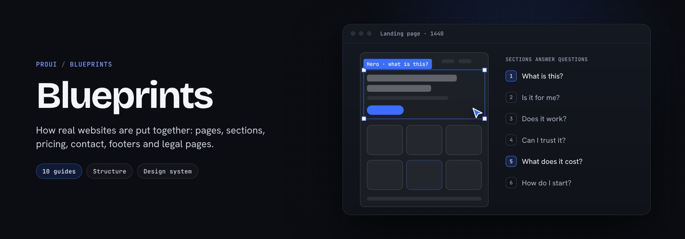

[Back to ProUI](../README.md) · [Page Structure Rulebook](../rules/structure/README.md) · [Effect kits](../effects/kits.md)

**A site has to make sense before it can look good.** The blueprints describe how real websites are put together: which pages a business needs, which sections a landing page has and in what order, and how pricing, contact pages, footers and legal pages work. The workflow's *Design system* and *Structure* stages read from here.

## The idea in one line

A page follows the visitor's questions in the order they arrive:

```text
What is this?  →  Is it for me?  →  Does it work?  →  Can I trust it?  →  What does it cost?  →  How do I start?
```

Every section answers one of them. A section that cannot be filled with real content is left out, never faked (`SL-43`, `PG-03`).

## Pages and sections

| Guide | Answers |
| --- | --- |
| [Sitemaps](site-types.md) | which pages a service business, company, SaaS, shop, portfolio, restaurant or personal site needs |
| [Landing page](landing-page.md) | which sections, in which order, where the main button repeats, what comes after |
| [Sections](sections.md) | what each section needs and which component fits each effect level |
| [Tables on phones](tables-on-phones.md) | rebuild a wide table for phones in six moves (rank, stack, slot, label, reveal, container breakpoint) with markup and CSS |
| [Lookbook](lookbook.md) | a clothing brand's lookbook in three levels: grid with stepper, full-screen stories with tap zones, shop the look |
| [Cart drawer](cart.md) | a shop's cart drawer: layout, free-gift ladder, one-click add-ons, paid extras done legally, what to measure |
| [Pricing](pricing.md) | three named packages for services, tiers and comparison tables for products |
| [Contact](contact.md) | contact pages for companies and local businesses: forms, maps, departments |
| [Footers](footer.md) | slim, standard or fat, by the amount of information |
| [Legal and trust](legal-and-trust.md) | cookie consent done right, privacy, personal data, uploads, security.txt, status page |

## Colour and type

| Guide | Answers |
| --- | --- |
| [Colour schemes](colour-schemes.md) | a method for a palette, the 60-30-10 split, starter palettes and palettes measured on real sites |
| [Type pairing](type-pairing.md) | how to choose and pair typefaces, starter pairings per feel |
| [Typography](../typography/README.md) | what modern sites and big brands use, free matches, specimen sheets |

## How the workflow uses them

| Stage | Reads | Produces |
| --- | --- | --- |
| Intake | the kind of site and the feel | a sitemap from [site-types.md](site-types.md) and a section order from [landing-page.md](landing-page.md) |
| Design system | [colour-schemes.md](colour-schemes.md), [type-pairing.md](type-pairing.md) | two or three palettes and pairings to choose from |
| Structure | [sections.md](sections.md), [pricing.md](pricing.md), [cart.md](cart.md), [lookbook.md](lookbook.md), [contact.md](contact.md), [footer.md](footer.md), [legal-and-trust.md](legal-and-trust.md) | every page with its sections, content and one component each |
| Outline checkpoint | everything above | you see the plan and approve it before anything is built |
