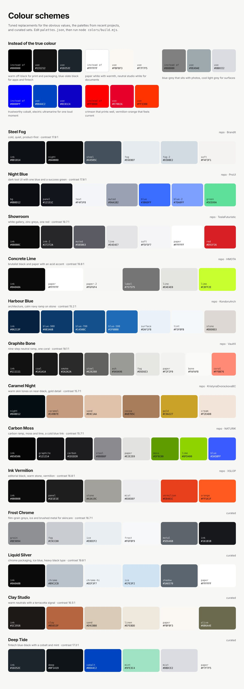

# Colour schemes

A growing library of modern colour schemes in one JSON file, with CSS variables and a swatch page generated from it.



## Files

| File | What it is |
| --- | --- |
| `palettes.json` | the source: replacements and palettes, each colour named by its role |
| `palettes.css` | generated; every palette as `[data-palette="id"]` with `--role` variables |
| `index.html` | generated swatch sheet with the contrast between the darkest and lightest colour |
| `build.mjs` | `node colors/build.mjs` rebuilds the CSS and the sheet |

## Never the true colour

Pure `#000000`, `#FFFFFF`, `#808080`, `#0000FF` and `#FF0000` look like defaults. Use a tuned value instead:

| Instead of | Use | When |
| --- | --- | --- |
| `#000000` | `#131212` · `#1D252C` | warm off-black for print and packaging, blue-slate black for apps |
| `#FFFFFF` | `#FBF8F3` · `#F7F7F5` | warm paper, neutral studio white |
| `#808080` | `#9EA9AE` · `#DBDCE2` | blue-grey next to photos, cool light grey for surfaces |
| `#0000FF` | `#0044C2` · `#0C01C4` | trustworthy cobalt, electric ultramarine for one loud moment |
| `#FF0000` | `#E7002A` · `#FF3300` | crimson that prints well, vermilion-orange |

The idea and these values come from the carousel "I hate true colors" by lay.the.designer on Instagram.

## Palettes

- **From recent projects:** Steel Fog (BrandIt), Night Blue (ProUI), Showroom (TeslaFuturistic), Concrete Lime (HMOTA), Harbour Blue (KondoruArch), Graphite Bone (VaultX), Caramel Night (KristynaDvorackovaBC), Carbon Moss (NATURIK), Ink Vermilion (XSLOP). Values were read from each repository's CSS tokens.
- **Curated:** Frost Chrome, Liquid Silver, Clay Studio and Deep Tide.

## Using one

```html
<link rel="stylesheet" href="colors/palettes.css">
<body data-palette="graphite-bone">  <!-- var(--ink), var(--bone), var(--coral) -->
```

Keep the roles: one ink, one or two paper tones, a short ramp of greys, and at most one accent. Check text contrast against `rules/color/` before shipping.

## Adding colours over time

1. Add a palette object to `palettes.json`, using the fields `id`, `name`, `source` (`repo:Name`, `curated` or a credited source), `mood` and `colors`.
2. Run `node colors/build.mjs`, then refresh `preview.jpg` with a screenshot of `index.html`.
3. When a new project ships, read its `--tokens` and add them as a palette sourced as `repo:Name`.
