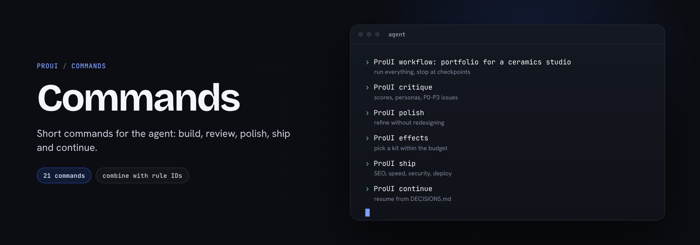

[Back to ProUI](../README.md) · [Workflow](../workflow/README.md) · [Rulebooks](../rules/README.md)

**Short commands you can give the agent.** Each file says what the command does, what it reads, what it changes and what it reports. Every command can carry overrides, for example `ProUI polish, keep SL-25`.

## Build

| Command | Does |
| --- | --- |
| `ProUI workflow: <request>` | builds a new site step by step with checkpoints ([WORKFLOW.md](../workflow/WORKFLOW.md)) |
| [`ProUI continue`](continue.md) | resumes from `proui/DECISIONS.md` |
| [`ProUI init`](init.md) | writes `PRODUCT.md`: who it is for, what it does, what must stay true |
| [`ProUI document`](document.md) | writes `DESIGN.md` from an existing site's code and look |
| [`ProUI shape <surface>`](shape.md) | plans one page or feature before code: mode, content, states, direction |
| [`ProUI dashboard`](dashboard.md) | builds or reviews product UI in operate mode |

## Review

| Command | Does |
| --- | --- |
| [`ProUI critique`](critique.md) | design review with heuristic scores, personas and P0–P3 issues |
| [`ProUI audit`](audit.md) | technical review: accessibility, performance, theming, responsive, rules scan |
| [`ProUI scan`](scan.md) | runs the slop scanner and explains the findings |

## Refine

| Command | Does |
| --- | --- |
| [`ProUI polish`](polish.md) | refines an existing surface without redesigning it |
| [`ProUI bolder`](bolder.md) | more commitment when a design is safe and bland |
| [`ProUI quieter`](quieter.md) | less noise when a design is loud |
| [`ProUI distill`](distill.md) | removes what does not earn its place |
| [`ProUI harden`](harden.md) | edge cases: long text, errors, other languages, slow network |

## One subject at a time

| Command | Does |
| --- | --- |
| [`ProUI typeset`](typeset.md) | typography pass |
| [`ProUI colorize`](colorize.md) | colour pass, gradients included |
| [`ProUI layout`](layout.md) | spacing, grid and hierarchy pass |
| [`ProUI effects`](effects.md) | picks and installs effects at the chosen level, within the budget |
| [`ProUI animate`](animate.md) | motion plan and implementation |
| [`ProUI clarify`](clarify.md) | copy and UX writing pass |

## Ship

| Command | Does |
| --- | --- |
| [`ProUI ship`](ship.md) | SEO, performance, security and GitHub passes, then deploy |

Every command that changes files ends by updating `proui/DECISIONS.md` and running the final checklist in [SKILL.md](../SKILL.md) for the parts it touched.
