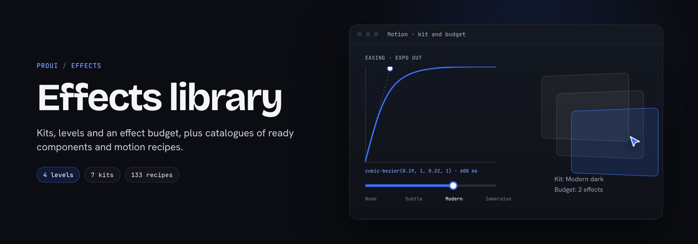

[Back to ProUI](../README.md) · [Effects Rulebook](../rules/effects/README.md) · [Motion Rulebook](../rules/motion/README.md)

**Modern effects, used with taste.** When someone asks for a "modern web" or a "website with 3D effects", ProUI does not sprinkle animation on every section. It asks how much effect you want, picks one kit of components that look alike, and keeps to an effect budget: ask for "a couple of 3D effects" and you get two.

## Start here

| Guide | What it decides |
| --- | --- |
| [levels.md](levels.md) | the four levels, from no effects to immersive 3D, and what each allows |
| [kits.md](kits.md) | seven kits (Quiet, Modern dark, Modern light, Studio, Immersive, Retro, Playful) and the effect budget |
| [presets.md](presets.md) | ready combinations per style keyword and per kind of site |
| [install.md](install.md) | installing from the registries, and what to do without React |

| Level | You get |
| --- | --- |
| None | a calm, fast site with hover and focus feedback only |
| Subtle | gentle motion, tilt and spotlight cards |
| Modern | an animated headline, gradients or one shader background, one interactive section |
| Immersive 3D | a 3D hero scene, 3D galleries, scroll-driven sequences |

## Written for ProUI

| Folder | What's inside |
| --- | --- |
| [fx/](fx/README.md) | 12 small effects in plain HTML, CSS and JavaScript, no library, with a demo page |
| [briefs/](briefs/README.md) | 20 detailed build briefs for signature motion: stacking cards, curtain slider, pricing roll and more |
| [kits/motion-primitives/](kits/motion-primitives/README.md) | the source of all 33 Motion Primitives components, saved under their MIT licence |

## Catalogues

| Catalogue | What's in it |
| --- | --- |
| [Motion recipes](catalog/motion-recipes.md) | 133 GSAP build prompts for studio-style motion, written in our own words |
| [Motion Primitives](catalog/motion-primitives.md) | 33 quiet Motion components: text effects, reveals, spotlight, tilt, morphing dialogs |
| [Skiper UI](catalog/skiper-ui.md) | 37 free components: scroll stacks, coverflow, expanding panels, theme toggles (credit Skiper UI) |
| [Aceternity UI](catalog/aceternity.md) | 114 free components: beams, spotlights, aurora, bento grids, 3D cards, globes |
| [React Bits](catalog/react-bits.md) | 217 components: shader backgrounds, cursor and reveal animations, animated text |
| [21st.dev 3D](catalog/21st-3d.md) | 169 community 3D components with author and licence |

Each catalogue is generated from its `.json` file by `scripts/build-effects.mjs`.

## How the agent uses it

| Step | Source | Result |
| --- | --- | --- |
| "How much effect?" | intake question | a level |
| Feel and level | [kits.md](kits.md) | one kit and an effect budget |
| Direction | [presets.md](presets.md) | a preset inside that kit |
| Sections | [../blueprints/sections.md](../blueprints/sections.md) | one component per section, within the budget |
| Checkpoint | | you see the picks with links and approve |
| Build | [install.md](install.md) | installed from the registry, restyled to the project's tokens, checked against `EF` |

## The short version

- Ask first. Never add 3D because the brief said "modern".
- One hero effect per page, one signature moment per site, everything else quiet.
- One kit per site. "A few" effects means two at most.
- Restyle every component to the project's colours, radius and type. Demo colours are a giveaway (`SL-19`).
- Heavy effects load lazily, pause off screen, cap the pixel ratio and have a static fallback.
- Everything works with reduced motion, and content works without JavaScript.

> [!IMPORTANT]
> Only Motion Primitives (MIT) is saved in this repository. Aceternity, React Bits, Skiper UI and 21st.dev components are installed into each project from their official registries; their source is not copied here.
