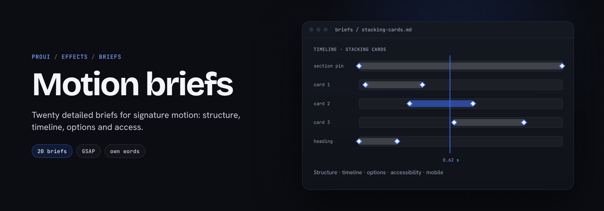

[Effects library](../README.md) · [Motion recipes](../catalog/motion-recipes.md) · [Kits](../kits.md)

**Twenty briefs for motion that has to be right the first time.** Each brief describes one signature component in full: structure, timeline, options, accessibility and mobile behaviour, written in our own words. The set follows the free Annnimate starter pack, which the repository owner studied; no code from it is included. Build each one with GSAP from its brief.

Use a brief when the effect is the signature moment of a page. For everything else, the one-line [motion recipes](../catalog/motion-recipes.md) are enough.

## The briefs

| Brief | Level | GSAP tools | Use in |
| --- | --- | --- | --- |
| [ASCII overlay on media](ascii-overlay.md) | Modern | GSAP, three.js, ScrollTrigger | tech, data, gaming, editorial heroes |
| [Accordion with line reveal](accordion.md) | Subtle | GSAP, SplitText | FAQ, product details, specs |
| [Curtain column slider](curtain-slider.md) | Modern | GSAP | full-screen heroes, chapters, case study openers |
| [Diagonal stepping gallery](diagonal-gallery.md) | Modern | GSAP, ScrollTrigger | collections, case studies, timelines |
| [Echo headline](echo-headline.md) | Immersive | GSAP, ScrollTrigger | one big word in a campaign or brand page |
| [Elastic divider line](elastic-divider.md) | Subtle | GSAP | between sections on playful or editorial sites |
| [Feature dialog rising from a tile](feature-dialog.md) | Subtle | GSAP | feature details, product quick view, "learn more" without leaving the page |
| [Header that folds into a pill](floating-navbar.md) | Subtle | GSAP, ScrollTrigger | most marketing sites at Subtle level and above |
| [Images flying toward the viewer](image-fly-in.md) | Immersive | GSAP, ScrollTrigger, SplitText | campaign heroes, launches, portfolios with strong photography |
| [Line and word reveal](text-reveal.md) | Subtle | GSAP, ScrollTrigger, SplitText | hero headlines, section titles, statements |
| [Magnetic tag cloud](magnetic-tag-cloud.md) | Modern | GSAP, Draggable | skills, services, topics, playful about pages |
| [Pricing with rolling prices](pricing.md) | Subtle | GSAP | SaaS and subscription pricing |
| [Process rail with a travelling bead](process-rail.md) | Modern | GSAP, ScrollTrigger, MotionPathPlugin, DrawSVGPlugin | how it works, onboarding, service process |
| [Proximity work index](hover-index.md) | Modern | GSAP | portfolio and studio work lists |
| [Rotating word wheel](rotating-words.md) | Modern | GSAP, ScrollTrigger | hero lines like "We design ___", services, audiences |
| [Shrinking row slider](scale-slider.md) | Modern | GSAP, Draggable, InertiaPlugin | collections, lookbooks, project galleries |
| [Split-flap board](split-flap-board.md) | Modern | GSAP | launch dates, scores, departures, playful headlines |
| [Stacking cards](stacking-cards.md) | Modern | GSAP, ScrollTrigger | product lines, services, chapters, case studies |
| [Two-colour text scramble](dual-scramble.md) | Subtle | GSAP, ScrambleTextPlugin, ScrollTrigger | tech brands, labels, numbers, hero kicker |
| [Two-panel drawer menu](multi-level-drawer-menu.md) | Subtle | GSAP | shops, sports, editorial sites with deep categories |

