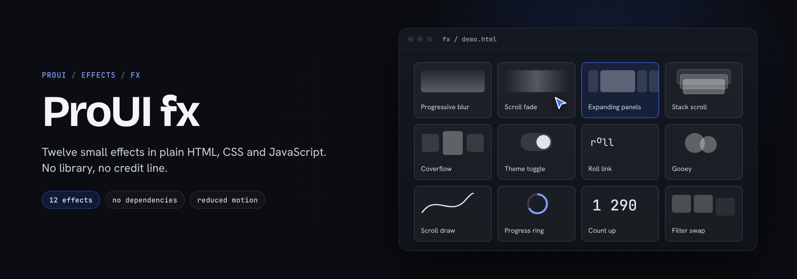

[Effects library](../README.md) · [Demo page](demo.html) · [Skiper UI catalogue](../catalog/skiper-ui.md) · [Kits](../kits.md)

**Thirteen small effects, written for ProUI from scratch.** Plain HTML, CSS and JavaScript, no library and no credit line. They cover the most useful ideas of the free Skiper UI set, so a site can have them without Framer Motion or Swiper. Each one works with keyboard and touch, keeps real text in the page, and has a reduced-motion version.

## The effects

| Effect | What it does | Files | Similar idea in |
| --- | --- | --- | --- |
| [Progressive blur](progressive-blur/) | five stacked blur layers with masks, so blur ramps up toward an edge (captions over photos, scroll edges) | CSS | Skiper `skiper41` |
| [Scroll fade](scroll-fade/) | soft fade at the edges of a scroll area; with scroll-driven animations it only fades where more content exists | CSS | Skiper `skiper87` |
| [Expanding panels](expand-panels/) | row or column of image panels, the hovered or focused one widens and its title rises; stacks on phones | CSS | Skiper `skiper52`, `skiper53` |
| [Stack scroll](stack-scroll/) | sticky cards; the covered card shrinks and dims as the next arrives | CSS + 30 lines JS | Skiper `skiper16`, `skiper17` |
| [Coverflow](coverflow/) | native scroll-snap carousel with a 3D tilt; swipe, keys and buttons | CSS + JS | Skiper `skiper47`, `skiper49` |
| [Theme toggle](theme-toggle/) | light and dark switch with a circular reveal from the button (View Transitions), remembers the choice | CSS + JS | Skiper `skiper4`, `skiper26` |
| [Roll link](roll-link/) | link letters roll up one after another on hover and focus | CSS + JS | Skiper `skiper58` |
| [Gooey](gooey/) | SVG filter that melts shapes together where they meet | CSS + SVG filter | Skiper `skiper64` |
| [Scroll draw](scroll-draw/) | SVG path draws itself as its section passes | JS | Skiper `skiper19` |
| [Progress ring](progress-ring/) | reading progress ring with a percentage, back to top on click | CSS + JS | Skiper `skiper89` |
| [Count up](count-up/) | numbers count up once in view; final values stay in the HTML, formatted for the page language | CSS + JS | Skiper `skiper37` |
| [Filter swap](filter-swap/) | the only filtering transition (`MO-29`): shown items fade out and drop 14 px, the set swaps after 260 ms, new items rise in 45 ms apart; nothing grows or shuffles | CSS + JS | machacekdesign.cz portfolio |
| [Petal loader](petal-loader/) | intro loader for a heavy first screen (`MO-30`–`MO-32`): six circles around one fill clockwise in the accent, each from the side of the previous one; no outlines, large on desktop, static with reduced motion | CSS + JS | HMOTA hero |

## Use one

Copy the folder of the effect into the project, link its CSS and load its JS at the end of `body` (or import it
in a framework component and run it after mount). Markup and options are at the top of each file.

```html
<link rel="stylesheet" href="fx/expand-panels/expand-panels.css">
<ul class="xfx-expand">
  <li><a href="/work/a"><p class="xfx-expand-title">Project A</p></a></li>
  …
</ul>
```

The gooey effect needs this filter once per page:

```html
<svg width="0" height="0" style="position:absolute" aria-hidden="true">
  <filter id="xfx-goo"><feGaussianBlur in="SourceGraphic" stdDeviation="10" result="b"/>
  <feColorMatrix in="b" mode="matrix" values="1 0 0 0 0  0 1 0 0 0  0 0 1 0 0  0 0 0 20 -9" result="g"/>
  <feComposite in="SourceGraphic" in2="g" operator="atop"/></filter>
</svg>
```

Colours come from the page tokens (`--bg`, `--surface`, `--text`, `--accent`, `--font-display`, `--font-mono`).
Open [demo.html](demo.html) locally to see all of them; the demo uses generated gradients instead of photos.

## Budget and licence

Every effect here counts against the effect budget (`EF-20`) except the theme toggle, roll link and count up,
which are small interface details, and the filter swap, which is the required behaviour of any filter (`MO-29`). All of them belong to the Quiet kit and fit any other kit.

Original ProUI code under the [ProUI licence](../../LICENSE.md): use it in projects you build with a purchased copy of ProUI. No code from Skiper UI or Annnimate.
