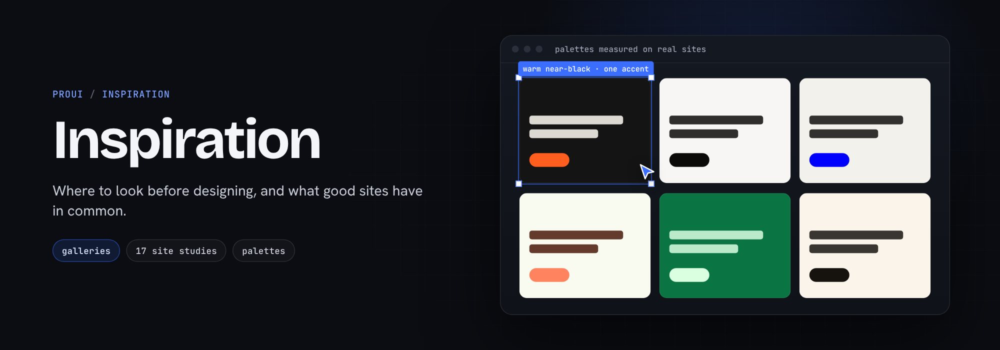

[Back to ProUI](../README.md) · [Style keywords](../style/README.md) · [Typography](../typography/README.md)

**Look at real work before designing anything.** The research step of the workflow starts here: which galleries to search, how to analyse what you find, and what the best sites have in common once you measure them.

| Guide | What it covers |
| --- | --- |
| [INSPIRATION.md](INSPIRATION.md) | the galleries (Dark, Recent, Saved, Designeer, Mobbin, Dribbble), what each is good for, and the analysis every reference gets |
| [Site studies](site-studies/README.md) | 17 live sites studied in the browser: type, colour, navigation, cookie banners and footers, with a build prompt per site |
| [Animations](site-studies/animations.md) | the motion those sites ship, the easing curves they use, a prompt per pattern, and what colour and motion say about a site |
| [Dashboards](dashboards.md) | what well-made dashboards and professional business sites have in common |

## What the best sites share

- Warm grounds instead of pure white or pure black, and ink that is not pure black.
- One accent colour, used on the main action and almost nowhere else.
- One grotesk family for most of the page; a serif, mono or pixel face only as a second voice.
- A hero built from the real product or real people, not abstract shapes.
- Motion that is quick for the interface (150–400 ms) and slow only for the one reveal that matters.

> [!NOTE]
> Inspiration means learning the idea. No text, logos, images or code from a studied site go into a build (`SL-43`, `EF-24`).
