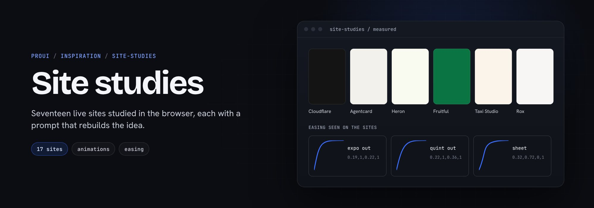

[Inspiration](../README.md) · [Animations](animations.md) · [Typography](../../typography/README.md) · [Footers and legal pages](../../blueprints/legal-and-trust.md)

**Seventeen live websites, studied in the browser in November 2026.** For each one: its type, colour, navigation, motion, cookie banner and footer, measured from the page itself, and a prompt that rebuilds the *idea* for a different brand. Inspiration, never a copy: no text, logos, images, illustrations or code from these sites go into a build (`SL-43`, `EF-24`).

## The sites

| Study | Kind of site | The idea worth learning |
| --- | --- | --- |
| [Mintlify](#mintlify) | documentation platform | serif headline on a dark technical page, live status in the footer |
| [Cloudflare](#cloudflare) | infrastructure | one warm grotesk, one orange, a fat footer that maps the whole company |
| [Jack & Jill](#jack--jill) | AI recruiting | two audiences side by side from the first screen |
| [Fruitful](#fruitful) | personal finance | a prompt field as the hero, deep green on white |
| [Rox](#rox) | enterprise AI | a real customer on video behind the headline |
| [Shopify Editions](#shopify-editions) | release archive | the archive as a record shelf, invisible UI |
| [Town](#town) | AI assistant for small business | headline broken around a portrait, a mascot, a handwriting voice |
| [TypeSafe](#typesafe) | AI model | early-Mac nostalgia with modern numbers |
| [Taxi Studio](#taxi-studio) | brand agency | condensed capitals over a 3D video, results before clients |
| [Agentcard](#agentcard) | fintech for AI agents | one saturated blue field full of 3D objects |
| [Mobbin](#mobbin) | design library | images inserted between the words of the headline |
| [Cosmos](#cosmos) | visual discovery | a rotating noun and a cloud of floating images |
| [Heron](#heron) | AI underwriting | the brand animal drawn from data bars, brown ink on ivory |
| [xAI](#xai) | AI lab | a dark bento of products under a two-tone headline |
| [X Money](#x-money) | consumer finance | an app-like sidebar on a marketing page, the card as the hero |
| [Brik](#brik) | AI design tool | every category has its own colour; a giant prompt box |
| [Ramp design](#ramp-design) | design team site | the team's work printed on the product (cards) |

Six links from the original list (Metic, Graphical, Altitude, Atlas, Creative Intelligence Company, The Performance Lab) could not be matched to a live site from their names; they are left out rather than guessed.

## Patterns across all seventeen

| Topic | What the sites do |
| --- | --- |
| **Background** | warm, never pure: off-white `rgb(247,246,244)`, paper `rgb(242,241,236)`, cream `rgb(250,244,235)`, ivory `rgb(249,250,240)`; dark sites use warm near-black `rgb(21,20,20)` or `rgb(10,10,10)` |
| **Text colour** | warm black `rgb(16,15,15)`, `rgb(12,10,8)`, or a deep brand hue (Heron's brown `rgb(74,24,9)`); secondary text is the same colour at 55–66 % opacity |
| **Accent** | exactly one: Cloudflare orange `rgb(255,94,31)`, Fruitful green `rgb(11,116,67)`, Agentcard blue `rgb(0,0,255)`, Heron coral `rgb(255,131,94)`, Ramp design lime; or none at all (black and white pills) |
| **Buttons** | pills (`border-radius: 9999px`) on 9 sites, square or 2 px corners on 5 (Rox, TypeSafe, Brik, Heron, Mintlify); primary = filled ink or accent, secondary = translucent or outline |
| **Navigation** | 4–7 links, transparent and fixed over the hero, primary action at the right; Agentcard moves it to a floating bottom pill, X Money to a left sidebar |
| **Hero** | product or people, never abstract blobs: a customer video (Rox), the product UI (Mintlify, xAI), the physical card (X Money, Ramp design), a prompt field (Fruitful, Brik, Cosmos) |
| **Proof** | logo marquee right under the hero on 8 sites; numbers in big type (TypeSafe, Taxi, X Money) |
| **Motion** | CSS transitions 0.15–0.4 s for UI, 0.5–1 s for reveals; expo-out and quint-out curves; one hero animation, everything else quiet. Details in [animations.md](animations.md) |
| **Cookies** | every EU-facing site offers Reject next to Accept with the same size and weight on the first layer |
| **Footer** | grouped by audience or job, legal row last, Status and Trust Center links on every product company |

---

## Mintlify

**Seen:** near-black page, an ABC Arizona Flare serif headline at only 40 px over Inter text, Paper Mono labels, a full product screenshot as the hero, fifteen canvas line drawings, a live "All systems normal" status line in the footer. Footer groups: Explore, Resources, Documentation, Company, Legal (includes Responsible disclosure, Security, DSR/DSAR).

**Why it works:** the serif makes a technical product feel written by people; a small headline lets the product screenshot be the hero.

```text
Build a dark hero for <product>: a 40–48 px serif headline (Source Serif 4 or Literata, regular),
one supporting line in Inter at 60 % opacity, two buttons (filled light, outline), and the real
product UI below at full width. Labels in IBM Plex Mono. Add a live status indicator to the footer.
```

## Cloudflare

**Seen:** warm near-black `rgb(21,20,20)` with an orange-to-ember hero glow, one grotesk (STK Bureau Sans 500, −2.5 %) for everything plus Apercu Mono for labels, cream text `rgb(255,251,245)`, orange pill "Start building", a red "Under attack?" link in the nav, transitions `0.2s cubic-bezier(0.19,1,0.22,1)`, video with a visible Pause button. Built with Astro.

**Footer:** Getting started · Company (About, Careers, Investors, Press, Press kit, Global network) · Public interest · Compliance (Trust Hub, Data Protection, Responsible AI, Transparency report, Report abuse) · Resources (Status, Support, Events, Blog, Case studies) · Developers · Solutions; bottom row: © · Privacy policy · Report security issues · Terms of use · Trademark · Your privacy choices.

**Why it works:** one family and one accent keep a huge site coherent; the footer is the sitemap.

```text
Design a one-family system for <company>: Geist Sans 500 for headlines with −2.5 % tracking, the same
family at 400 for text, Geist Mono uppercase labels. Warm near-black background, cream text, a single
orange accent for primary buttons only. Build a fat footer with columns by audience and a legal row
that includes "Report security issues" and a privacy choices link.
```

## Jack & Jill

**Seen:** white page, a Marist serif headline 72 px centred on two lines, everything else ABC Diatype; under the hero two cards side by side ("For candidates" and "For companies"), each with its own call to action and a product video. Letter-by-letter headline reveal with a typing caret.

**Why it works:** two audiences are served from the first screen without a chooser page.

```text
Two-audience hero for <marketplace>: centred serif headline (Source Serif 4, 72 px, −2.5 %), then two
equal cards: "For <side A>" and "For <side B>", each with one sentence, its own button and a short
muted product video. Nav links per audience. Headline enters letter by letter once.
```

## Fruitful

**Seen:** white with soft pastel haze, PP Neue Montreal 500 headline, Figtree text, a hero that is a single prompt field ("What's your biggest money goal?") with suggestion chips, deep green `rgb(11,116,67)` button with mint text `rgb(217,255,224)`, GSAP + ScrollTrigger + Lenis on Webflow.

```text
Hero for <service> as one input: a large rounded field with a placeholder question, a circular submit
button in the accent, five suggestion chips below. Headline above in Hanken Grotesk 500, two lines,
centred. Deep green accent with a pale mint label instead of white for a calmer contrast.
```

## Rox

**Seen:** a full-bleed video of a real customer talking, a two-line serif-ish headline (Season Mix 420) in white with the second line at 60 %, square-cornered buttons, Geist for UI, twenty-five videos of customer stories; footer with a long legal disclaimer (SOC 2, AES-256, results vary).

```text
Hero for <B2B product> built on a real customer: a muted, looping interview clip full-bleed, a dark
gradient at the bottom third, a two-line headline where the second line is 60 % white, two square
buttons. Below: a logo row and an "Open story" card per customer with the result in numbers.
```

## Shopify Editions

**Seen:** a neutral grey studio with two white shelves, every past release shown as a square album cover with its own art direction; the UI is tiny (Inter 14 px, captions 11 px at 60 %). The cookie card offers "Reject all" and "Accept cookies" side by side.

```text
Archive page for <recurring releases>: each release is a square cover with its own art direction,
placed on lit shelves in a neutral room. Interface text stays small and grey so the covers carry all
colour. Hover lifts a cover; click opens the release.
```

## Town

**Seen:** the headline "Learns how … work" split around a portrait photo inside the line, a very light soft-slab display (Material Upright), ABC Diatype UI, a handwriting face for notes, a cartoon dog mascot, a phrase highlighted with a yellow marker, stepped transitions (`steps(4)`), a "manifesto" text that fills as you scroll. Cookie card: Customize, Reject, Accept, and the line "optional cookies only with your permission".

```text
Friendly hero for <small-business tool>: a light slab serif headline (Zilla Slab 300, 80 px) broken
across lines with a round portrait placed inside the sentence, one phrase on a yellow marker, a small
mascot illustration at the side, a prompt box "Ask <assistant> anything". Use stepped 4-frame
transitions for playful UI.
```

## TypeSafe

**Seen:** a painted pink-and-blue cloud sky, a tiny early-Mac-style window "TypeSafe 1.1 Loading…", black-and-white boxed tabs as nav, Die Grotesk up to 150 px with line height 0.8 and Capitalised Words, a bitmap terminal face plus two monos, keyframed SVG speed bars comparing models.

```text
Retro-computing hero for <developer product>: a soft painted sky, a small 1984-style window with a
loading bar in the centre, boxed black-and-white nav tabs, then giant grotesk numbers ("12x faster.
40x cheaper.") and animated comparison bars. VT323 for labels, IBM Plex Mono for data.
```

## Taxi Studio

**Seen:** "COMMERCIAL BY DESIGN." in condensed capitals over a looping video of a glossy black 3D elephant, then cream sections with statements in a light didone (Lust Text), a case-study list that leads with the result ("Net revenue up 35 %") and only then names the client.

```text
Agency homepage for <studio>: a single line of condensed capitals (Archivo width 62 %, weight 800)
over one looping 3D object video on black, then cream sections with light didone statements (Bodoni
Moda). Case studies list the measurable impact first, client name second.
```

## Agentcard

**Seen:** a pure blue `rgb(0,0,255)` hero full of floating 3D-rendered shopping objects around a white Neue Haas Grotesk headline at −5.5 % tracking; the rest of the site on warm paper `rgb(242,241,236)`; navigation as a floating pill at the bottom of the screen; a merchant marquee of retailer names; Geist Pixel labels.

```text
Hero for <fintech>: one fully saturated brand colour field, 20–30 small 3D objects related to the
product floating in depth around a white headline (Hanken Grotesk 500, −5 % tracking). Everything
below the hero on warm paper with ink text. A floating pill nav at the bottom centre.
```

## Mobbin

**Seen:** a headline with small images inserted between the words ("Where teams [img] and agents [img] find designs [img] that work"), the image slots open on load, `1s cubic-bezier(0.19,1,0.22,1)`; footer: Products, Resources (Colors, Glossary, Merch), Company.

```text
Headline with inline images for <brand>: three short phrases, each followed by a rounded image slot
the height of the capital letters; slots open from zero width one after another on load (expo out,
1 s, 120 ms stagger). Images are real product shots.
```

## Cosmos

**Seen:** white page, one custom grotesk (based on ABC Oracle) at 700 with −4 % tracking, a rotating noun in the headline ("Find your next / lamp with character"), dozens of image tiles floating at different depths around the hero, a search field, a "Get the app" QR card in the corner.

```text
Discovery hero for <catalogue>: "Find your next / <rotating noun>" where the noun changes every
2.5 s with a vertical slide, a search field and a shuffle button, and 30 real image tiles scattered
around at three depths (scale and blur by depth, slow drift).
```

## Heron

**Seen:** ivory `rgb(249,250,240)` with burnt-brown text `rgb(74,24,9)`, coral buttons `rgb(255,131,94)` with a small dark arrow square, Season Sans at 103 px, and a heron drawn from hundreds of coloured pixel bars that shift hue (the brand animal made of data). Footer by audience (For Funders, For Brokers, For Insurance), legal entity, street address, phone, SOC 2 Type II and GDPR badges.

```text
Data-art hero for <data company>: the brand symbol drawn from thousands of small coloured bars in a
canvas, hue slowly drifting. Palette: ivory paper, a deep brown instead of black, one coral action.
Footer grouped by customer type, with the company's legal name, address and compliance badges.
```

## xAI

**Seen:** near-black, a custom variable sans at 450, headline "Frontier AI models for everything you build." with the last word in grey, a "New" announcement chip above, a bento of product tiles (chat, code terminal, image, voice) directly under the hero, a very large footer (Products, Solutions, Developers, Enterprise, Company, Trust, Legal).

```text
Dark product-family hero for <platform>: an announcement chip, a two-line headline with the last word
at 45 % opacity, two pills (filled white, dark), then a bento of four live product tiles. Text 13–15 px
at 55 % white. Geist Mono for code.
```

## X Money

**Seen:** black, a left sidebar navigation like the app itself, the metal card inside an opened box as the hero video, headline words animating in, then "Built to earn" with the second line muted; trust sections about interest and FDIC coverage; cookie notice with "Accept all cookies" and "Refuse non-essential cookies" as equal pills.

```text
Product-object hero for <card or device>: the physical object in a dark studio video, a centred
headline whose words rise in one by one, one white pill "Follow for updates". Marketing page uses the
app's own sidebar navigation so it feels like the product.
```

## Brik

**Seen:** white, square corners everywhere, HAL Matex at 130 px with −7 % tracking, a headline with an inline image tile, a giant prompt box with a blue square send arrow, colour-coded use-case chips (orange, lilac, green, pink), a right-edge strip of live community work.

```text
Tool-builder hero for <creative app>: a huge prompt box with a square send button in the accent, a
row of category chips where each category owns one colour (used everywhere that category appears),
a vertical strip of live user creations on the right edge. Square corners, tight display tracking.
```

## Ramp design

**Seen:** white, TWK Lausanne at 144 px and weight 300, a giant light-grey wordmark, rotating 3D credit cards each illustrated by a different team member with their name printed on the card, IBM Plex Mono meta, a lime "Apply now" pill.

```text
Team or careers page for <company>: the company's own product as the canvas for the team's work
(cards, packaging, screens), each piece signed by its maker, rotating slowly in 3D. Headline in a
light grotesk at 140 px with −4 % tracking, one lime accent for the apply button.
```
