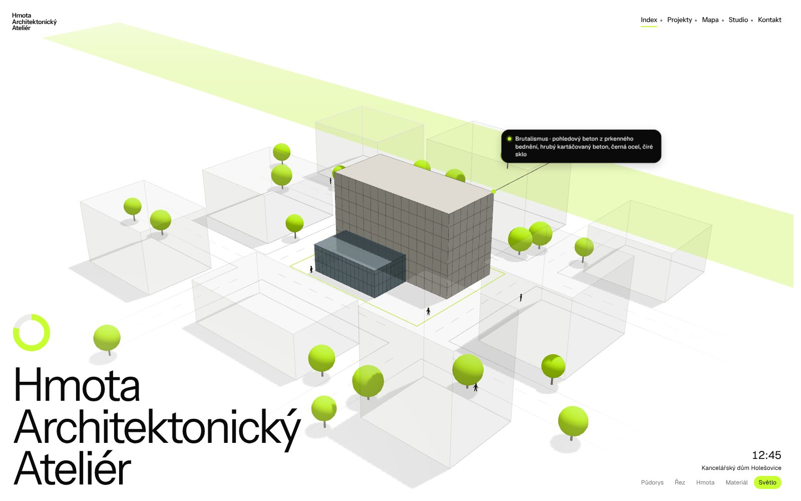
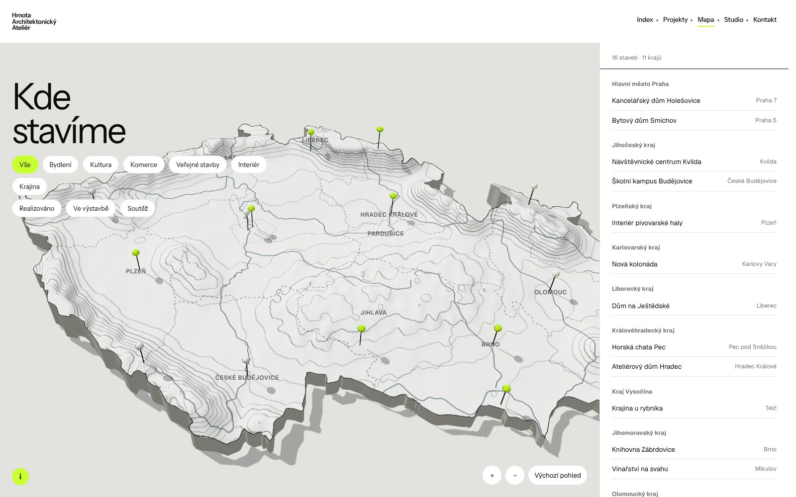
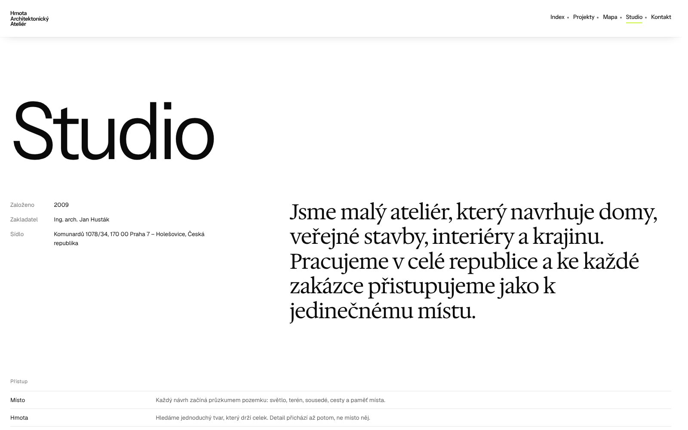

[Site studies](README.md) · [Style CONCRETE LIME](../../style/STYLES.md#concrete-lime) · [Petal loader](../../effects/fx/petal-loader/) · [Filter swap](../../effects/fx/filter-swap/)

# HMOTA: a full study of a site built with ProUI

**HMOTA** ("mass", the solid volume of a building before any detail) is a demo website for an invented
Prague architecture studio, built with ProUI in November 2026: [live site](https://denysovski.github.io/HMOTA/) ·
[repository](https://github.com/denysovski/HMOTA). Unlike the other studies, this one is written from the
inside: every value below comes from the source, and every lesson from a bug that was actually hit and
fixed. Use it as the reference build for the style [`CONCRETE LIME`](../../style/STYLES.md#concrete-lime).



## The idea in one paragraph

The page is a drawing sheet. White paper, ink, hairlines and small grey labels like the title block of
an architectural drawing; one acid lime for everything that is alive (the current page, the progress, the
trees, the loader, the pills). The first screen tells the whole job of an architect in one scroll: plan,
section, mass, material, light. The rest is quiet: oversized grotesk headlines, serif statements that
reveal line by line, hairline tables, a scattered project grid, a 3D map of built work, and one dark
section for the studio. It is brutalist in the architectural sense (the structure and the material are
shown raw, nothing is decorated) and maximal only in scale (type up to 220 px, one full-screen 3D scene).

## Stack

| Part | Choice | Why |
| --- | --- | --- |
| Framework | Next.js 16 App Router, static export (`output: "export"`, `basePath` for GitHub Pages) | free hosting, every page prerendered for SEO |
| 3D | React Three Fiber 9, three 0.187, drei | the hero and the map |
| Motion | GSAP 3 (ScrollTrigger, SplitText), Lenis 1.3 driven by the GSAP ticker | one clock for scroll and animation |
| Fonts | Fontsource variable: Instrument Sans (headlines), Hedvig Letters Serif (statements), Geist (labels, data) | self-hosted, no layout shift |
| Data | typed content files validated with zod; the map relief baked to static geometry at build time | no runtime fetches |

## Tokens

```css
--paper: #ffffff;  --paper-2: #f6f6f4;  --ink: #0a0a0a;  --label: #757575;  --grey-ink: #5e5e5e;
--line: #e4e4e0;   --lime: #c8ff2e;     /* lime is a surface or a mark, never text on white */

--pad: clamp(14px, 1.5vw, 28px);   /* page side padding, header padding */
--gap: clamp(12px, 1.4vw, 24px);   /* 12-column grid gap */

--t-xs: 12px;  --t-sm: 13.5px;  --t-base: clamp(16px, 0.35vw + 15px, 18px);
--t-statement: clamp(27px, 3.1vw, 58px);   /* serif statements */
--t-h2: clamp(40px, 6.2vw, 116px);
--t-mega: clamp(56px, 11.5vw, 220px);      /* the first headline */

--ease-out: cubic-bezier(0.22, 1, 0.36, 1);   /* entrances */
--ease-io: cubic-bezier(0.65, 0, 0.35, 1);    /* moves and loops */
--header-h: 64px;
```

Contrast is written at the top of the stylesheet and checked: ink on paper 19.8:1, grey ink 6.5:1, label
grey 4.6:1, ink on lime 16.8:1. Lime on white is 1.1:1, so lime never carries text on paper.

## Spacing: the rules that make it feel expensive

| Where | Value |
| --- | --- |
| Between sections | `clamp(96px, 14vw, 240px)`; a tight section `clamp(64px, 8vw, 140px)` |
| Side padding | `clamp(14px, 1.5vw, 28px)`, the same as the header, so the wordmark and the content share an edge |
| Grid | 12 columns, `clamp(12px, 1.4vw, 24px)` gap; text blocks start on a column, never centred in the page except the first headline |
| A headline and its first content | `clamp(28px, 3vw, 48px)` |
| A block after a statement | `clamp(80px, 10vw, 160px)` |
| Footer from the last section | `clamp(96px, 12vw, 200px)` |
| Phones (`LY-24`) | the section rhythm stays; blocks inside get 40–56 px between them, label/value rows 14 px, table rows 16 px, body text 15 px with 1.55 line height; every title-block column spans the full width |
| Tables | hairline rows, 18 px vertical padding; on phones each row stacks: title on its own line, project and year under it |

Two habits matter more than the numbers: space is added before text is made smaller, and nothing on a
phone is the desktop layout shrunk (`LY-23`).

## Pages

| Page | What is on it |
| --- | --- |
| Index | the 3D story, an intro statement with services, selected work (scattered grid, two columns on phones), process, awards table, a map teaser, then the page turns to ink for the studio teaser and a giant footer |
| Projekty | filter chips with the filter swap (`MO-29`), grid and list views; in the list view a drawing of the hovered project follows the cursor |
| Project | title block (place, year, area, status, team), statement, drawings and images, "Další projekt" link at the end |
| Mapa | full-screen 3D relief of the Czech Republic with pins; only the side list scrolls; no footer |
| Studio | statement, approach table, people, social icons scattered at four sizes, a hiring block with an SVG envelope |
| Kontakt | form with per-field lime underline focus, auto-growing textarea, errors that fade in, a promised reply time |



## Motion system

Everything moves on one clock: Lenis (`lerp: 0.1`, smooth wheel only, off with reduced motion) is driven by
the GSAP ticker, and ScrollTrigger reads Lenis.

| Moment | How it moves |
| --- | --- |
| Headlines and statements | SplitText into masked lines, each rises from `yPercent: 112`, 1.05 s, `expo.out`, 85 ms apart, once, when the block reaches 88 % of the viewport. Text stays real HTML; screen readers get it unsplit |
| Leaving a page | content fades out and lifts 14 px, a white veil comes over it (380 ms) and a thin lime line grows across the top while the next page loads; navigation fires after 420 ms |
| Arriving | the page is pinned to the top before it paints (`NV-15`), then fades in rising 32 px over 900 ms |
| Filtering | the filter swap (`MO-29`): fade out and drop 14 px, swap after 260 ms, rise in 45 ms apart |
| Header | transparent over the 3D hero (decided by an inline script before first paint, so there is no flash), white with a soft shadow below it; slides away on the way down, returns on the way up (`NV-16`); always visible on phones |
| Hover | links get a 1 px ink underline that becomes 2 px; the current page keeps its lime underline while another link is hovered; arrows sit in a lime circle and do not move |
| Labels in 3D | magnetic: the label is pulled toward the cursor (32 % of the distance, at most 16 px) with a spring, and the hairline to the building follows it |

Never in this style: bouncing, scaling cards on hover, parallax on text, endless decorative loops (the
loader is the only loop, and only while loading).

## The first screen: one building told in five stages

A pinned section about two and a half screens tall; scroll progress `p` from 0 to 1 drives every stage
directly (no timeline that runs on its own, so scrolling back plays it backwards):

| Stage | Scroll range | What happens |
| --- | --- | --- |
| Plan | intro 0.5 s, then 0.02–0.2 | streets and neighbouring footprints fade in first, the plot last; under the line "Jeden dům od půdorysu po světlo." the plan stays a faint backdrop (28 %) |
| Section and mass | 0.22–0.44 | the volumes rise from the footprint, labelled with magnetic callouts |
| Fill | 0.44–0.6 | the wireframes fill with white clay; neighbours stay translucent ghosts |
| Material | 0.6–0.86 | clay turns to board-marked concrete and glass; the labels hand over to one material callout |
| Light | 0.62–1 | the sun travels from 7:00 to 19:00 and the clock in the corner follows; trees, people and shadows fade in on the way |

A lime progress ring above the title and a row of stage pills show where the visitor is.

## The loader: the right way to make people wait

The hero is the only thing on the site heavy enough to need a loader (`MO-30`), and the loader time is
not wasted (`MO-32`):

1. The 3D chunk is code-split and prefetched as soon as the page starts.
2. A full-screen petal loader shows on white: six circles around one fill clockwise in lime, each from the
   side of the previous petal, no outlines (`MO-31`, ready code in
   [`effects/fx/petal-loader/`](../../effects/fx/petal-loader/)). It is up to 800 px wide on desktop,
   76 px on phones, and static with reduced motion.
3. Behind it the scene plays every stage once in about eleven frames
   (`0.12, 0.3, 0.45, 0.55, 0.62, 0.7, 0.8, 0.9, 1, 0.5, 0`), so every shader, material, light and shadow
   variant is compiled before the visitor can scroll. Then it jumps back to where the page really is.
4. Scrolling is locked while it shows; after 12 s it gives up and shows the page anyway.
5. It fades out over 600 ms into a frame that is already drawn.

What did not work: replacing the scene with still images while it warmed up. Visitors saw the swap and it
felt cheap. A first version with a plain rotating ring worked but looked generic; a shape from the
subject (petals, a house filling with colour) is what made it feel designed.

## Performance of the 3D scene (`PF-34`)

- `frameloop="demand"`: a frame is drawn only when ScrollTrigger, the pointer or a running animation asks
  for one. A still page costs nothing.
- Pixel ratio `[1, 2]` for the hero, `[1.5, 2]` for the map (its hairlines must stay crisp).
- The sun's shadow map is drawn by hand (`shadowMap.autoUpdate = false`): 4096 px on desktop, 2048 px under
  768 px, an orthographic frustum of ±46 units that covers the whole street.
- The shadow map keeps redrawing for 24 frames after the last change. Trees, people and volumes update in
  their own frame callbacks, some one frame behind the scroll; redrawing only on the frame where the scroll
  changed froze a stale map and left white gaps beside the houses.
- The scene component is memoised and reads all stage values from refs, so scrolling never re-renders React.
- On the map, flying to a pin centres it, and only the side list scrolls; the page itself does not.

## Light and shadow that look architectural (`DC-26`)

- One directional sun with a warm tint in the morning and evening, a hemisphere light as a soft fill, neutral tone mapping, white
  fog far away so the city fades instead of ending.
- Shadows are caught by an invisible `ShadowMaterial` ground at 11 % opacity, so the paper stays white.
- The ground shader discards every point inside a footprint, the building's and the neighbours', so a
  shadow stops at the edge of a house instead of showing through it.
- The neighbours are translucent ghosts that cast shadows but do not receive them, and their sunlit walls
  are capped below the brightness of the shade; otherwise a shadow seen through a wall became a white patch.
- Shadow intensity fades in with the stage, so shadows appear softly, never pop.

## Accessibility, SEO, phones

- Every motion has a reduced-motion version: no Lenis, no line reveals, the loader static, and instead of
  the 3D story a still of the finished building (also shown when WebGL is missing).
- The 3D canvas is `aria-hidden`; everything it says is also in the HTML (building name, stages, labels).
- Focus is visible everywhere: 2 px current colour on paper, lime on ink.
- `scrollbar-gutter: stable` so the navigation does not shift when a page has no scrollbar.
- Static export with a sitemap, robots, per-page metadata and Open Graph tags; `lang="cs"`.
- Phones checked at 320, 360, 390 and 430 px (`LY-23`): two-column project grid, stacked tables, radial lines
  kept inside the screen, header always visible, the footer's demo note in a tap-to-open "i" bubble.



## Bugs worth knowing before the next build

| Symptom | Cause | Fix |
| --- | --- | --- |
| A project opened halfway down, at the old scroll position | the App Router's root `template.tsx` does not remount when only a deeper segment changes (`/projekty` → `/projekty/x`) | run the arrival in an effect keyed on `pathname`, pin Lenis to 0 for two frames (`NV-15`) |
| The header never hid on slow scrolls | Lenis splits a slow wheel tick into 1–3 px steps; the 6 px per-frame threshold never fired | measure from the point where the direction changed: hide after 24 px, show after 12 px (`NV-16`) |
| White gaps between houses and their shadows | the shadow map stopped redrawing one frame too early | keep redrawing for 24 frames after the last change (`PF-34`) |
| Shadows visible inside translucent buildings, white patches behind them | the ground received shadows under the footprints; bright ghost walls lightened the shade behind them | discard the ground inside footprints, ghosts do not receive, cap their brightness (`DC-26`) |
| The lime fill of the loader escaped its circle | a composited CSS transform inside an SVG `clipPath` is drawn outside the clip in Chrome | clip with an HTML element, `overflow: hidden` and `border-radius` (`MO-33`) |
| The transparent header flashed white on refresh | the state was set after hydration | an inline script in `<head>` sets `data-hero-intro` before the first paint |
| That inline script silently did nothing | a regular expression lost its escaping on the way into the template string (`/\/$/` became a comment) | avoid regular expressions in inline scripts, use `slice` |
| Filter results disappeared instantly instead of fading out | removing a CSS animation does not animate anything | use transitions in phases: out, swap, a frame without transitions, in (`MO-29`) |
| A green flicker at the foot of the building | the footprint line and the wall foot fought for the same pixels | fade the footprint line out as the walls fill |

## Build prompt

> Use ProUI, style `CONCRETE LIME + MEGA TYPE`. Website for [an engineering or architecture practice] in
> [city]. Paper, ink, hairlines and one acid accent; an oversized grotesk headline, a text serif for
> statements, a small sans for labels and numbers. The first screen is one scroll-driven 3D story of
> [the subject] in five stages, with a brand-shaped intro loader that warms the scene up behind it
> (`MO-30`–`MO-32`), rendered on demand (`PF-34`), with shadows only on open ground (`DC-26`). Below it:
> a serif statement with line reveals, a scattered work grid with the filter swap, a hairline awards
> table, a map of built work, a dark studio section and a giant footer. Every page opens at its top
> (`NV-15`); the header hides on the way down by distance (`NV-16`). Phones get their own spacing
> (`LY-24`). Never copy HMOTA's text, images or code: rebuild the idea for the new brand.
