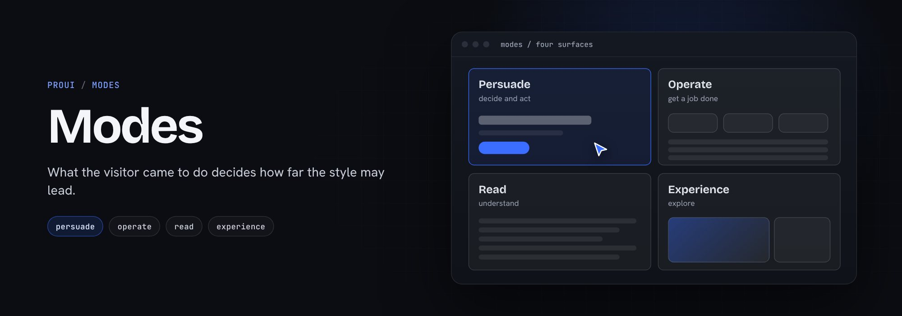

[Back to ProUI](../README.md) · [Rulebooks by mode](../rules/README.md#which-rulebooks-lead-in-each-mode)

**What the visitor came to do decides how far the style may lead.** Before designing anything, the agent names the mode of each surface. The mode changes which rules weigh most, how much the brand may show off, and how motion behaves.

| Mode | The visitor came to | Style may | Examples |
| --- | --- | --- | --- |
| [Persuade](persuade.md) | decide and act | lead, with one signature moment | landing page, shop, service business, product site |
| [Operate](operate.md) | get a job done | step back; speed and clarity first | dashboard, admin, tool, settings, checkout, account |
| [Read](read.md) | understand | serve the text | docs, blog, article, guide, case study, legal pages |
| [Experience](experience.md) | explore and feel | lead the whole way | portfolio, campaign, gallery, launch microsite |

## How it is used

- One site can have several modes: a persuade landing page, an operate dashboard behind the login, read docs.
- The mode is written into `proui/DECISIONS.md` next to each surface.
- When the request does not make the mode clear, the agent picks the most likely one, says so in one line and goes on.
