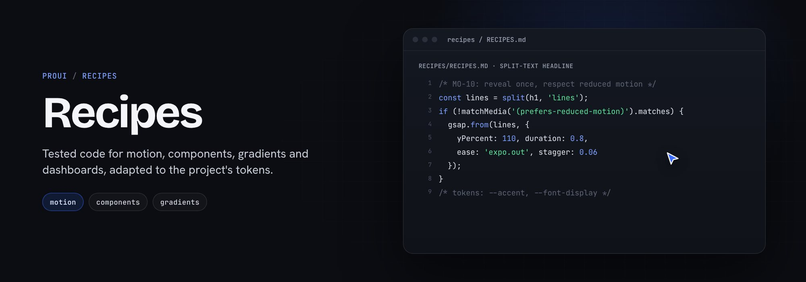

[Back to ProUI](../README.md) · [Effects library](../effects/README.md) · [Motion Rulebook](../rules/motion/README.md)

**Tested code the agent adapts to the project's tokens.** Each recipe is short, names the rules it implements (for example `MO-10` or `DB-09`), reads colours and fonts from CSS variables, and has a reduced-motion path where it moves.

| File | Recipes |
| --- | --- |
| [RECIPES.md](RECIPES.md) | smooth scroll, section reveals, split-text headlines, pinned gallery, magnetic button, marquee, popovers, custom select, icon swap, success pulse, toasts, light 3D hero, countdown, tracking boxes |
| [gradients.md](gradients.md) | OKLCH tokens and gradients, soft mesh, eased stops against banding, scrims, animated gradients that stop off screen |
| [dashboard.md](dashboard.md) | app shell, headline number with trend, data table, skeletons, widget errors |

## Recipe or effect?

| You need | Use |
| --- | --- |
| a small, common behaviour (reveal, toast, select) | a recipe from this folder |
| a ready visual effect with no library | [effects/fx](../effects/fx/README.md) |
| a signature motion moment | a [motion brief](../effects/briefs/README.md) |
| a component from a library | the [effects catalogues](../effects/README.md#catalogues) |
