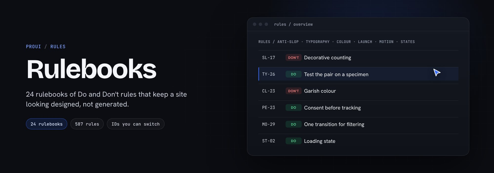

[Back to ProUI](../README.md) · 24 rulebooks · 587 rules

**Every rule ProUI applies, sorted by subject.** Each rulebook is a short list of Do and Don't rules with a fixed ID, so you can name a rule in a prompt, switch it off for one project, or point at it in a review.

## How rules are named

Every rule has an ID made of a **prefix** and a **number**:

```text
SEO-05
│   └─ number: the rule's place in its rulebook. It never changes once given,
│      so prompts, reviews and commits can refer to it. It is not a priority.
└──── prefix: the rulebook (SEO = SEO Rulebook, ST = States Rulebook, SL = Anti-Slop)
```

Each rule is either a **Do** (positive: what to do) or a **Don't** (negative: what never ships). Some carry a label:

| Label | Meaning |
| --- | --- |
| SOFT | allowed only as a deliberate, sparing part of a brand or a chosen style |
| HARD RULE | can never be switched back on, whatever the prompt says |

## Design

| Rulebook | Prefix | Rules | Covers |
| --- | --- | --- | --- |
| [Anti-Slop Rulebook](anti-slop/README.md) | `SL` | 73 | Patterns that make a website look AI-generated. Everything here is a don't; the positive counterparts live in the other rulebooks. |
| [Design Craft Rulebook](craft/README.md) | `DC` | 25 | Small decisions that separate a considered design from a template. |
| [Typography Rulebook](typography/README.md) | `TY` | 27 | Choosing faces, setting a scale, measure, leading and tracking, and loading fonts properly. |
| [Colour Rulebook](color/README.md) | `CL` | 23 | Colour strategy, roles, OKLCH, contrast and dark mode. |
| [Gradients and Backgrounds Rulebook](gradients/README.md) | `GR` | 16 | When a gradient or background pattern has a job, and how to make one that looks intentional. |
| [Effects and 3D Rulebook](effects/README.md) | `EF` | 24 | Modern effects, shaders and 3D from the effects library, used at the level the user chose and without hurting speed or access. |
| [Layout and Spacing Rulebook](layout/README.md) | `LY` | 22 | Hierarchy, spacing scale, rhythm, grid and adapting to every screen. |
| [Page Structure Rulebook](structure/README.md) | `PG` | 23 | Which pages a site needs, which sections a landing page has and in what order, and how pricing, contact and footers are built. |
| [Images and Media Rulebook](images/README.md) | `IM` | 15 | Photography, illustration, video and icons: what to use, how to prepare it, what never to ship. |

## Interaction

| Rulebook | Prefix | Rules | Covers |
| --- | --- | --- | --- |
| [Navigation Rulebook](navigation/README.md) | `NV` | 14 | Menus, wayfinding, search, footers and URLs that let people find things and know where they are. |
| [Components and Interaction Rulebook](components/README.md) | `IX` | 26 | Controls, overlays, feedback and behaviour that feel familiar and trustworthy. |
| [Forms and Checkout Rulebook](forms/README.md) | `FO` | 18 | Forms people can finish: fields, labels, validation, errors and checkout. |
| [States Rulebook](states/README.md) | `ST` | 16 | Every situation the interface has to handle, not only the happy path. |
| [Motion Rulebook](motion/README.md) | `MO` | 29 | Timing, easing and choreography that make an interface feel fast and physical. |
| [Accessibility Rulebook](accessibility/README.md) | `AX` | 28 | Usable by everyone, designed in from the start. Target: WCAG 2.2 AA. |
| [Platform Conventions Rulebook](platform/README.md) | `PL` | 14 | Principles from Apple's Human Interface Guidelines and Microsoft Fluent 2, applied to the web. |

## Product

| Rulebook | Prefix | Rules | Covers |
| --- | --- | --- | --- |
| [Dashboards and Product UI Rulebook](dashboards/README.md) | `DB` | 26 | Dashboards, admin panels, tools and settings: shell, data, charts, tables and states. |

## Content

| Rulebook | Prefix | Rules | Covers |
| --- | --- | --- | --- |
| [Copy and UX Writing Rulebook](copy/README.md) | `CP` | 22 | Words that sound like the business and help people act: headlines, buttons, errors, claims. |
| [Localisation Rulebook](localization/README.md) | `LO` | 10 | Sites in more than one language or market: language, formats, currencies and switching. |

## Production

| Rulebook | Prefix | Rules | Covers |
| --- | --- | --- | --- |
| [Launch Essentials Rulebook](launch/README.md) | `PE` | 26 | What every real, launched website has: system pages, legal pages, contact details, monitoring. |
| [SEO Rulebook](seo/README.md) | `SEO` | 29 | Being found: technical SEO, content signals, structured data and what search engines penalise. |
| [Performance Rulebook](performance/README.md) | `PF` | 33 | Fast loading, smooth interaction and stable layout, measured with Core Web Vitals. |
| [Security Rulebook](security/README.md) | `SEC` | 26 | Protecting visitors, data and the site itself, from headers to authentication. |
| [GitHub Workflow Rulebook](github/README.md) | `GH` | 22 | The repository, branches, commits, pull requests, CI, quality gates, deploys and releases. |

## Hard rules

| ID | Never |
| --- | --- |
| `SL-17` | Decorative counting |
| `SL-43` | Fake testimonials |
| `SL-44` | Placeholder business info |
| `SL-49` | Side-stripe accent borders |
| `MO-29` | One transition for filtering: fade out, swap, rise in |
| `CP-14` | Invented claims, numbers or customers |

## Which rulebooks lead in each mode

| Mode | Lead with | Then |
| --- | --- | --- |
| [Persuade](../modes/persuade.md) | Anti-Slop, Craft, Typography, Colour, Copy | everything else |
| [Operate](../modes/operate.md) | Dashboards, Components, Forms, States, Accessibility | everything else; Gradients rarely apply |
| [Read](../modes/read.md) | Typography, Layout, Navigation, Accessibility, SEO | everything else |
| [Experience](../modes/experience.md) | Anti-Slop, Effects, Motion, Images, Performance, Accessibility | everything else |

## Adding or changing a rule

```bash
# 1. edit the rulebook data
rules/<rulebook>/rulebook.json   # add an object to "rules" with the next free id

# 2. rebuild the READMEs
node scripts/build-rulebooks.mjs

# 3. validate (also runs in CI)
node scripts/build-rulebooks.mjs --check
```

A rule object:

```json
{
  "id": "SEO-30",
  "kind": "do",
  "title": "Short title",
  "text": "One or two sentences: what to do and why.",
  "level": "soft"
}
```

`kind` is `do` or `dont`; `level` is optional (`soft` or `hard`). IDs are never reused or renumbered.

---

<sub>Generated from the `rulebook.json` files by `scripts/build-rulebooks.mjs`. To change a rule, edit the JSON and run the script.</sub>
