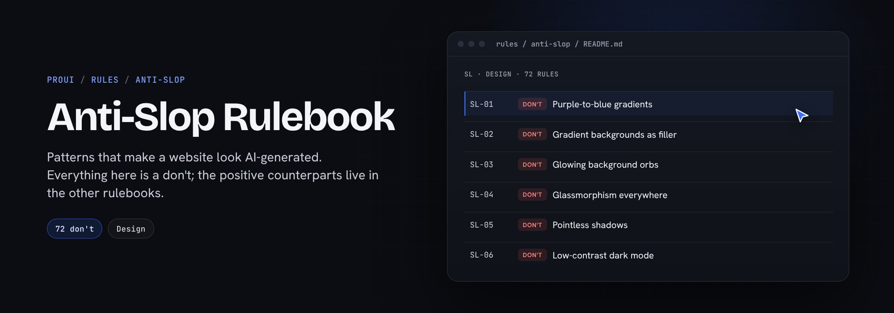

[All rulebooks](../README.md) · Prefix `SL` · Design · 72 rules

**Patterns that make a website look AI-generated. Everything here is a don't; the positive counterparts live in the other rulebooks.**

> [!IMPORTANT]
> Every rule here is a **don't**. Rules marked SOFT are allowed only as a deliberate, sparing part of a brand or a chosen style. Rules marked HARD RULE can never be switched back on.

```text
Apply the Anti-Slop Rulebook (SL) to this page.
Review this page against SL-01 to SL-05.
Why does SL-01 matter here?
```

## Don't · 72

What never ships.

| ID | Avoid | Details |
| --- | --- | --- |
| `SL-01` | **Purple-to-blue gradients** | The default "AI startup" gradient. Pick colours that come from the brand, the product or its photography instead. |
| `SL-02` | **Gradient backgrounds as filler** <sub>SOFT</sub> | A gradient behind a section in place of real content or imagery. Acceptable as one signature brand element; slop when every section has one. |
| `SL-03` | **Glowing background orbs** | Blurred coloured blobs floating behind content to add "depth". |
| `SL-04` | **Glassmorphism everywhere** <sub>SOFT</sub> | Frosted translucent panels on every card. Use only where something really sits above imagery (a header over a photo, a sheet over a map). |
| `SL-05` | **Pointless shadows** | Strong drop shadows on everything. Use elevation only to show that something floats (menus, dialogs, dragged items). |
| `SL-06` | **Low-contrast dark mode** | Grey text on near-black that is hard to read. See `DC-15`. |
| `SL-07` | **Too many shades and opacities** | Text at 70 %, 50 %, 40 % and 30 %, five greys, three tints of one colour. Use a small, named palette: typically ink, muted, surface, border, one accent, one danger. |
| `SL-08` | **Dithering and grain as decoration** <sub>SOFT</sub> | Pixel-dither or noise effects on images and gradients because they are trendy. |
| `SL-09` | **Three feature cards in a row** | Icon, title and two lines, three times. Show the feature itself (screenshot, demo, numbers) or use a layout that fits the content. |
| `SL-10` | **Empty bento grids** | A grid of uneven tiles holding an icon and four words each. Bento only works when each tile holds something real to look at. |
| `SL-11` | **Generic three-tier pricing** | Starter, Pro and Enterprise with "Most popular" in the middle, even when the product has one price. Show the pricing the business actually has. |
| `SL-12` | **Containers with borders** | Every block wrapped in a bordered box, boxes inside boxes. Separate content with spacing first (`DC-08`), borders second. |
| `SL-13` | **Overusing dividers** | Hairlines between everything. Whitespace usually does the job. |
| `SL-14` | **Tags and pills everywhere** | Small rounded labels on every item without a job to do. |
| `SL-15` | **Badges above headlines** | "New", "Introducing" or a sparkle chip above every heading. Use one only for real news. |
| `SL-16` | **Eyebrows on every heading** <sub>SOFT</sub> | A small kicker above each title ("FEATURES" above "Our features"). Fine occasionally when it adds information (a date or a category), never a number. |
| `SL-17` | **Decorative counting** <sub>HARD RULE</sub> | No counting labels anywhere: no "01 / 02 / 03" on sections, no "001", "(02)", "No. 3" or "04 —" on cards, photos, features, services, FAQ items, steps, slides or list rows, no "1/5" image counters, no numbered form steps ("1 Contact", "2 Delivery"). Give each item a name instead ("Contact", "Delivery"), and let order come from position. This holds even when the order is real and even inside styles that otherwise like catalogues or grids. Numbers that are data stay: prices, sizes, dates, times, quantities, stock left, order IDs, measurements. |
| `SL-18` | **Squircles everywhere** | iOS-style super-rounded squares on every icon and card. |
| `SL-19` | **Untouched component library** | shadcn/ui (or any kit) in its default look. Restyle it to the brand: colours, radii, type, spacing, states. |
| `SL-20` | **Over-the-top detailed UI mockups** | Fake dashboards crowded with tiny charts and numbers that show nothing real. Show the actual product (`DC-06`). |
| `SL-21` | **Overly detailed diagrams** | Complex schematics that look clever and explain nothing. |
| `SL-22` | **Instrument Serif and the default "AI serif" look** | Instrument Serif (often italic) mixed into headlines has become a cliché. Choose type for the brand. |
| `SL-23` | **Excessive italics** | Random single words in italics for "elegance". Italics need a reason. |
| `SL-24` | **Negative kerning on body text** | Tight tracking is fine on large display headlines and nowhere else. |
| `SL-25` | **Excessive mono fonts** <sub>SOFT</sub> | Monospace on every label to look "technical". Use mono for data that benefits from it: prices, timers, codes, IDs, specs. See `DC-04`. |
| `SL-26` | **ALL CAPS subtitles everywhere** <sub>SOFT</sub> | Wide-tracked uppercase on every label and subheading. |
| `SL-27` | **Periods in titles** <sub>SOFT</sub> | "Built for speed." on every heading. Fine as an occasional voice choice, slop as a rule. |
| `SL-28` | **Gradient-filled headline text** | Headlines filled with a colour gradient. |
| `SL-29` | **Lucide icons everywhere** | The default icon set on every line. Use icons only where they help scanning, from one consistent set (`DC-12`), styled to the brand. |
| `SL-30` | **Emojis in headings and UI** | "🚀 Fast", "🔒 Secure". Never in headings, buttons or navigation. |
| `SL-31` | **Sparkle icons for anything "AI" or "new"** | ✨ as decoration. |
| `SL-32` | **Code breadcrumbs as decoration** | `~/app`, `// comments`, `{ }` and terminal chrome on a site that is not about code. |
| `SL-33` | **ASCII art and ASCII animations** | Text-character imagery used as an effect. |
| `SL-34` | **Cursor-following beams and spotlights** | Glows that chase the pointer. Effect for its own sake. |
| `SL-35` | **Everything fades in on scroll** | Every block sliding and fading as it enters. It slows reading and tires people. Animate a few key moments only (section 4). |
| `SL-36` | **Bouncy everyday UI** | Springy overshoot on menus, toggles and dialogs (`MO-13`). |
| `SL-37` | **Em dashes everywhere** | A dash in every sentence is the clearest sign of generated copy. Use commas, full stops and colons. |
| `SL-38` | **"It's not X, it's Y" phrasing** | "It's not just a tool, it's a revolution." Say what it does. |
| `SL-39` | **Generic hero copy** | "Supercharge your workflow", "The future of X". Write a specific headline (`DC-09`). |
| `SL-40` | **Verbose, redundant text** | Paragraphs that repeat the heading in other words. Cut it in half. |
| `SL-41` | **Vague button labels** | "Get started", "Learn more", "Submit". Say what happens: "Download the price list", "Book a 20-minute call", "Place order". |
| `SL-42` | **Claims without proof** | "10× faster", "Trusted by thousands" without numbers, sources or names. Back it up or remove it. |
| `SL-43` | **Fake testimonials** <sub>HARD RULE</sub> | Invented quotes from "Sarah K., CEO" with stock headshots. Use real ones or none. Never present invented reviews as genuine. |
| `SL-44` | **Placeholder business info** <sub>HARD RULE</sub> | Lorem ipsum, "123 Main Street", info@company.com, fake phone numbers left in the build. |
| `SL-45` | **No real product demo** | Abstract illustrations instead of screenshots, video or a live demo. |
| `SL-46` | **Broken third-party embeds** | Maps, videos, calendars or chat widgets that fail to load or break the layout. Test every embed and give it a fallback. |
| `SL-47` | **Forms asking for too much** | Phone, company, job title and budget before any value is shown. Ask only what is needed now. |
| `SL-48` | **Keyboard-unfriendly forms** | Wrong tab order, Enter does not submit, no visible focus. See `ST-09`. |
| `SL-49` | **Side-stripe accent borders** <sub>HARD RULE</sub> | A thick coloured `border-left` (or right) on cards, callouts, list items or alerts as decoration. Use a full border, a tinted background, an icon or nothing. |
| `SL-50` | **Accent border on a rounded card** | A one-side coloured border bent around a large radius. It reads as a template and the corner looks broken. |
| `SL-51` | **Nested cards** | A card inside a card inside a card. Flatten: one surface, grouping by spacing (`DC-08`, `LY-05`). |
| `SL-52` | **Hard offset shadows by reflex** <sub>SOFT</sub> | The solid black `4px 4px 0` "neo-brutalist" shadow on every button and card. Keep it only when a chosen style (`PLAYFUL POP`, `POSTER COLLAGE`) asks for it, and then use it consistently. |
| `SL-53` | **Thin border plus wide soft shadow** | A 1 px grey border and a huge blurred shadow on the same card. Pick one way to show elevation. |
| `SL-54` | **Dark glow** | Coloured `box-shadow` or `drop-shadow` glows on dark backgrounds (neon edges, glowing buttons). Light is not a decoration. |
| `SL-55` | **Radial halo or spotlight behind the hero** | A soft radial gradient centred behind the headline to "add depth". Related to `SL-03`. |
| `SL-56` | **Grid and stripe backgrounds** | Faint graph-paper lines, dot grids or repeating diagonal stripes behind sections to look technical. Allowed when the grid is real content (a plan, a chart, a cutting mat for a craft shop) or a chosen style asks for it, used once. |
| `SL-57` | **Icon tile stack** | A rounded square tile with an icon, then a title, then two lines, repeated. The most common generated component. Show the thing itself. |
| `SL-58` | **Hero eyebrow chip** | A pill above the hero headline ("✦ Now with AI", "v2.0 is here"). Covered by `SL-15`; listed so audits can name it. |
| `SL-59` | **Overused display faces** | Inter, Roboto, Geist, Space Grotesk, Plus Jakarta Sans, DM Sans, Outfit, Instrument Sans, Syne, Fraunces, Playfair Display, Cormorant, Newsreader and Instrument Serif as the *display* face by default. They are fine for UI text in an app (`TY-02`); as a headline face they say "I stopped looking". Choosing one needs a reason no other face satisfies. |
| `SL-60` | **Flat type hierarchy** | Heading sizes less than about 1.25× apart, so nothing leads (`TY-05`). |
| `SL-61` | **Oversized H1 by reflex** | A giant headline that pushes the action below the fold and wraps into a stack of one-word lines. Big type is a choice of a style (`MEGA TYPE`), not a default. |
| `SL-62` | **Extreme negative tracking** | Letter-spacing tighter than about `-0.04em` on any text, or any negative tracking below about 32 px. |
| `SL-63` | **Italic serif display by reflex** | One italic serif word in a sans headline ("Design that *feels*"). Related to `SL-22`, `SL-23`. |
| `SL-64` | **Cream, terracotta and serif** | Warm off-white ground, high-contrast serif headline and a terracotta or signal-red accent, used because the subject is "warm", "bookish" or "human". It is one of the four looks generated sites fall into. |
| `SL-65` | **Near-black and one neon** | Black ground, one acid or neon accent, glowing edges. The second default look. |
| `SL-66` | **Broadsheet costume** | Hairline rules, italic display serif and tiny tracked mono labels on a site that is not a publication. The third default look. |
| `SL-67` | **Neo-brutalist kit** | Flat saturated ink, black boxes, hard offset shadows and heavy condensed type, used by default. The fourth default look. All four (`SL-64` to `SL-67`) are fine when the brief or a style keyword asks for them; landing in one without being asked means the direction was not chosen. |
| `SL-68` | **Marquee filler** | An endless scrolling ticker of logos or adjectives because the page felt empty. A marquee needs real content (real client logos, real news) and must pause for reduced motion. |
| `SL-69` | **Pulsing dots and blinking cursors** | "Live" dots and typing cursors as decoration on content that is not live. |
| `SL-70` | **Shape-assembled illustrations** | Pictures built from CSS circles and rectangles, or many-point `clip-path` polygons and blob masks where a real image, icon or drawing belongs. |
| `SL-71` | **Aphoristic cadence** | Short punchy fragments in threes ("Fast. Simple. Yours."), slogans in place of information, and buzzwords ("seamless", "unlock", "elevate", "empower", "next-level", "game-changing"). See `CP-03`. |
| `SL-72` | **Content hidden at rest** | Text or images that stay invisible until a scroll animation fires, so the page is blank without JavaScript, in screenshots, for crawlers, or when the animation fails. Content is visible by default; motion only enhances it (`MO`, `PF-21`). |

## How to check

- Run `node scripts/proui-scan.mjs <src>` and review every finding in context.
- Compare screenshots at 390 and 1440 px against this list, section by section.
- Search the build for counting labels (`01`, `/ 05`, `No.`) and placeholder text.

## Sources

- [Impeccable](https://github.com/pbakaus/impeccable)

---

Previous: [GitHub Workflow Rulebook](../github/README.md) · Next: [Design Craft Rulebook](../craft/README.md)

<sub>Generated from `rulebook.json` by `scripts/build-rulebooks.mjs`. To change a rule, edit the JSON and run the script.</sub>
