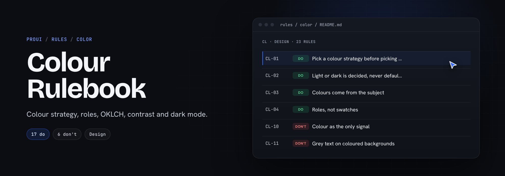

[All rulebooks](../README.md) · Prefix `CL` · Design · 23 rules

**Colour strategy, roles, OKLCH, contrast and dark mode.**

```text
Apply the Colour Rulebook (CL) to this page.
Review this page against CL-01 to CL-05.
Why does CL-01 matter here?
```

## Do · 17

What a finished, professional site does.

| ID | Rule | Details |
| --- | --- | --- |
| `CL-01` | **Pick a colour strategy before picking colours** | One of: **Restrained** (tinted neutrals plus one accent; the default for product UI), **Committed** (one strong colour covers 30–60 % of the surface), **Full palette** (three or four named roles), **Drenched** (the surface is the colour). Write the choice into the decisions record. |
| `CL-02` | **Light or dark is decided, never defaulted** | Write one sentence about where the site is used (who, where, under what light) and let it decide. Neither mode is the safe choice. |
| `CL-03` | **Colours come from the subject** | Take them from the product, its photography, its materials or its place, not from a generic palette generator. See `SL-01`, `SL-64` to `SL-67`. |
| `CL-04` | **Roles, not swatches** | Name colours by job: `bg`, `surface`, `surface-raised`, `text`, `text-muted`, `border`, `accent`, `accent-contrast`, `focus`, `success`, `warning`, `danger`, `info`. Components use roles, never raw values. |
| `CL-05` | **Define colours in OKLCH** | `oklch()` keeps lightness steps even across hues, so ramps and dark-mode variants are predictable. Keep sRGB fallbacks only where old browsers matter. |
| `CL-06` | **Tint the neutrals** | Greys lean slightly towards the brand hue (chroma about 0.005–0.02). Pure `#000` and `#fff` are rarely the right ground; near-black and off-white are. |
| `CL-07` | **A small palette** | About 8–12 tokens for a marketing site, a few more for an app with states. Fewer opacities and fewer shades (`SL-07`). |
| `CL-08` | **One meaning per colour** | If the accent means "you can click this", do not use it for decoration or static text. Status colours mean status only. |
| `CL-09` | **Contrast table before building** | Check every text/background pair you will use: 4.5:1 for body text, 3:1 for large text (about 24 px, or 19 px bold), icons and control borders, 7:1 for small text when possible. Check both themes and hover/disabled states. |
| `CL-12` | **Dark mode is redesigned, not inverted** | Dim, slightly tinted grounds; raised surfaces get lighter, not shadowed; accents usually lose a little chroma and gain lightness; body text is off-white, not pure white. Large white areas in images are softened. |
| `CL-13` | **Follow the system setting** | Respect `prefers-color-scheme`; add a manual switch only when people ask for it, and remember their choice. Support `prefers-contrast: more` with stronger borders and text. |
| `CL-14` | **Elevation in dark mode is lighter, not darker** | Each raised layer (card, popover, dialog) is a step lighter than the one below. |
| `CL-15` | **Accent sparingly** | The primary action, links, the current selection and focus. Not every icon, heading and border (`DC-11`). |
| `CL-16` | **Respect culture and context** | Red can mean danger, loss or luck; green can mean gain or not. In charts and finance follow the audience's convention, and label the meaning. |
| `CL-17` | **Define state colours once** | Success, warning, danger and info are tokens with a background, border and text variant each, checked for contrast in both themes. |
| `CL-18` | **A visible focus colour** | The focus ring has its own token with 3:1 contrast against every surface it can appear on, not the accent at low opacity. |
| `CL-22` | **Start from a palette that is proven** | Base the palette on combinations that already work on real, respected sites: a warm off-white or warm near-black ground, ink that is not pure black, and one accent. `inspiration/site-studies/` and `blueprints/colour-schemes.md` list measured palettes. Adapt the hue to the subject; do not invent a scheme from nothing. |

## Don't · 6

What never ships.

| ID | Avoid | Details |
| --- | --- | --- |
| `CL-10` | **Colour as the only signal** | Errors, status, chart series and required fields also carry a label, icon, pattern or shape. Check with a colour-blindness simulation. |
| `CL-11` | **Grey text on coloured backgrounds** | Muted grey on a coloured surface drops contrast; use a tint of the surface colour or white/near-black at a checked ratio. |
| `CL-19` | **Red and green as the only difference** | Never rely on a red/green pair alone for good and bad, up and down, or valid and invalid; add a sign, icon or label (`CL-10`). |
| `CL-20` | **Several saturated accents in one view** | One saturated accent per view. A second strong colour competes with the primary action. |
| `CL-21` | **Pure black text on pure white for long reading** | For long reading, soften the extremes slightly (near-black on off-white) to reduce glare, while keeping contrast well above 7:1. |
| `CL-23` | **Garish colour** | Neon on neon, fully saturated backgrounds behind long text, rainbow gradients, more than one loud colour fighting for attention, or a saturated accent on every element. Luxury and trust read as restraint: muted grounds, deep inks and one confident accent used for the main action only. |

## Related anti-slop rules

Don'ts from the [Anti-Slop Rulebook](../anti-slop/README.md) that belong to this subject.

| ID | Avoid |
| --- | --- |
| `SL-01` | Purple-to-blue gradients |
| `SL-02` | Gradient backgrounds as filler |
| `SL-03` | Glowing background orbs |
| `SL-04` | Glassmorphism everywhere |
| `SL-05` | Pointless shadows |
| `SL-06` | Low-contrast dark mode |
| `SL-07` | Too many shades and opacities |
| `SL-08` | Dithering and grain as decoration |
| `SL-53` | Thin border plus wide soft shadow |
| `SL-54` | Dark glow |
| `SL-55` | Radial halo or spotlight behind the hero |
| `SL-64` | Cream, terracotta and serif |
| `SL-65` | Near-black and one neon |

## How to check

- Make a contrast table of every text/background pair in light and dark.
- View the site with a colour-blindness simulator (DevTools Rendering panel).

## Sources

- [Apple HIG: Color](https://developer.apple.com/design/human-interface-guidelines/color)
- [Apple HIG: Dark Mode](https://developer.apple.com/design/human-interface-guidelines/dark-mode)
- [OKLCH in CSS (Evil Martians)](https://evilmartians.com/chronicles/oklch-in-css-why-quit-rgb-hsl)

---

Previous: [Typography Rulebook](../typography/README.md) · Next: [Gradients and Backgrounds Rulebook](../gradients/README.md)

<sub>Generated from `rulebook.json` by `scripts/build-rulebooks.mjs`. To change a rule, edit the JSON and run the script.</sub>
