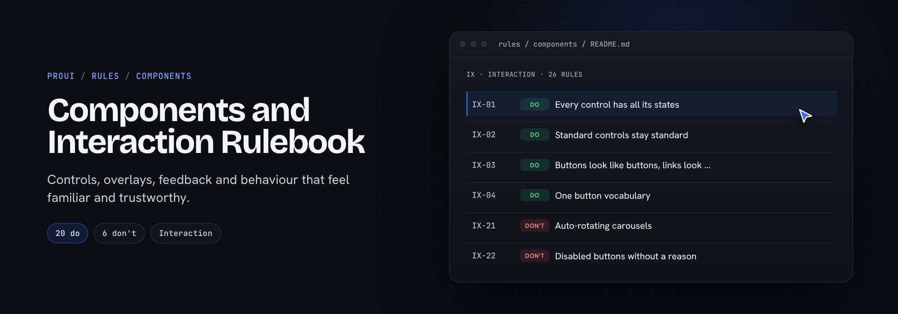

[All rulebooks](../README.md) · Prefix `IX` · Interaction · 26 rules

**Controls, overlays, feedback and behaviour that feel familiar and trustworthy.**

```text
Apply the Components and Interaction Rulebook (IX) to this page.
Review this page against IX-01 to IX-05.
Why does IX-01 matter here?
```

## Do · 20

What a finished, professional site does.

| ID | Rule | Details |
| --- | --- | --- |
| `IX-01` | **Every control has all its states** | Default, hover, focus-visible, active/pressed, disabled, loading, error, and selected where it applies. A control without a focus style is unfinished. |
| `IX-02` | **Standard controls stay standard** | Use native `<button>`, `<a>`, `<select>`, `<input>`, `<dialog>`, `<details>` or well-tested accessible components. Do not reinvent scrollbars, selects, checkboxes or date pickers for flavour; restyle them instead. |
| `IX-03` | **Buttons look like buttons, links look like links** | Buttons for actions, links for navigation. Links in text are underlined or otherwise clearly distinct without relying only on colour. |
| `IX-04` | **One button vocabulary** | Primary, secondary, tertiary (text) and destructive, the same shapes and sizes everywhere. If "Save" looks different on two screens, one is wrong. |
| `IX-05` | **Target size** | Touch targets at least 44 × 44 px (24 × 24 px is the WCAG AA floor; aim for 44), with space between neighbours. Small icons get padding to reach it. |
| `IX-06` | **Hover is a bonus** | Nothing important only appears on hover; touch screens have no hover. Hover effects never move the element away from the pointer or shift its neighbours. |
| `IX-07` | **Modal is the last choice** | Prefer inline editing, expanding sections, a side sheet or a new page. Use a modal only for a focused task that must be finished or cancelled before going on. |
| `IX-08` | **Dialogs done right** | `<dialog>` or an accessible equivalent: focus moves in, stays trapped, Escape closes, focus returns to the trigger, background is inert, a visible close button and a clear title. |
| `IX-09` | **Overlays escape their container** | Dropdowns and popovers use the popover API, `<dialog>`, `position: fixed` or a portal so `overflow: hidden` parents do not clip them. |
| `IX-10` | **Toasts for confirmation, not for errors that need action** | Toasts disappear; anything the user must fix stays on the screen next to the cause (`ST-09`). |
| `IX-11` | **Labels above fields, always visible** | Placeholders are examples, not labels. |
| `IX-12` | **The right input** | `type="email"`, `tel`, `number` only for real numbers, `autocomplete` attributes, `inputmode`, and native pickers where they work well. |
| `IX-13` | **Forgiving input** | Accept spaces in phone numbers and card numbers, trim whitespace, accept both decimal separators where the locale needs it. |
| `IX-14` | **Preserve input** | Never clear a form after an error. Autosave long forms and drafts (`ST-08`). |
| `IX-15` | **Undo over confirm** | For reversible actions (archive, remove from cart), act immediately and offer undo. Confirm only destructive, irreversible ones, and name what will be lost. |
| `IX-16` | **Immediate feedback** | Every action responds within about 100 ms (pressed state, spinner on the button, optimistic update) and confirms its result (`DC-20`, `ST-10`). |
| `IX-17` | **Keyboard and shortcuts** | Everything works with the keyboard in a logical order; frequent actions in apps get shortcuts (for example `/` for search, `⌘K` for a command menu) shown in tooltips or menus. |
| `IX-18` | **Touch gestures have a fallback** | Swipe, drag and long-press always have a visible button alternative; drag surfaces set `touch-action` and clean up when a gesture is interrupted. |
| `IX-19` | **Sticky actions on long forms and pages** | On long forms and product pages, the main action stays reachable (a sticky footer bar on phones) without covering content. |
| `IX-20` | **Confirm destructive actions by name** | Irreversible actions say exactly what will be lost and use a specific button label ("Delete 3 invoices"), not "OK". |

## Don't · 6

What never ships.

| ID | Avoid | Details |
| --- | --- | --- |
| `IX-21` | **Auto-rotating carousels** | No hero carousel that changes slides on its own. People miss the content and lose control; show the most important item, or let people move the carousel themselves with visible controls. |
| `IX-22` | **Disabled buttons without a reason** | A disabled button says why (helper text or a tooltip), or stays enabled and explains what is missing when pressed. |
| `IX-23` | **Essential information only in tooltips** | Tooltips are for hints. Anything needed to complete a task is visible on the page. |
| `IX-24` | **Infinite scroll that hides the footer** | Infinite lists offer "Load more" or pagination when the footer, contact or legal links live below them. |
| `IX-25` | **Custom cursors in working interfaces** | The system cursor stays in product UI and forms. Custom cursors are a style choice for portfolios and experiences only. |
| `IX-26` | **Pop-ups on arrival** | No newsletter, discount or chat pop-up on page load or within the first scroll. Offer it inline or after a clear sign of interest. |

## Related anti-slop rules

Don'ts from the [Anti-Slop Rulebook](../anti-slop/README.md) that belong to this subject.

| ID | Avoid |
| --- | --- |
| `SL-19` | Untouched component library |
| `SL-34` | Cursor-following beams and spotlights |
| `SL-46` | Broken third-party embeds |
| `SL-48` | Keyboard-unfriendly forms |

## How to check

- Tab through every control and check every state.
- Trigger every overlay: focus moves in, Escape closes, focus returns.

## Sources

- [NN/g: Auto-forwarding carousels](https://www.nngroup.com/articles/auto-forwarding/)
- [ARIA Authoring Practices Guide](https://www.w3.org/WAI/ARIA/apg/)

---

Previous: [Navigation Rulebook](../navigation/README.md) · Next: [Forms and Checkout Rulebook](../forms/README.md)

<sub>Generated from `rulebook.json` by `scripts/build-rulebooks.mjs`. To change a rule, edit the JSON and run the script.</sub>
