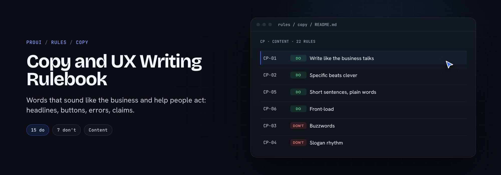

[All rulebooks](../README.md) · Prefix `CP` · Content · 22 rules

**Words that sound like the business and help people act: headlines, buttons, errors, claims.**

```text
Apply the Copy and UX Writing Rulebook (CP) to this page.
Review this page against CP-01 to CP-05.
Why does CP-01 matter here?
```

## Do · 15

What a finished, professional site does.

| ID | Rule | Details |
| --- | --- | --- |
| `CP-01` | **Write like the business talks** | Use the client's own words from their brief, their menus, their emails. A bakery does not "empower"; it bakes. |
| `CP-02` | **Specific beats clever** | Name the thing, the number, the place and the time: "Fresh bread from 7:00, Vinohradská 12" beats "Crafted with passion". |
| `CP-05` | **Short sentences, plain words** | Most sentences under about 20 words; one idea per sentence. |
| `CP-06` | **Front-load** | The important word comes first in headings, buttons and list items, so scanning works. |
| `CP-07` | **Buttons say what happens** | Verb plus object: "Book a table", "Download the menu", "Save changes". The button keeps the same words as the heading or link that led to it (`SL-41`). |
| `CP-08` | **Consistent terms** | One name per thing across the whole site ("basket" or "cart", never both). |
| `CP-09` | **Sentence case** | Headings, buttons and labels in sentence case unless the brand insists otherwise. |
| `CP-10` | **Error messages: what, why, how to fix** | "This card has expired. Use another card or update the expiry date." Never blame the user, never "Invalid input", never only a code. |
| `CP-11` | **Empty states invite** | Say what will be here and how to start (`ST-01`). |
| `CP-12` | **Confirmations name the result** | "Order 4821 is placed. We will email you when it ships." (`ST-10`). |
| `CP-13` | **Permission and data requests explain why** | Say what you need and what the user gets for it, at the moment you ask (`PL-04`). |
| `CP-15` | **Numerals for numbers** | Write numbers as digits ("3 days", "12 %") in interfaces; they scan faster than words. |
| `CP-16` | **Write for scanning** | Short paragraphs, meaningful subheadings, lists for steps and options, the key point first. |
| `CP-17` | **Unambiguous dates and times** | Write dates in a format nobody misreads ("17 Nov 2026", "Tue 9:00–17:00") and show time zones where they matter. |
| `CP-18` | **Inclusive, plain language** | Gender-neutral wording, no idioms that do not translate, explain necessary jargon once. |

## Don't · 7

What never ships.

| ID | Avoid | Details |
| --- | --- | --- |
| `CP-03` | **Buzzwords** | Avoid "seamless", "unlock", "elevate", "empower", "revolutionise", "next-level", "cutting-edge", "game-changing", "supercharge", "effortless", "delve", "leverage", "robust", "in today's fast-paced world", and the newer AI tells "quiet" (quiet confidence, quietly powerful), "real" (real results, real people), "crafted" and "thoughtfully". |
| `CP-04` | **Slogan rhythm** | Avoid three-word fragments in a row, rhetorical questions as headings, and "not X but Y" contrasts (`SL-38`, `SL-71`). |
| `CP-14` | **Invented claims, numbers or customers** <sub>HARD RULE</sub> | No invented numbers, customers, awards or reviews. Placeholders are marked as placeholders for the client to replace (`SL-42` to `SL-44`). |
| `CP-19` | **Cute error messages** | No "Oops!", "Uh-oh" or jokes in errors. People with a problem want the cause and the fix. |
| `CP-20` | **Exclamation marks everywhere** | At most one exclamation mark on a page, saved for real good news. |
| `CP-21` | **All-caps for emphasis** | Do not shout. Use weight or placement for emphasis, never capitals in sentences. |
| `CP-22` | **Placeholder copy in a design** | No lorem ipsum in reviewed designs. Write real or realistic copy; placeholder text hides layout problems. |

## Related anti-slop rules

Don'ts from the [Anti-Slop Rulebook](../anti-slop/README.md) that belong to this subject.

| ID | Avoid |
| --- | --- |
| `SL-37` | Em dashes everywhere |
| `SL-38` | "It's not X, it's Y" phrasing |
| `SL-39` | Generic hero copy |
| `SL-40` | Verbose, redundant text |
| `SL-41` | Vague button labels |
| `SL-42` | Claims without proof |
| `SL-43` | Fake testimonials |
| `SL-44` | Placeholder business info |
| `SL-71` | Aphoristic cadence |

## How to check

- Read every button out of context; it says what happens.
- Search the copy for buzzwords, em dashes and "Oops".

## Sources

- [GOV.UK: Writing for the web](https://www.gov.uk/guidance/content-design/writing-for-gov-uk)
- [Fluent 2: Content](https://fluent2.microsoft.design)

---

Previous: [Dashboards and Product UI Rulebook](../dashboards/README.md) · Next: [Localisation Rulebook](../localization/README.md)

<sub>Generated from `rulebook.json` by `scripts/build-rulebooks.mjs`. To change a rule, edit the JSON and run the script.</sub>
