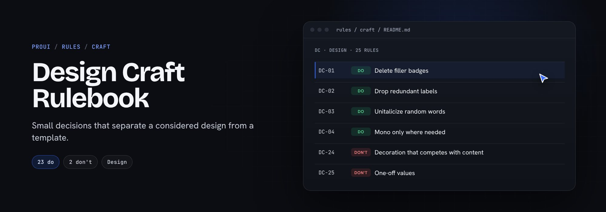

[All rulebooks](../README.md) · Prefix `DC` · Design · 26 rules

**Small decisions that separate a considered design from a template.**

```text
Apply the Design Craft Rulebook (DC) to this page.
Review this page against DC-01 to DC-05.
Why does DC-01 matter here?
```

## Do · 24

What a finished, professional site does.

| ID | Rule | Details |
| --- | --- | --- |
| `DC-01` | **Delete filler badges** | Remove any badge, chip or label that does not carry information. |
| `DC-02` | **Drop redundant labels** | No "Email:" above a field whose placeholder is already an email. No "Our Services" above three service cards. If the content says it, the label does not need to. |
| `DC-03` | **Unitalicize random words** | Italics only for titles of works, foreign words or one deliberate emphasis. |
| `DC-04` | **Mono only where needed** | Numbers that change or align (prices, timers, tables), codes, IDs. |
| `DC-05` | **Use a design system** | Define tokens before building: colour, type scale (about 5–7 sizes), spacing scale (for example 4, 8, 12, 16, 24, 32, 48, 64, 96), radii, shadows, motion durations. Never invent a one-off value. |
| `DC-06` | **Show the actual product** | Real screenshots, real photos, real UI. Mockups only of the real thing. |
| `DC-07` | **Enlarge the main feature** | The most important thing on each page is clearly the biggest. Hierarchy is readable at a glance. |
| `DC-08` | **Group with spacing** | Related items sit closer together, groups sit further apart. Spacing does the grouping before any border or background. |
| `DC-09` | **Make headlines specific** | "Invoices sent in 30 seconds" beats "Revolutionise your finances". |
| `DC-10` | **Emphasise the CTA** | One primary action per view, visually the strongest element. Secondary actions look secondary. |
| `DC-11` | **One accent colour, used sparingly** | For the primary button, links and key highlights only. |
| `DC-12` | **Keep icons consistent** | One set, one stroke width, one size grid, one corner style. |
| `DC-13` | **Remove embellishments** | Ornaments, extra gradients and decorative shapes that say nothing go. |
| `DC-14` | **Inner radius = outer radius − padding** | A card with 20 px radius and 8 px padding holds children with 12 px radius. Nested corners then look concentric. |
| `DC-15` | **Text contrast** | WCAG AA at least: 4.5:1 for body text, 3:1 for large text and UI parts. Check muted text and dark mode especially. |
| `DC-16` | **Wrap headlines properly** | `text-wrap: balance` on headings, `text-wrap: pretty` on paragraphs. No single orphaned word on the last line. Set a sensible max width (about 60–75 characters for body text). |
| `DC-17` | **Align by eye, not by pixels** | Optically centre play triangles, arrows and round icons. Nudge icons next to text to sit on the visual centre line. |
| `DC-18` | **Tabular numbers** | `font-variant-numeric: tabular-nums` for prices, timers, counters and table columns, so digits do not jump. |
| `DC-19` | **Loading states everywhere** | Every action and every data region has a loading state that matches the final layout (`ST-02`). |
| `DC-20` | **Animate useful feedback** | Animation confirms something happened (added to bag, saved, error). It is never only decoration. |
| `DC-21` | **One radius scale** | Corners come from a small radius scale (for example 4, 8, 12, 999). Every card, button and input uses it, and nested corners stay concentric (`DC-14`). |
| `DC-22` | **Every interactive element looks interactive** | Cards that link have a hover and focus state, a cursor change and a clear target; static cards do not pretend to be clickable. |
| `DC-23` | **Optical sizes for icons** | Icons sit on a fixed size grid (16, 20, 24) with one stroke width, and are visually balanced against the cap height of the text next to them. |
| `DC-26` | **Shadows fall on open ground, never through houses** <sub>SOFT</sub> | In an architectural or product scene a shadow lands only where something could receive it. Mask the shadow-catching ground inside every footprint, so a shadow stops at the edge of a building instead of showing through it. See-through volumes do not receive shadows, and their sunlit walls must never be brighter than the shade behind them (cap their colour), or a shadow seen through a wall turns into a white patch. Every shadow starts at the foot of what casts it; a gap means the shadow map is stale or biased. |

## Don't · 2

What never ships.

| ID | Avoid | Details |
| --- | --- | --- |
| `DC-24` | **Decoration that competes with content** | No ornament, shape or effect draws the eye before the headline, the product or the action. If people remember the decoration first, remove it. |
| `DC-25` | **One-off values** | No spacing, colour, radius, shadow or font size that is not a token. A one-off value is a missing token or a mistake (`DC-05`). |

## Related anti-slop rules

Don'ts from the [Anti-Slop Rulebook](../anti-slop/README.md) that belong to this subject.

| ID | Avoid |
| --- | --- |
| `SL-15` | Badges above headlines |
| `SL-16` | Eyebrows on every heading |
| `SL-17` | Decorative counting |
| `SL-18` | Squircles everywhere |
| `SL-19` | Untouched component library |
| `SL-20` | Over-the-top detailed UI mockups |
| `SL-21` | Overly detailed diagrams |
| `SL-29` | Lucide icons everywhere |
| `SL-30` | Emojis in headings and UI |
| `SL-31` | Sparkle icons for anything "AI" or "new" |
| `SL-32` | Code breadcrumbs as decoration |
| `SL-33` | ASCII art and ASCII animations |
| `SL-34` | Cursor-following beams and spotlights |
| `SL-49` | Side-stripe accent borders |
| `SL-50` | Accent border on a rounded card |
| `SL-52` | Hard offset shadows by reflex |
| `SL-67` | Neo-brutalist kit |
| `SL-70` | Shape-assembled illustrations |

## How to check

- Squint at each page: one focal point, one primary action.
- List every distinct spacing, radius and colour value in the CSS; anything not a token is a fix.

---

Previous: [Anti-Slop Rulebook](../anti-slop/README.md) · Next: [Typography Rulebook](../typography/README.md)

<sub>Generated from `rulebook.json` by `scripts/build-rulebooks.mjs`. To change a rule, edit the JSON and run the script.</sub>
