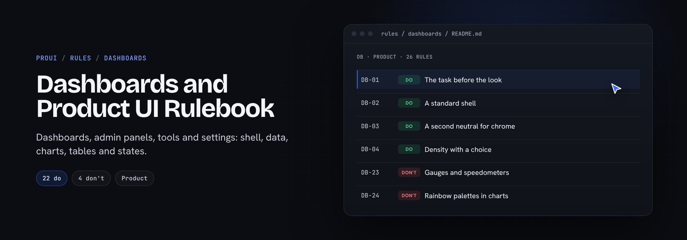

[All rulebooks](../README.md) · Prefix `DB` · Product · 26 rules

**Dashboards, admin panels, tools and settings: shell, data, charts, tables and states.**

```text
Apply the Dashboards and Product UI Rulebook (DB) to this page.
Review this page against DB-01 to DB-05.
Why does DB-01 matter here?
```

## Do · 22

What a finished, professional site does.

| ID | Rule | Details |
| --- | --- | --- |
| `DB-01` | **The task before the look** | Someone who uses tools like this should know where everything is before they notice the style. Style comes through type, palette, density and one signature move, never through a strange layout or invented controls. |
| `DB-02` | **A standard shell** | Side navigation (collapsible) or top bar, a page header with title and primary action, then the work area. Breadcrumbs for deep hierarchies, a command menu for power users. |
| `DB-03` | **A second neutral for chrome** | Sidebar and toolbars sit on a slightly different neutral than the content surface, so structure is visible without borders everywhere. |
| `DB-04` | **Density with a choice** | Comfortable by default, compact available where people scan many rows. Compact means tighter spacing, not smaller type below `TY-06`. |
| `DB-05` | **Lead with the question** | The first thing on a dashboard answers the user's main question ("Are we on track this month?"), not a wall of equal KPI tiles. |
| `DB-06` | **Numbers with context** | Every headline number shows its unit, its period and a comparison (vs last period, vs target) and, when it changes over time, a small trend line with the change marked. |
| `DB-07` | **Charts that fit the question** | Line for change over time, bar for comparison, stacked bar for parts of a whole over time, table for exact values. No pie charts with more than about five slices, no 3D charts, no dual axes without labels. |
| `DB-08` | **Honest charts** | Bar charts start at zero, axes are labelled with units, series are labelled directly where possible, and colour is never the only key (`CL-10`). Follow `dataviz` guidance for palettes. |
| `DB-09` | **Real tables** | Sticky header, sortable columns with a visible sort state, right-aligned tabular numbers (`DC-18`), left-aligned text, row hover, selection with bulk actions, pagination or virtualisation for long lists (`PF-10`). |
| `DB-10` | **Filters over what they filter** | Filters sit above or beside the data they scope, show what is active, and can be cleared in one action. The URL keeps filter state so views can be shared. |
| `DB-11` | **Skeletons, not spinners in content** | Loading tables and charts show their own shape (`ST-02`). |
| `DB-12` | **Empty states teach** | A new account's empty dashboard explains what will appear and offers the first action, with sample data clearly labelled as sample if shown (`ST-01`). |
| `DB-13` | **Partial failure** | One failed widget shows its own error and retry; the rest of the dashboard keeps working. |
| `DB-14` | **Status colours only for status** | Red for critical, amber for warning, green for success, blue for information, each with an icon or label. Inactive items are not shown in full-saturation colours. |
| `DB-15` | **Fast transitions** | 150–250 ms for UI changes, no page-load choreography, no decorative motion (`MO-02`). |
| `DB-16` | **Inline over modal** | Edit in place or in a side panel; keep context. Modals only for short focused tasks (`IX-07`). |
| `DB-17` | **Respect power users** | Keyboard navigation in tables, shortcuts for frequent actions, bulk operations, saved views. |
| `DB-18` | **Realistic demo data** | Mockups and empty-account demos use plausible names, values and units, with one interesting state visible (an alert, a degraded service), never tiles of random numbers (`SL-20`). |
| `DB-19` | **Data freshness and time zone** | Every dashboard shows when the data was last updated and which time zone it uses. |
| `DB-20` | **Compact numbers with exact values on demand** | Large numbers are shortened (48.2k) in tiles and charts, with the exact value in a tooltip or table. |
| `DB-21` | **Export and share** | Tables and charts that people report from can be exported (CSV) and the current view shared by URL. |
| `DB-22` | **Accessible charts** | Every chart has a text summary and a data table alternative; series are distinguishable without colour. |

## Don't · 4

What never ships.

| ID | Avoid | Details |
| --- | --- | --- |
| `DB-23` | **Gauges and speedometers** | No dials, gauges or speedometer charts. A number with a target and a bar says the same thing in a fraction of the space. |
| `DB-24` | **Rainbow palettes in charts** | No rainbow or random colours for data. Use a sequential palette for ordered values and a small categorical palette for categories. |
| `DB-25` | **A wall of KPIs** | No more than about four to six headline numbers above the fold. Everything else is one click away. |
| `DB-26` | **Auto-refresh that moves content** | Live updates never shift what the user is reading or clicking. Show "3 new items" and let people load them. |

## Related anti-slop rules

Don'ts from the [Anti-Slop Rulebook](../anti-slop/README.md) that belong to this subject.

| ID | Avoid |
| --- | --- |
| `SL-20` | Over-the-top detailed UI mockups |
| `SL-57` | Icon tile stack |

## How to check

- Load realistic data at small, normal and huge volumes.
- Force one widget to fail; the rest keeps working.

## Sources

- [Impeccable](https://github.com/pbakaus/impeccable)
- [Fluent 2](https://fluent2.microsoft.design)

---

Previous: [Platform Conventions Rulebook](../platform/README.md) · Next: [Copy and UX Writing Rulebook](../copy/README.md)

<sub>Generated from `rulebook.json` by `scripts/build-rulebooks.mjs`. To change a rule, edit the JSON and run the script.</sub>
