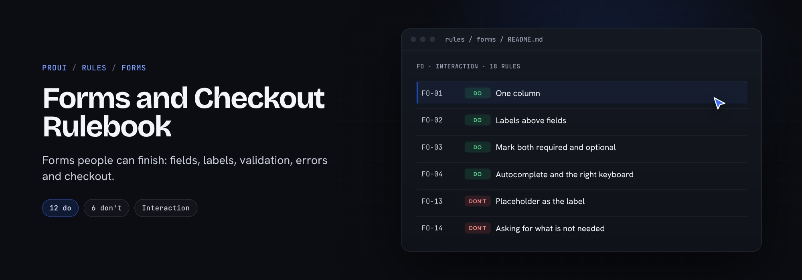

[All rulebooks](../README.md) · Prefix `FO` · Interaction · 20 rules

**Forms people can finish: fields, labels, validation, errors and checkout.**

```text
Apply the Forms and Checkout Rulebook (FO) to this page.
Review this page against FO-01 to FO-05.
Why does FO-01 matter here?
```

## Do · 14

What a finished, professional site does.

| ID | Rule | Details |
| --- | --- | --- |
| `FO-01` | **One column** | Forms run in a single column, in the order people think about the information. Short related fields (city and postcode) may share a row. |
| `FO-02` | **Labels above fields** | Every field has a visible label above it, always visible while typing (`IX-11`). |
| `FO-03` | **Mark both required and optional** | Mark required fields and optional ones explicitly, so nobody has to guess. |
| `FO-04` | **Autocomplete and the right keyboard** | `autocomplete` tokens (name, email, tel, street-address, postal-code, cc-number) and `inputmode` on every field, so browsers fill them in and phones show the right keyboard. |
| `FO-05` | **Validate after leaving the field** | Check a field when the user leaves it and on submit, not on every keystroke. Show success quietly and errors next to the field. |
| `FO-06` | **Error summary on long forms** | After a failed submit of a long form, list all errors at the top with links to each field, and move focus there. |
| `FO-07` | **Keep everything on error** | A failed submit keeps every value, including payment fields where allowed (`IX-14`). |
| `FO-08` | **Guest checkout first** | Shops let people buy as a guest as the most prominent option and offer an account after the order. |
| `FO-09` | **Full price early** | Shipping, taxes and fees are visible in the cart, before the payment step. |
| `FO-10` | **Named steps in multi-step forms** | Multi-step forms show the steps by name ("Delivery", "Payment") with the current one marked. No step numbers (`SL-17`). |
| `FO-11` | **Show password option** | Password fields have a show/hide toggle and accept paste and password managers. |
| `FO-12` | **Address lookup where it helps** | Offer address autocomplete or postcode lookup, with manual entry always possible. |
| `FO-19` | **Topic first, then three fields** <sub>HARD RULE</sub> | A contact form asks as little as possible. First the visitor picks what it is about from a few large choices (for example Product, Partnership, Bug, Billing, Other), and only then the form appears with three fields: name, email and a description of the problem or request, its placeholder and label matched to the chosen topic ("What went wrong?" for Bug). The topic travels with the message and routes it to the right person. No phone, company, budget or subject fields unless the owner says the answer changes who replies (`FO-14`). After sending, a thank-you that says who answers and when, and a plain email address stays on the page for anyone who prefers it (`PG-20`). |
| `FO-20` | **Lock the button while it sends** <sub>HARD RULE</sub> | A submit button is disabled while its request runs and its label says so ("Sending…", "Paying…"), so a double click or an impatient second tap cannot send it twice. The server is protected too (`SEC-31`). The button unlocks with a clear result or an error. Inputs live in a real `<form>` with `onSubmit`, so Enter submits. |

## Don't · 6

What never ships.

| ID | Avoid | Details |
| --- | --- | --- |
| `FO-13` | **Placeholder as the label** | Never use placeholder text as the only label. It disappears while typing and has poor contrast. |
| `FO-14` | **Asking for what is not needed** | No title, gender, birth date, company or phone unless the task truly needs it now (`SL-47`). |
| `FO-15` | **Forced account creation** | Never require an account to buy, book or download something. |
| `FO-16` | **Splitting simple fields** | Do not split names, phone numbers or dates into several boxes unless the format really requires it. |
| `FO-17` | **CAPTCHA by default** | No puzzle for every visitor. Use invisible protection (honeypot, time check, rate limits) and show a challenge only on suspicious traffic (`SEC-08`). |
| `FO-18` | **Clearing the form or resetting it** | No "Reset" button, and never clear fields after an error or a session timeout. |

## Related anti-slop rules

Don'ts from the [Anti-Slop Rulebook](../anti-slop/README.md) that belong to this subject.

| ID | Avoid |
| --- | --- |
| `SL-47` | Forms asking for too much |
| `SL-48` | Keyboard-unfriendly forms |

## How to check

- Fill every form with the keyboard and with browser autofill.
- Submit with errors: values kept, messages next to fields, focus moves to the first error.

## Sources

- [Baymard: Checkout usability](https://baymard.com/research/checkout-usability)
- [GOV.UK Design System: Patterns](https://design-system.service.gov.uk/patterns/)
- [HTML autocomplete tokens (MDN)](https://developer.mozilla.org/en-US/docs/Web/HTML/Attributes/autocomplete)

---

Previous: [Components and Interaction Rulebook](../components/README.md) · Next: [States Rulebook](../states/README.md)

<sub>Generated from `rulebook.json` by `scripts/build-rulebooks.mjs`. To change a rule, edit the JSON and run the script.</sub>
