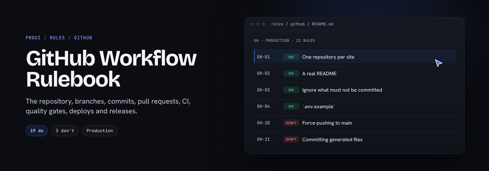

[All rulebooks](../README.md) · Prefix `GH` · Production · 22 rules

**The repository, branches, commits, pull requests, CI, quality gates, deploys and releases.**

```text
Apply the GitHub Workflow Rulebook (GH) to this page.
Review this page against GH-01 to GH-05.
Why does GH-01 matter here?
```

## Do · 19

What a finished, professional site does.

| ID | Rule | Details |
| --- | --- | --- |
| `GH-01` | **One repository per site** | Each site has its own repository with a clear name, a description, topics and the live website URL set. |
| `GH-02` | **A real README** | What the site is, the live URL, how to install, run, build and deploy (commands that actually exist in `package.json`), where content is edited, and the tech stack. |
| `GH-03` | **Ignore what must not be committed** | `.gitignore` for `node_modules`, build output, `.env*` (except `.env.example`), OS and editor files, logs, local caches. |
| `GH-04` | **`.env.example`** | Every environment variable the project needs, with placeholder values and a comment. Real secrets live in GitHub Actions secrets or the host's secret store (`SEC-04`). |
| `GH-05` | **Consistent formatting** | `.editorconfig`, a formatter (Prettier or the stack's equivalent) and a linter configured in the repo and run in CI. |
| `GH-06` | **`main` is always deployable** | Work happens on short branches (`feat/…`, `fix/…`, `chore/…`), merged by pull request. |
| `GH-07` | **Conventional commits** | `feat:`, `fix:`, `style:`, `perf:`, `refactor:`, `docs:`, `chore:`, `ci:`, with a short imperative summary. One logical change per commit. |
| `GH-08` | **Pull requests with a checklist** | Every PR uses the template: what changed, screenshots at mobile and desktop, ProUI passes touched, how it was tested. |
| `GH-09` | **Protected `main`** | Branch protection (or a ruleset): pull request required, CI must pass, no force pushes. For a solo project, at least require CI. |
| `GH-10` | **CI on every push and PR** | Install with a lockfile, lint, type-check, run tests if any, build. |
| `GH-11` | **Quality gates** | Lighthouse CI with budgets (performance, accessibility, SEO, best practices), an accessibility check (axe or pa11y), a link checker, and `scripts/proui-scan.mjs` for slop patterns. |
| `GH-12` | **Preview deploys** | Each PR gets a preview URL (Vercel, Netlify, Cloudflare Pages) so changes are reviewed in a browser, not only in code. |
| `GH-13` | **Automated deploy from `main`** | GitHub Pages, Vercel, Netlify or Cloudflare deploy on merge; the hosting config lives in the repo (`vercel.json`, `netlify.toml`, `wrangler.toml` or the Pages workflow). |
| `GH-14` | **Dependency and security automation** | Dependabot (or Renovate) for npm and GitHub Actions, secret scanning and push protection on, CodeQL or another code scan for apps with a backend (`SEC-14`). |
| `GH-15` | **Releases** | Tag versions (`v1.0.0`) at launch and at major changes, with release notes generated from the commits. |
| `GH-16` | **Issue and PR templates** | A bug template (steps, expected, actual, device, screenshot) and a feature template, so feedback after launch arrives in a usable shape. |
| `GH-17` | **Semantic versions** | Releases follow semantic versioning (major.minor.patch), so it is clear what a change means. |
| `GH-18` | **A licence when the code is public** | Public repositories state a licence (MIT, Apache-2.0) or say clearly that all rights are reserved. |
| `GH-19` | **CODEOWNERS on team projects** | A `CODEOWNERS` file asks the right people to review changes in their area. |

## Don't · 3

What never ships.

| ID | Avoid | Details |
| --- | --- | --- |
| `GH-20` | **Force-pushing to main** | Never rewrite the history of `main`. Revert with a new commit instead. |
| `GH-21` | **Committing generated files** | No build output, `node_modules`, caches or large binaries in Git. Large media goes to a CDN or Git LFS. |
| `GH-22` | **Long-lived branches** | Branches live days, not months. Merge small changes often to avoid painful conflicts. |

## How to check

- CI and quality workflows green on the main branch; branch protection on; Dependabot running.

## Sources

- [GitHub Docs: Actions](https://docs.github.com/actions)
- [Conventional Commits](https://www.conventionalcommits.org)
- [Semantic Versioning](https://semver.org)

---

Previous: [Security Rulebook](../security/README.md) · Next: [Anti-Slop Rulebook](../anti-slop/README.md)

<sub>Generated from `rulebook.json` by `scripts/build-rulebooks.mjs`. To change a rule, edit the JSON and run the script.</sub>
