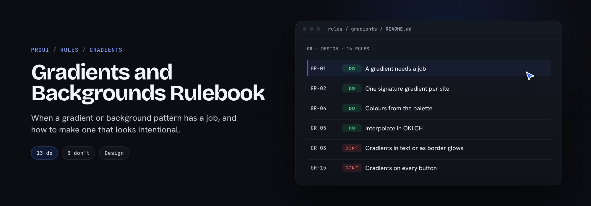

[All rulebooks](../README.md) · Prefix `GR` · Design · 16 rules

**When a gradient or background pattern has a job, and how to make one that looks intentional.**

```text
Apply the Gradients and Backgrounds Rulebook (GR) to this page.
Review this page against GR-01 to GR-05.
Why does GR-01 matter here?
```

## Do · 13

What a finished, professional site does.

| ID | Rule | Details |
| --- | --- | --- |
| `GR-01` | **A gradient needs a job** | Lighting a product, setting a time of day, carrying a brand colour across a whole surface, separating a section from the next. "The section looked empty" is not a job (`SL-02`). |
| `GR-02` | **One signature gradient per site** | Reuse it in two or three places (hero, one feature, the footer or OG image). Different gradients in every section are noise. |
| `GR-04` | **Colours from the palette** | Stops come from the colour tokens (`CL-04`), or from the hero photo. Never the purple-to-blue default (`SL-01`). |
| `GR-05` | **Interpolate in OKLCH** | `linear-gradient(in oklch, …)` avoids the grey, muddy middle that sRGB gradients get between distant hues. Close hues are safer than opposite ones. |
| `GR-06` | **Few stops, soft transitions** | Two to four stops. Use easing stops (extra stops along a curve) so there is no visible band edge. |
| `GR-07` | **Mesh gradients from layered radials** | Build soft "mesh" backgrounds from two to four overlapping `radial-gradient()` layers on a base colour, or export one from a gradient tool as an image. Keep the brightest area behind the content that matters, not dead centre by reflex (`SL-55`). |
| `GR-08` | **Fight banding** | Large smooth gradients band on 8-bit screens. Add very subtle noise (an exported noise PNG at 2–4 % opacity, or noise baked into an exported image), or export with dithering. Grain as a visible effect is a style choice (`SL-08`, `DITHER GRAIN`). |
| `GR-09` | **Check text on gradients** | Measure contrast at the lightest and darkest point behind the text, not the average. If it fails anywhere, add a scrim or move the text. |
| `GR-10` | **Both themes** | A gradient designed on light may glow on dark. Define a dark variant with lower lightness and chroma. |
| `GR-11` | **Backgrounds hold back** | A background texture or pattern sits at low contrast so it never competes with type. If you notice it before the headline, it is too strong. |
| `GR-12` | **Patterns from a real system** | Use generated patterns with a clear logic (grid, radial, flow, isometric) from a pattern tool, tuned to the palette, instead of hand-drawn random shapes (`SL-70`). |
| `GR-13` | **Export the right format** | SVG for patterns and shapes (optimised with SVGO), AVIF/WebP for photo-like gradients and mesh exports, CSS only when the gradient is simple. Animated shader gradients render only while visible and stop for reduced motion (`PF-21`). |
| `GR-14` | **Dividers with intent** | Wave or angled section dividers only when the style is organic or playful, and the same divider shape across the site. |

## Don't · 3

What never ships.

| ID | Avoid | Details |
| --- | --- | --- |
| `GR-03` | **Gradients in text or as border glows** | No gradient-filled headlines (`SL-28`), no glowing gradient borders around cards (`SL-54`). |
| `GR-15` | **Gradients on every button** | Buttons are solid colours from the palette. A gradient button is a template tell and loses contrast at one end. |
| `GR-16` | **Animated gradients behind text** | Text never sits on a background that moves. Animate gradients only where nothing has to be read. |

## Related anti-slop rules

Don'ts from the [Anti-Slop Rulebook](../anti-slop/README.md) that belong to this subject.

| ID | Avoid |
| --- | --- |
| `SL-01` | Purple-to-blue gradients |
| `SL-02` | Gradient backgrounds as filler |
| `SL-03` | Glowing background orbs |
| `SL-28` | Gradient-filled headline text |
| `SL-55` | Radial halo or spotlight behind the hero |
| `SL-56` | Grid and stripe backgrounds |

## How to check

- Measure text contrast at the lightest and darkest point behind it.
- View large gradients on an 8-bit screen or a compressed screenshot for banding.

---

Previous: [Colour Rulebook](../color/README.md) · Next: [Effects and 3D Rulebook](../effects/README.md)

<sub>Generated from `rulebook.json` by `scripts/build-rulebooks.mjs`. To change a rule, edit the JSON and run the script.</sub>
