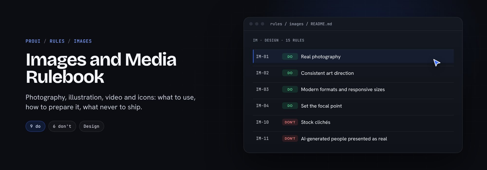

[All rulebooks](../README.md) · Prefix `IM` · Design · 15 rules

**Photography, illustration, video and icons: what to use, how to prepare it, what never to ship.**

```text
Apply the Images and Media Rulebook (IM) to this page.
Review this page against IM-01 to IM-05.
Why does IM-01 matter here?
```

## Do · 9

What a finished, professional site does.

| ID | Rule | Details |
| --- | --- | --- |
| `IM-01` | **Real photography** | Photos of the real product, place, team and work. Commission or take them; stock only for neutral textures and never for people presented as staff or customers. |
| `IM-02` | **Consistent art direction** | All images share light, colour grade, crop logic and angle, so the site looks like one story. |
| `IM-03` | **Modern formats and responsive sizes** | AVIF or WebP with a fallback, `srcset` and `sizes` for every content image, served at the size displayed (`PF-01`). |
| `IM-04` | **Set the focal point** | Use `object-fit: cover` with `object-position` so faces and products stay in frame on every crop. |
| `IM-05` | **Width, height and aspect ratio** | Every image and video has dimensions or `aspect-ratio` to prevent layout shift. |
| `IM-06` | **Meaningful alt text** | Alt text says what the image shows and why it is there; decorative images use `alt=""` (`AX-07`). |
| `IM-07` | **Video done properly** | Videos have a poster image, captions, controls, and are compressed for the web (H.264 or AV1, short loops under a few MB). |
| `IM-08` | **SVG for icons and logos** | Icons and logos are optimised inline SVG or an SVG sprite, not icon fonts or PNGs. |
| `IM-09` | **Credit and licence** | Every image that is not the client's own has a licence that allows the use, recorded in the project. |

## Don't · 6

What never ships.

| ID | Avoid | Details |
| --- | --- | --- |
| `IM-10` | **Stock clichés** | No handshakes, people pointing at laptops, smiling call-centre headsets or generic city skylines. |
| `IM-11` | **AI-generated people presented as real** | No generated faces or scenes passed off as real customers, staff, places or products. |
| `IM-12` | **Text baked into images** | No headlines, prices or buttons inside images. Text stays HTML so it scales, translates and is read by screen readers and search engines. |
| `IM-13` | **Upscaled or blurry images** | No images shown larger than their source resolution, and no visible compression artefacts. |
| `IM-14` | **Autoplay with sound** | Video and audio never start with sound. Background video is muted, short, pausable and stops for reduced motion. |
| `IM-15` | **Lazy-loading the first image** | Never lazy-load images in the first viewport, especially the largest one (`PF-22`). |

## Related anti-slop rules

Don'ts from the [Anti-Slop Rulebook](../anti-slop/README.md) that belong to this subject.

| ID | Avoid |
| --- | --- |
| `SL-45` | No real product demo |
| `SL-46` | Broken third-party embeds |
| `SL-70` | Shape-assembled illustrations |

## How to check

- Lighthouse image audits: modern formats, proper sizing, no lazy LCP image.
- Check every image licence and alt text.

## Sources

- [web.dev: Image performance](https://web.dev/learn/performance/image-performance)
- [W3C: Images tutorial (alt text)](https://www.w3.org/WAI/tutorials/images/)

---

Previous: [Page Structure Rulebook](../structure/README.md) · Next: [Navigation Rulebook](../navigation/README.md)

<sub>Generated from `rulebook.json` by `scripts/build-rulebooks.mjs`. To change a rule, edit the JSON and run the script.</sub>
