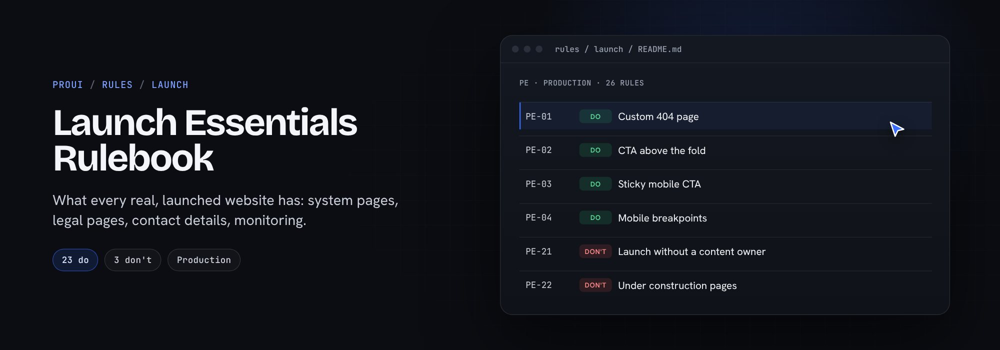

[All rulebooks](../README.md) · Prefix `PE` · Production · 26 rules

**What every real, launched website has: system pages, legal pages, contact details, monitoring.**

```text
Apply the Launch Essentials Rulebook (PE) to this page.
Review this page against PE-01 to PE-05.
Why does PE-01 matter here?
```

## Do · 23

What a finished, professional site does.

| ID | Rule | Details |
| --- | --- | --- |
| `PE-01` | **Custom 404 page** | In the site's design, with links home, to search and to key pages. |
| `PE-02` | **CTA above the fold** | The primary action is visible without scrolling on desktop and mobile. |
| `PE-03` | **Sticky mobile CTA** | On phones, the primary action stays reachable (for example a bar at the bottom) where it makes sense: product pages, booking, sign-up. |
| `PE-04` | **Mobile breakpoints** | Tested at roughly 360, 390, 768, 1024, 1440 and 1920 px. No horizontal scroll, tap targets at least 44 px. |
| `PE-05` | **Favicon set** | `favicon.ico` or SVG, `apple-touch-icon` (180 px), icons for Android and the web manifest. |
| `PE-06` | **Open Graph and social preview** | `og:title`, `og:description`, `og:image` (1200 × 630), Twitter card tags, per page where it matters. |
| `PE-07` | **Thank-you page or state** | After a form or an order, a confirmation with the next step. |
| `PE-08` | **Privacy policy page** | Required in the EU (GDPR) whenever the site collects any personal data, including analytics and newsletter emails. |
| `PE-09` | **Terms page** | Terms and conditions, required for shops and services. |
| `PE-10` | **Cookie banner** | Needed in the EU for non-essential cookies (analytics, marketing). "Reject" must be as easy as "Accept". Load those scripts only after consent. |
| `PE-11` | **Analytics installed** | Plausible, Umami, Google Analytics or similar, respecting consent. |
| `PE-12` | **Real contact details** | Real address, email, phone and company ID where applicable. |
| `PE-13` | **Version control** | The code lives in a Git repository with meaningful commits. |
| `PE-14` | **Accessibility basics** | Semantic HTML, labelled inputs, visible focus, keyboard navigation for every interactive element, `lang` attribute, reduced-motion support. |
| `PE-15` | **Accessibility statement** | For sites selling to EU consumers, an accessibility statement and a feedback channel for barriers, linked from the footer (`AX-24`). |
| `PE-16` | **Company details** | Legal name, registered address and company ID (in the Czech Republic the IČO, and DIČ if VAT registered) in the footer or contact page where the law asks for them. |
| `PE-17` | **Redirects from old URLs** | When a site replaces an old one, every old URL redirects with a 301 to its closest new page. |
| `PE-18` | **Email that arrives** | Form and order emails are sent from the site domain with SPF, DKIM and DMARC set up, and tested in common inboxes. |
| `PE-19` | **Uptime and error monitoring** | An uptime check and front-end error tracking are in place, alerting a real person. |
| `PE-20` | **Backups** | Content and databases are backed up automatically, and a restore has been tested at least once. |
| `PE-23` | **Consent before tracking** | Non-essential cookies, pixels, embedded videos and maps load only after the visitor agrees. The first layer of the banner offers Reject next to Accept, with the same size and style; no category is pre-ticked; a footer link reopens the choice. EU and Czech law require prior consent (Czech since 1 January 2022). See `blueprints/legal-and-trust.md`. |
| `PE-24` | **Security contact and status page** | Publish `/.well-known/security.txt` (RFC 9116) with `Contact` and `Expires`, and link "Report security issues" from the footer. Products people log in to, pay through or integrate with also link a status page hosted separately from the site. |
| `PE-25` | **Uploaded files are handled safely** | User uploads are checked for type and size on the server, renamed, stripped of metadata, stored privately and served through expiring links, never executed or rendered as HTML or SVG on the main domain, and deleted when their purpose ends, as the privacy policy says. |

## Don't · 3

What never ships.

| ID | Avoid | Details |
| --- | --- | --- |
| `PE-21` | **Launch without a content owner** | No site ships without someone named who keeps prices, opening hours, team and legal pages up to date. |
| `PE-22` | **Under construction pages** | No "coming soon" sections or empty pages in navigation. Ship what exists; add the rest when it is real. |
| `PE-26` | **Dark-pattern cookie banner** | Only "Accept all" and "Settings" on the first layer, a grey text link for reject next to a bright accept button, pre-ticked categories, cookie walls, or trackers that run before the choice. Authorities fine these. |

## How to check

- Open every system and legal page; test cookie consent in a fresh browser.
- Send a test through every form and check the email arrives.

## Sources

- [European Accessibility Act](https://eur-lex.europa.eu/eli/dir/2019/882/oj)
- [GDPR overview](https://gdpr.eu)

---

Previous: [Localisation Rulebook](../localization/README.md) · Next: [SEO Rulebook](../seo/README.md)

<sub>Generated from `rulebook.json` by `scripts/build-rulebooks.mjs`. To change a rule, edit the JSON and run the script.</sub>
