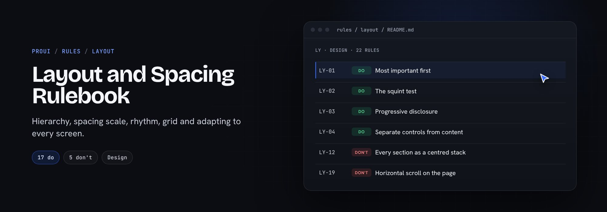

[All rulebooks](../README.md) · Prefix `LY` · Design · 26 rules

**Hierarchy, spacing scale, rhythm, grid and adapting to every screen.**

```text
Apply the Layout and Spacing Rulebook (LY) to this page.
Review this page against LY-01 to LY-05.
Why does LY-01 matter here?
```

## Do · 21

What a finished, professional site does.

| ID | Rule | Details |
| --- | --- | --- |
| `LY-01` | **Most important first** | People read top to bottom and from the start edge. The main message and action sit near the top and the leading side (`DC-07`, `PE-02`). |
| `LY-02` | **The squint test** | Blur the screen (or squint): you should still see one clear focal point, then two or three groups. If everything has equal weight, nothing leads. |
| `LY-03` | **Progressive disclosure** | Show what most people need; put the rest behind a link, a disclosure, a tab or the next page. Do not put every option on the first screen. |
| `LY-04` | **Separate controls from content** | Navigation and toolbars look like controls; content looks like content. A floating bar over content needs a clear edge or a scroll-edge fade, not a heavy box. |
| `LY-05` | **One spacing scale on a 4 px base** | For example 4, 8, 12, 16, 24, 32, 48, 64, 96, 128. Every margin, padding and gap comes from it (`DC-05`). |
| `LY-06` | **Proximity groups** | Space inside a group is clearly smaller than space between groups (at least about 1.5–2×). Spacing groups before borders or backgrounds do (`DC-08`, `SL-12`). |
| `LY-07` | **Vary the rhythm** | A page with the same gap everywhere is monotonous. Dense passages earn quiet ones; section spacing is larger than block spacing, which is larger than element spacing. |
| `LY-08` | **Use `gap`** | Lay out with flex/grid `gap` instead of margins on children, so spacing stays consistent and no stray margin collapses. |
| `LY-09` | **Comfortable padding** | Cards and buttons have enough inner padding that text never touches the edge; on phones, body text keeps at least 16 px from the screen edge (never under 12 px). |
| `LY-10` | **A grid with a reason** | A 12-column (or 4/8 on mobile) grid with fixed gutters, and content that sometimes breaks it on purpose. Align edges: things that look aligned must be aligned. |
| `LY-11` | **Alignment and indentation show hierarchy** | Items on the same edge read as siblings; indented items read as children. Do not centre everything. |
| `LY-13` | **Real content widths** | Text blocks capped by measure (`TY-10`); images and data allowed wider; the page container about 1200–1440 px with fluid side padding. |
| `LY-14` | **Same function on every size** | A smaller screen may show less at once (sidebar becomes a drawer, a table becomes cards or scrolls) but never removes a feature. |
| `LY-15` | **Container queries for components** | Components adapt to the space they get (`@container`), not only to the viewport, so the same card works in a sidebar and a main column. |
| `LY-16` | **Respect safe areas** | `env(safe-area-inset-*)` for fixed bars on phones with notches and home indicators; sticky CTAs sit above the home indicator (`PE-03`). |
| `LY-17` | **Reserve space for media** | Images, videos, embeds and ads have `width`/`height` or `aspect-ratio`, so nothing jumps while loading (`PF-03`). |
| `LY-18` | **A compact sticky header** | A sticky header stays short (about 56–72 px on desktop, less on phones) and may hide on scroll down and return on scroll up. |
| `LY-23` | **Every page works on a phone** <sub>HARD RULE</sub> | Build and check every page at 320, 360, 390 and 430 px, not only desktop: nothing overflows sideways, text fits its box and is start-aligned (`TY-25`), images are cropped or swapped for the narrow frame where needed, controls are at least 44 px, the navigation stays reachable, and every feature still works (`LY-14`, `LY-19`, `AX-08`). |
| `LY-24` | **Air between sections on phones** <sub>HARD RULE</sub> | Phones get their own spacing, not the desktop values scaled down: about 64–96 px between sections, 32–48 px between blocks inside a section and at least 12–16 px between related elements, with 16–24 px side padding (`LY-09`). If a phone screen looks crowded, add space before shrinking text. |
| `LY-25` | **Full-height sections in dvh** | A section meant to fill the screen uses `min-height: 100dvh` (or `100svh` when it must not jump as the browser bar hides), never `100vh`, which on phones is taller than the visible screen and hides the bottom under the browser bar (`LY-16`). |
| `LY-26` | **Tables on phones are rebuilt, not shrunk** <sub>HARD RULE</sub> | A table that does not fit a phone is not scaled down or left to scroll sideways at 11 px. Rebuild it in six moves: rank the columns by use (identity, value, state), stack each row into two lines (name left, value right, state below), keep one aligned slot for the numbers, label the ambiguous values (dates get a label, prices do not), reveal the rest on tap in an expanding row or a sheet (never a new page), and let the table own its breakpoint with a container query (`blueprints/tables-on-phones.md`, `DB-09`). |

## Don't · 5

What never ships.

| ID | Avoid | Details |
| --- | --- | --- |
| `LY-12` | **Every section as a centred stack** | Mix compositions: split, offset, full-bleed image, list, table, long text. A row of equal cards is the template (`SL-09`, `SL-57`). |
| `LY-19` | **Horizontal scroll on the page** | Nothing overflows the viewport sideways at any width from 320 px up. Wide tables and carousels scroll inside their own container. |
| `LY-20` | **Fixed heights on text containers** | Boxes that hold text grow with it. Fixed heights cut off translations, larger text and user zoom. |
| `LY-21` | **Full-width lines on large screens** | On wide screens text never runs edge to edge; the measure stays capped (`TY-10`) even when the layout is wide. |
| `LY-22` | **Content hidden behind sticky elements** | Sticky headers, footers, cookie bars and chat buttons never cover focused elements, anchors or the last line of content (`AX-17`). |

## Related anti-slop rules

Don'ts from the [Anti-Slop Rulebook](../anti-slop/README.md) that belong to this subject.

| ID | Avoid |
| --- | --- |
| `SL-09` | Three feature cards in a row |
| `SL-10` | Empty bento grids |
| `SL-11` | Generic three-tier pricing |
| `SL-12` | Containers with borders |
| `SL-13` | Overusing dividers |
| `SL-14` | Tags and pills everywhere |
| `SL-51` | Nested cards |
| `SL-57` | Icon tile stack |
| `SL-61` | Oversized H1 by reflex |

## How to check

- Screenshots at 360, 390, 768, 1024, 1440 and 1920 px.
- Blur a screenshot: the focal point and groups are still clear.

## Sources

- [Apple HIG: Layout](https://developer.apple.com/design/human-interface-guidelines/layout)
- [Fluent 2: Layout](https://fluent2.microsoft.design/layout)

---

Previous: [Effects and 3D Rulebook](../effects/README.md) · Next: [Page Structure Rulebook](../structure/README.md)

<sub>Generated from `rulebook.json` by `scripts/build-rulebooks.mjs`. To change a rule, edit the JSON and run the script.</sub>
