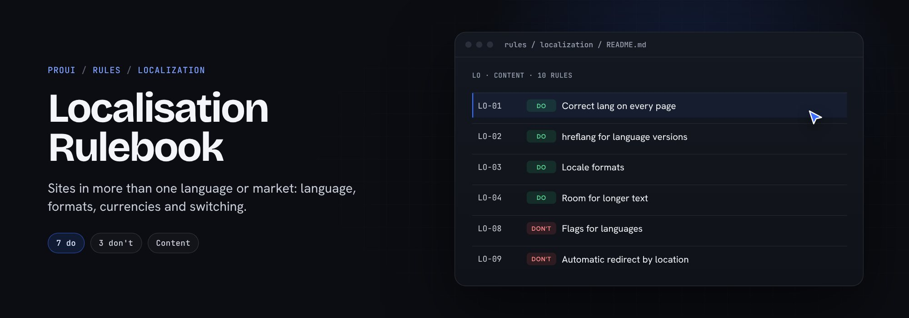

[All rulebooks](../README.md) · Prefix `LO` · Content · 10 rules

**Sites in more than one language or market: language, formats, currencies and switching.**

```text
Apply the Localisation Rulebook (LO) to this page.
Review this page against LO-01 to LO-05.
Why does LO-01 matter here?
```

## Do · 7

What a finished, professional site does.

| ID | Rule | Details |
| --- | --- | --- |
| `LO-01` | **Correct lang on every page** | `<html lang>` matches the page language, and passages in another language have their own `lang`. |
| `LO-02` | **hreflang for language versions** | Pages that exist in several languages link to each other with `hreflang`, including `x-default`. |
| `LO-03` | **Locale formats** | Dates, numbers, currencies and units are formatted for the locale with `Intl` APIs, never assembled by hand. |
| `LO-04` | **Room for longer text** | Layouts allow text that is 30–40 % longer than English and words that do not break (German, Czech). |
| `LO-05` | **Language switcher in native names** | The language switcher lists "Čeština", "Deutsch", "English", in the same place on every page, and keeps the user on the same page. |
| `LO-06` | **Translate everything** | Titles, meta descriptions, alt text, error messages, emails and legal pages are translated, not only the visible body. |
| `LO-07` | **Local currency and prices** | Prices show in the visitor's currency where the business supports it, with taxes as local law expects. |

## Don't · 3

What never ships.

| ID | Avoid | Details |
| --- | --- | --- |
| `LO-08` | **Flags for languages** | Flags stand for countries, not languages. Use language names. |
| `LO-09` | **Automatic redirect by location** | Never force a language or country version based on IP alone. Suggest it and let people stay. |
| `LO-10` | **Sentences built from fragments** | Never join translated pieces in code ("You have " + n + " items"); use full messages with placeholders and plural rules. |

## How to check

- Switch languages on a deep page: you stay on the same page.
- Check `lang`, `hreflang`, formats and long translations.

## Sources

- [Google: Localized versions (hreflang)](https://developers.google.com/search/docs/specialty/international/localized-versions)
- [MDN: Intl](https://developer.mozilla.org/en-US/docs/Web/JavaScript/Reference/Global_Objects/Intl)

---

Previous: [Copy and UX Writing Rulebook](../copy/README.md) · Next: [Launch Essentials Rulebook](../launch/README.md)

<sub>Generated from `rulebook.json` by `scripts/build-rulebooks.mjs`. To change a rule, edit the JSON and run the script.</sub>
