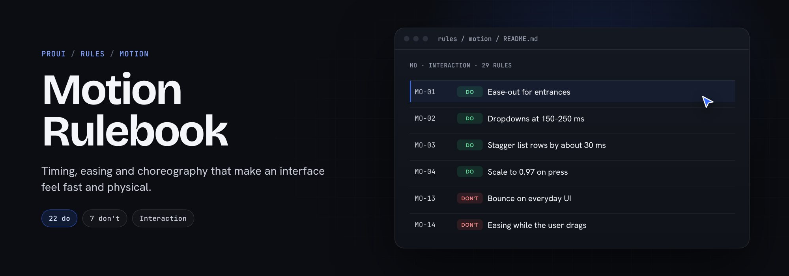

[All rulebooks](../README.md) · Prefix `MO` · Interaction · 41 rules

**Timing, easing and choreography that make an interface feel fast and physical.**

```text
Apply the Motion Rulebook (MO) to this page.
Review this page against MO-01 to MO-05.
Why does MO-01 matter here?
```

## Do · 33

What a finished, professional site does.

| ID | Rule | Details |
| --- | --- | --- |
| `MO-01` | **Ease-out for entrances** | Things that appear start fast and settle (for example `cubic-bezier(0.22, 1, 0.36, 1)`). |
| `MO-02` | **Dropdowns at 150–250 ms** | Menus, selects and tooltips open quickly. |
| `MO-03` | **Stagger list rows by about 30 ms** | Each row starts slightly after the previous one. Cap the total stagger so long lists do not crawl. |
| `MO-04` | **Scale to 0.97 on press** | Buttons shrink slightly while pressed. |
| `MO-05` | **Stretch moving knobs about 12 %** | A toggle knob or slider thumb stretches in its direction of travel while moving, then settles. |
| `MO-06` | **Stagger details as they settle** | The container arrives first, then its title, then the smaller details. |
| `MO-07` | **Arcs for object movement** | Objects travelling across the screen follow a slight curve, not a straight line. |
| `MO-08` | **Pulse to confirm success** | A short scale pulse (about 1 → 1.06 → 1) when something succeeds. |
| `MO-09` | **Ease-in-out for moves** | An element already on screen moving to a new position eases in and out. |
| `MO-10` | **Start popovers at 0.95** | Popovers and tooltips grow from 95 % scale and 0 opacity, not from zero. |
| `MO-11` | **Enter from the trigger** | Set `transform-origin` to the button that opened it, so the popover grows out of it. |
| `MO-12` | **Exit to the trigger** | On close it shrinks back towards the same point. |
| `MO-15` | **Make exits about 20 % shorter** | An exit runs about 20 % shorter than the matching entrance, so closing feels instant. |
| `MO-16` | **Overlap old and new states** | Crossfade between states so there is never an empty frame. |
| `MO-17` | **Masks for reveals and colour changes** | Reveal content or swap a colour with a moving `clip-path` mask rather than a plain fade. |
| `MO-18` | **Crossfade icons with blur** | When an icon changes (menu to close, copy to check), crossfade with a small blur (about 2–4 px) and a slight scale. |
| `MO-19` | **Rubber band past bounds** | Dragging or scrolling past an edge moves with increasing resistance, then springs back. |
| `MO-20` | **Reuse the same `layoutId`** | In Framer Motion (or a FLIP technique elsewhere), give the same element the same `layoutId` in both places so it travels between them: a card into its detail view, the underline of the active tab. |
| `MO-21` | **Native page transitions** | Use the View Transitions API for page and state transitions where it is supported, with an instant fallback. |
| `MO-22` | **Scroll-driven animation in CSS** | Prefer CSS scroll-driven animations (`animation-timeline`) over scroll listeners, with a static fallback. |
| `MO-23` | **Animate only transform and opacity** | Moving things use `transform` and `opacity`; filter and clip-path only for short, bounded moments. |
| `MO-29` | **One transition for filtering: fade out, swap, rise in** <sub>HARD RULE</sub> | When chips, tabs or categories filter a grid or list, the shown items fade out and drop about 14 px (opacity 450 ms, transform 600 ms), the set swaps after about 260 ms, then the new items fade in rising 14 px, about 45 ms apart. Use this and nothing else for filtering: no growing cards, clip-path reveals, scaling or shuffling layouts. Ready code: `effects/fx/filter-swap/`. |
| `MO-30` | **An intro loader only when the first screen is heavy** <sub>HARD RULE</sub> | Show a full-screen loader only when the first screen cannot work without something heavy: a 3D scene, compiled shaders, a large model or video that drives the page. An ordinary page paints its content at once, with no loader. While it shows, lock scrolling, keep the real page underneath, and give up after about 12 s: unlock and show the page as it is rather than waiting forever. It fades out over about 600 ms into a frame that is already rendered, never into a blank or half-built scene. |
| `MO-31` | **A loader shaped like the brand, not a spinner** <sub>SOFT</sub> | Build the loader from a few simple shapes taken from the brand or the subject (circles of a flower, a house, the logo's parts) and fill them one by one in the accent colour; skip the generic rotating ring. No outlines: an empty shape is the ink at about 7 % opacity, a full one is the accent. The fill flows in one direction (for example clockwise), each shape filling from the side of the previous one and emptying toward the next, in a 2.4–3 s loop with about 170 ms between shapes. It may be large on desktop (up to about 800 px wide, never taller than the screen) and about 76 px on phones. With reduced motion it shows the full shape without moving. Ready code: `effects/fx/petal-loader/`. |
| `MO-32` | **Warm up the scene behind the loader** <sub>HARD RULE</sub> | Use the loader time to play every stage of a scroll-driven scene once, out of sight: each material, light, shadow and effect variant is compiled and uploaded before the visitor can scroll, so the first scroll never stutters. Then jump back to where the page really is and start the intro from there. Do not replace the live scene with still images or a video of it while it warms up; visitors notice the swap. |
| `MO-34` | **Appear from 0.97, never from nothing** | Cards, dialogs, sheets and toasts that appear start at about `scale(0.97)` and opacity 0 and settle at 1. Starting from `scale(0)` looks like a jump cut and draws a moving outline (popovers: `MO-10`). |
| `MO-35` | **Shake a wrong password** | A rejected password or code shakes the field once (translateX 0, −10, 10, −6, 6, −3, 0 px over about 360 ms) as well as turning it red with a message. With reduced motion, only the colour and the message change. |
| `MO-36` | **Steps slide the way you are going** | In a stepper, wizard or multi-step form, the next step slides in from the right and the previous one leaves to the left; going back reverses it. A plain crossfade hides which way the person moved. |
| `MO-37` | **Accordions open to their real height** | Animate disclosure panels to `height: auto` with `:root { interpolate-size: allow-keywords }` (or `calc-size()`), so nobody measures heights in JavaScript or hard-codes a max-height. Browsers without it open instantly, which is a fine fallback. |
| `MO-38` | **No transitions during a theme switch** | While the colour theme changes, turn transitions off for one frame (`.theme-switching * { transition: none !important }`), so a hundred elements do not fade at different speeds. |
| `MO-39` | **Only the first tooltip waits** | The first tooltip opens after a short delay (about 400–600 ms); while one is open or was just closed, moving to the next control shows its tooltip at once, without the delay or the entrance animation. |
| `MO-40` | **Hand the release velocity to a spring** | When a dragged or flicked element is let go (a sheet, a card, a carousel), animate it to rest with a spring that starts from the release velocity (for example `animate(y, 0, { type: "spring", duration: 0.5, bounce: 0, velocity })`), not a fixed-duration transition that ignores how hard it was thrown (`MO-14`, `MO-19`). |
| `MO-41` | **The more often, the less motion** | Motion is inversely proportional to how often something is used: a once-a-session moment can animate, a command used fifty times a day (keyboard shortcuts, list navigation, a frequently opened menu) appears instantly. Respond in under 400 ms either way (`IX-16`). |

## Don't · 8

What never ships.

| ID | Avoid | Details |
| --- | --- | --- |
| `MO-13` | **Bounce on everyday UI** | No spring overshoot on menus, dialogs, toggles or tabs. Save bounce for rare playful moments. |
| `MO-14` | **Easing while the user drags** | While the user drags a slider, sheet or card, it follows the pointer 1:1 with no easing. Animate only after release. |
| `MO-24` | **Scroll hijacking** | Never take over the scroll wheel or trackpad to move the page in fixed steps, change its speed, or lock it until an animation ends. |
| `MO-25` | **Animating layout properties** | Never animate `width`, `height`, `top`, `left`, `margin` or `padding` in a loop; they force layout on every frame. |
| `MO-26` | **Motion that blocks input** | The user can click, scroll and type while something animates. No intro sequence holds the page hostage. |
| `MO-27` | **Parallax on text** | Text never moves at a different speed than the page. Parallax, if any, is for background imagery and stops for reduced motion. |
| `MO-28` | **Endless decorative loops** | No looping animation on content that people read or use (rotating badges, pulsing buttons, floating cards). |
| `MO-33` | **Clipping a moving fill with an SVG clipPath** <sub>SOFT</sub> | A CSS transform animation inside an SVG `clipPath` can be moved to the compositor and drawn outside the clip in Chrome. For a fill that slides into a shape, use an HTML element with `border-radius` and `overflow: hidden` around the moving element, which clips reliably, or animate SVG attributes instead of CSS transforms. |

## Related anti-slop rules

Don'ts from the [Anti-Slop Rulebook](../anti-slop/README.md) that belong to this subject.

| ID | Avoid |
| --- | --- |
| `SL-35` | Everything fades in on scroll |
| `SL-36` | Bouncy everyday UI |
| `SL-68` | Marquee filler |
| `SL-69` | Pulsing dots and blinking cursors |
| `SL-72` | Content hidden at rest |

## How to check

- Record the signature moment; check the performance panel for long frames.
- Turn on reduced motion and check every animation has a calm alternative.

## Sources

- [Apple HIG: Motion](https://developer.apple.com/design/human-interface-guidelines/motion)
- [MDN: View Transitions API](https://developer.mozilla.org/en-US/docs/Web/API/View_Transition_API)

---

Previous: [States Rulebook](../states/README.md) · Next: [Accessibility Rulebook](../accessibility/README.md)

<sub>Generated from `rulebook.json` by `scripts/build-rulebooks.mjs`. To change a rule, edit the JSON and run the script.</sub>
