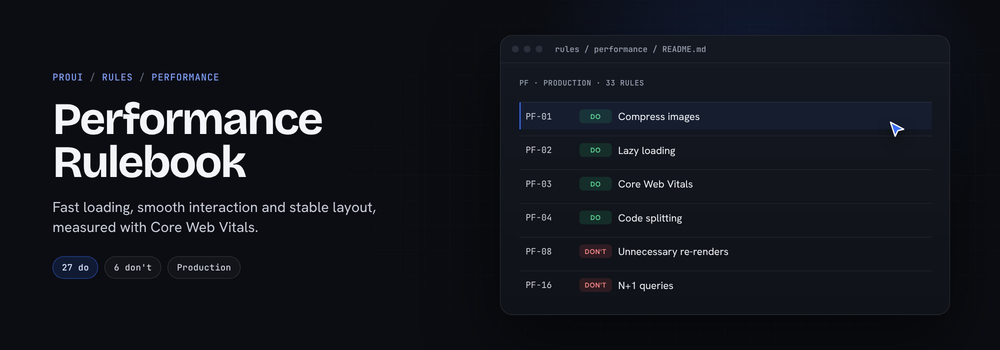

[All rulebooks](../README.md) · Prefix `PF` · Production · 33 rules

**Fast loading, smooth interaction and stable layout, measured with Core Web Vitals.**

```text
Apply the Performance Rulebook (PF) to this page.
Review this page against PF-01 to PF-05.
Why does PF-01 matter here?
```

## Do · 27

What a finished, professional site does.

| ID | Rule | Details |
| --- | --- | --- |
| `PF-01` | **Compress images** | Modern formats (AVIF/WebP), correct dimensions, `srcset` and `sizes`, explicit `width` and `height` to prevent layout shift. |
| `PF-02` | **Lazy loading** | Images, iframes and heavy sections below the fold load lazily (`loading="lazy"`); nothing in the first viewport does. |
| `PF-03` | **Core Web Vitals** | Good LCP (under 2.5 s), INP (under 200 ms) and CLS (under 0.1). |
| `PF-04` | **Code splitting** | Load only the JavaScript the current page needs. |
| `PF-05` | **Minify JS and CSS** | Production builds minify JavaScript and CSS; any modern bundler does this when configured for production. |
| `PF-06` | **Defer non-critical scripts** | Analytics, chat and embeds load with `defer`, `async` or after interaction. |
| `PF-07` | **Remove unused dependencies** | Uninstall packages nothing imports, and replace heavy libraries used for one small function with a few lines of code or a lighter alternative. |
| `PF-09` | **Debounce input handlers** | Search-as-you-type waits about 250–300 ms after the last keystroke. |
| `PF-10` | **Paginate or virtualise long lists** | Lists of more than about 50–100 items are paginated, loaded in batches, or virtualised so only visible rows are rendered. |
| `PF-11` | **Use a CDN** | Static files are served from a CDN close to visitors. |
| `PF-12` | **Cache API responses** | API responses are cached on the client and the server wherever the data allows. |
| `PF-13` | **Server-side caching** | Rendered pages or fragments are cached on the server or at the edge. |
| `PF-14` | **Cache expensive queries** | Expensive queries (statistics, rankings) are cached and refreshed on a schedule instead of computed per request. |
| `PF-15` | **Index the database** | Columns used for lookups, filters and sorting have database indexes. |
| `PF-17` | **Compress API payloads** | Return only needed fields; enable gzip or brotli. |
| `PF-18` | **Database connection pooling** | Servers reuse a pool of database connections instead of opening a new one per request; serverless functions use the provider's pooler. |
| `PF-19` | **Load balancing** | When traffic needs more than one server, a load balancer spreads it and health checks remove broken instances. |
| `PF-20` | **Lighthouse audit** | Run Lighthouse before launch on every page type, on mobile, and fix what it flags. |
| `PF-21` | **Heavy visuals stay light** | WebGL, video and large animations render only while visible, cap pixel ratio and frame rate, and have a static fallback for weak devices and reduced motion. |
| `PF-22` | **Prioritise the LCP image** | The largest image above the fold is a real `` in the HTML with `fetchpriority="high"`, never lazy-loaded. |
| `PF-23` | **Preconnect to critical origins** | `<link rel="preconnect">` for the one or two third-party origins needed above the fold (fonts, image CDN). |
| `PF-24` | **Long cache for hashed assets** | Fingerprinted files get `Cache-Control: public, max-age=31536000, immutable`; HTML is revalidated. |
| `PF-25` | **Critical CSS first** | CSS needed for the first screen is inlined or loaded first; the rest does not block rendering. |
| `PF-26` | **A performance budget** | Agree limits (for example under about 170 KB of compressed JavaScript for the first load, LCP under 2.5 s on a mid-range phone) and check them in CI (`GH-11`). |
| `PF-27` | **Keep the back/forward cache working** | No `unload` handlers and no `Cache-Control: no-store` on normal pages, so Back is instant. |
| `PF-28` | **Break up long tasks** | JavaScript work over about 50 ms is split up or moved to a worker so input stays responsive (INP under 200 ms). |
| `PF-29` | **Skip off-screen rendering** | `content-visibility: auto` with `contain-intrinsic-size` on long pages with heavy sections below the fold. |

## Don't · 6

What never ships.

| ID | Avoid | Details |
| --- | --- | --- |
| `PF-08` | **Unnecessary re-renders** | In React and similar: keep state local, memoise expensive parts, avoid new objects in props on every render. |
| `PF-16` | **N+1 queries** | Load related data in one query (JOIN, eager loading), not one query per item. |
| `PF-30` | **Client-rendering static pages** | Do not ship a JavaScript app to render content that never changes per visitor. Pre-render it. |
| `PF-31` | **Autoplaying hero video on mobile data** | Large background videos do not autoplay on small screens or with `prefers-reduced-data`; show a poster image. |
| `PF-32` | **Too many third-party scripts** | Every tag, widget and pixel costs performance and privacy. Remove what nobody looks at; load the rest after interaction or consent. |
| `PF-33` | **Huge DOM** | Avoid pages with thousands of nodes. Paginate, virtualise or simplify markup (about 1,500 nodes is a warning sign). |

## How to check

- Lighthouse on mobile for each page type; PageSpeed Insights field data once live.
- Check bundle sizes against the budget in CI.

## Sources

- [web.dev: Web Vitals](https://web.dev/articles/vitals)
- [web.dev: Optimize LCP](https://web.dev/articles/optimize-lcp)
- [web.dev: INP](https://web.dev/articles/inp)

---

Previous: [SEO Rulebook](../seo/README.md) · Next: [Security Rulebook](../security/README.md)

<sub>Generated from `rulebook.json` by `scripts/build-rulebooks.mjs`. To change a rule, edit the JSON and run the script.</sub>
