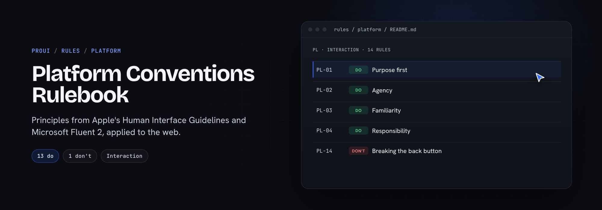

[All rulebooks](../README.md) · Prefix `PL` · Interaction · 14 rules

**Principles from Apple's Human Interface Guidelines and Microsoft Fluent 2, applied to the web.**

```text
Apply the Platform Conventions Rulebook (PL) to this page.
Review this page against PL-01 to PL-05.
Why does PL-01 matter here?
```

## Do · 13

What a finished, professional site does.

| ID | Rule | Details |
| --- | --- | --- |
| `PL-01` | **Purpose first** | Know what the product is for and make those few things great before adding anything else. Every element earns its place; simplicity is not the same as minimalism. |
| `PL-02` | **Agency** | Let people move freely, skip guided flows, and recover from mistakes. Forgiveness (undo, back, drafts) makes people confident to explore (`IX-15`). |
| `PL-03` | **Familiarity** | Build on patterns people know from the web and their OS. Familiar controls in the expected place beat clever new ones (`IX-02`). |
| `PL-04` | **Responsibility** | Be transparent about what the product does with data, ask for permissions with a reason at the moment they are needed, collect only what is needed (`SEC-17`). |
| `PL-05` | **Delight is not decoration** | Delight comes from the sum of care: speed, clear feedback, kind words in errors, one well-made moment. Effects that slow the task are not delight. |
| `PL-06` | **Respect user settings** | Colour scheme, reduced motion, reduced transparency, more contrast, text size and language preferences of the browser and OS are honoured, not overridden. |
| `PL-07` | **Materials only in the control layer** | Translucent "glass" belongs to bars and overlays that float over content (a header over a photo, a sheet over a map), never to content cards, and never stacked glass on glass. Text on glass uses a thicker material or a scrim (`SL-04`). |
| `PL-08` | **Concentric corners** | Nested radii follow the parent: inner radius = outer radius − padding (`DC-14`). Radii come from a small radius scale. |
| `PL-09` | **Elevation by meaning** | A small elevation ramp (for example rest, raised, popover, dialog) where higher means more temporary and more important. Shadows are soft, low and few (`SL-05`, `SL-53`). |
| `PL-10` | **Platform-appropriate input** | Hover and right-click on desktop, large targets and thumb reach on phones, visible focus for keyboard, and voice/screen-reader-friendly labels. |
| `PL-11` | **Same experience across sizes** | Content and controls keep predictable positions when the window resizes; layouts change structure (tab bar to sidebar), not function (`LY-14`). |
| `PL-12` | **Native app look on the web only when it is an app** | A web app may borrow platform patterns (sidebar, toolbar, segmented controls); a marketing site should not dress up as an operating system. |
| `PL-13` | **Respect the reading direction** | Use logical CSS properties (`margin-inline-start`, `inset-inline-end`) so layouts mirror correctly for right-to-left languages. |

## Don't · 1

What never ships.

| ID | Avoid | Details |
| --- | --- | --- |
| `PL-14` | **Breaking the back button** | Navigation, filters and opened items create history entries where people expect them, and Back always returns to the previous view. |

## How to check

- Change OS settings (dark mode, reduced motion, larger text, more contrast) and reload.

## Sources

- [Apple HIG: Design principles](https://developer.apple.com/design/human-interface-guidelines/design-principles)
- [Apple HIG: Materials](https://developer.apple.com/design/human-interface-guidelines/materials)
- [Fluent 2](https://fluent2.microsoft.design)

---

Previous: [Accessibility Rulebook](../accessibility/README.md) · Next: [Dashboards and Product UI Rulebook](../dashboards/README.md)

<sub>Generated from `rulebook.json` by `scripts/build-rulebooks.mjs`. To change a rule, edit the JSON and run the script.</sub>
