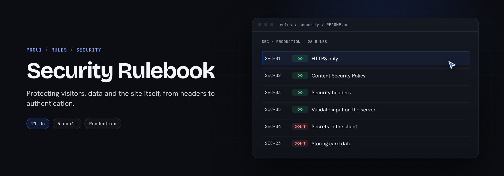

[All rulebooks](../README.md) · Prefix `SEC` · Production · 40 rules

**Protecting visitors, data, money and the budget: from headers to authentication, access control, prices and paid APIs. Attack library and checklist: security/.**

```text
Apply the Security Rulebook (SEC) to this page.
Review this page against SEC-01 to SEC-05.
Why does SEC-01 matter here?
```

## Do · 30

What a finished, professional site does.

| ID | Rule | Details |
| --- | --- | --- |
| `SEC-01` | **HTTPS only** | The site is served only over HTTPS, with HSTS (`Strict-Transport-Security: max-age=31536000; includeSubDomains`) once HTTPS is confirmed working. |
| `SEC-02` | **Content Security Policy** | A CSP header (or meta tag on static hosting) that allows only the origins the site really uses; no `unsafe-eval`, avoid `unsafe-inline` for scripts (use nonces or hashes). |
| `SEC-03` | **Security headers** | `X-Content-Type-Options: nosniff`, `Referrer-Policy: strict-origin-when-cross-origin`, `Permissions-Policy` that turns off unused features (camera, microphone, geolocation), and `frame-ancestors 'none'` (or `X-Frame-Options: DENY`) unless embedding is wanted. |
| `SEC-05` | **Validate input on the server** | Every form and API endpoint checks type, length and format on the server, not only in the browser. |
| `SEC-06` | **Escape output** | Never insert user content as HTML (`innerHTML`, `dangerouslySetInnerHTML`, `v-html`) without sanitising it; prefer text nodes. |
| `SEC-07` | **Injection-safe data access** | Parameterised queries or an ORM; no string-built SQL; the database user has only the rights it needs. |
| `SEC-08` | **Forms protected from abuse** | CSRF protection on state-changing requests, rate limiting, and spam protection that does not punish people (honeypot field, time check, or a privacy-friendly challenge). |
| `SEC-09` | **Safe cookies and sessions** | `Secure`, `HttpOnly` and `SameSite=Lax` (or `Strict`) cookies; sessions expire; log-out really ends the session. |
| `SEC-10` | **Authentication done properly** | When the site has accounts: use a proven provider or library, hash passwords with a slow algorithm (argon2 or bcrypt), offer two-factor where it matters, and never reveal whether an email is registered. |
| `SEC-11` | **Safe uploads** | When the site accepts files: check type and size on the server, rename files, store them outside the web root or in object storage, and never execute them. |
| `SEC-12` | **Restricted CORS** | Allow only the origins that need the API; never `*` with credentials. |
| `SEC-13` | **Third-party code is pinned and checked** | Exact versions for CDN scripts with Subresource Integrity (`integrity` + `crossorigin`), sandboxed iframes for embeds, as few third-party scripts as possible. |
| `SEC-14` | **Dependencies audited** | Run `npm audit` (or the stack's equivalent) and fix high and critical issues; remove unused packages (`PF-07`); keep a lockfile. |
| `SEC-15` | **Errors without leaks** | Production error pages and API errors show a friendly message, never stack traces, file paths, queries or versions. |
| `SEC-16` | **Safe external links** | `rel="noopener noreferrer"` on links that open in a new tab. |
| `SEC-17` | **Collect only what is needed** | Minimal personal data, stored securely, with a retention period and a way to delete it; matches the privacy policy (`PE-08`). |
| `SEC-18` | **Security contact** | `/.well-known/security.txt` with a contact address for reporting issues. |
| `SEC-19` | **Rate-limit sign-in and forms** | Repeated failed sign-ins, password resets and form posts are slowed down or blocked per IP and account. |
| `SEC-20` | **Verify webhooks** | Incoming webhooks (payments, forms) are checked by signature before anything happens. |
| `SEC-21` | **Least-privilege keys** | API keys and service accounts have only the rights they need, and are rotated when people leave or keys leak. |
| `SEC-22` | **Expiring reset links** | Password reset and magic links are single-use and expire within about an hour. |
| `SEC-27` | **Check the owner on every object** <sub>HARD RULE</sub> | Every read, change or download of a private object (order, invoice, file, message, profile) is filtered by the signed-in user on the server: `where: { id, userId: session.user.id }`, answering 404 otherwise. Changing the ID in the URL must never show someone else's data. Add row-level security in the database as a second wall where it exists (`security/attacks/access-control.md`, AT-10). |
| `SEC-28` | **Admin routes checked on the server** <sub>HARD RULE</sub> | Every admin page and every admin API route checks the role on the server, from the session or the database, inside the handler as well as in middleware. A hidden link, an unlisted URL or a client-side check is not protection. Staff accounts use two-factor sign-in (AT-11). |
| `SEC-29` | **Allow-list the fields a request may set** <sub>HARD RULE</sub> | Never save a request body as it came (`create({ data: req.body })`). Parse it with a schema that lists the allowed fields, so `role`, `isAdmin`, `credits`, `price` or `verified` sent by an attacker are dropped (AT-12). |
| `SEC-30` | **The server sets every price** <sub>HARD RULE</sub> | The browser sends what the person wants (product, variant, quantity, coupon code); the server looks up prices, discounts, shipping and tax and computes the total, and creates the payment amount itself. Quantities are whole numbers from 1 to a sensible maximum; totals never go below zero (AT-30, AT-31). |
| `SEC-31` | **One-time things are used atomically** <sub>HARD RULE</sub> | Coupons, gift-card balances, referral bonuses, the last item in stock and one-time codes are checked and used in one atomic step (a conditional `UPDATE ... WHERE used_at IS NULL RETURNING`, a unique constraint or a locking transaction). Money-moving requests carry an idempotency key, so a double click or a replay creates one order (AT-33, AT-34). |
| `SEC-32` | **Budgets and limits on every paid API** <sub>HARD RULE</sub> | Every paid service (AI, maps, search, SMS, voice, storage egress) has a hard budget with alerts at the provider, per-user and per-IP rate limits, and limits fixed on the server: the model, the maximum output tokens, the number of tool calls, the voice minutes. Expensive calls need sign-in; repeated results are cached; images are resized once and served from a CDN with hotlinking blocked (AT-70, AT-83). |
| `SEC-35` | **Server-side fetches only to allowed hosts** | A feature that fetches a URL given by a user (link previews, imports, webhooks to test) fetches only allow-listed hosts, refuses private, loopback and link-local addresses after resolving and after redirects, and has short timeouts and size limits (AT-52). |
| `SEC-36` | **Redirect only to your own paths** | `next`, `returnTo` and `callbackUrl` parameters accept only relative paths on the same site (starting with `/`, not `//`), checked against an allow-list; OAuth redirect URIs are registered exactly (AT-42, AT-25). |
| `SEC-39` | **Verify the email before it counts** | A new account's email is verified before it can receive credits, invite others, send email through the site or become an admin, and before it is linked to an existing account. Otherwise anyone can sign up as someone else or farm free credits (`AT-71`). |

## Don't · 10

What never ships.

| ID | Avoid | Details |
| --- | --- | --- |
| `SEC-04` | **Secrets in the client** | API keys with write access, tokens and passwords never appear in front-end code, the repository or build output. Use environment variables on the server; commit an `.env.example`, never `.env`. |
| `SEC-23` | **Storing card data** | Never store or log card numbers. Use the payment provider's hosted fields or checkout. |
| `SEC-24` | **Exposed internals on the server** | No reachable `.git`, `.env`, backups, directory listings or server version headers in production. |
| `SEC-25` | **Your own crypto** | Never invent hashing, encryption or token schemes. Use the platform's and well-known libraries' implementations. |
| `SEC-26` | **Personal data in logs and URLs** | Logs, analytics and URLs never contain passwords, tokens, card data or unnecessary personal data. |
| `SEC-33` | **AI features that trust the prompt** <sub>HARD RULE</sub> | Never treat a system prompt as a security boundary or let a model's answer grant anything. Put no secrets in prompts; give tools the least power (read-only, one user's data); confirm side effects with the user; render model output as sanitised text so it cannot load outside images or run scripts; build each user's context only from their own data (AT-80 to AT-82). |
| `SEC-34` | **Secrets in Git, now or ever** <sub>HARD RULE</sub> | `.env*` files are ignored before the first commit, with a `.env.example` of names only; a secret scan runs before commits and in CI. A key that was ever pushed is rotated at the provider first, then removed from the history, because it must be assumed copied (AT-61). |
| `SEC-37` | **File paths and shell commands from input** | Never build a file path, an archive entry path or a shell command from user input. Map IDs to stored paths, check that resolved paths stay inside their folder, and call programs with `execFile` and an argument array (AT-04, AT-51). |
| `SEC-38` | **Session tokens in localStorage** <sub>HARD RULE</sub> | Never keep session or refresh tokens in `localStorage` or `sessionStorage`: any script on the page, including an XSS or a compromised third-party script, can read them. Use `HttpOnly`, `Secure`, `SameSite` cookies set by the server (`SEC-09`). |
| `SEC-40` | **Public storage buckets** <sub>HARD RULE</sub> | Storage buckets (S3, Supabase Storage, Firebase Storage, R2) are private by default. Only intentionally public assets (product images, the logo) live in a public bucket; user uploads, invoices and exports are served through short-lived signed URLs after an ownership check (`SEC-27`, `PE-25`). |

## How to check

- Run `node scripts/proui-security-scan.mjs . --build <build dir>` and fix every hard finding.
- Go through security/CHECKLIST.md at the right level and run the self-tests in security/PROBES.md against localhost or staging.
- `curl -I` the live site for headers; `npm audit`.

## Sources

- [OWASP Top 10](https://owasp.org/www-project-top-ten/)
- [MDN: HTTP security headers](https://developer.mozilla.org/en-US/docs/Web/HTTP/Headers)
- [securityheaders.com](https://securityheaders.com)

---

Previous: [Performance Rulebook](../performance/README.md) · Next: [GitHub Workflow Rulebook](../github/README.md)

<sub>Generated from `rulebook.json` by `scripts/build-rulebooks.mjs`. To change a rule, edit the JSON and run the script.</sub>
