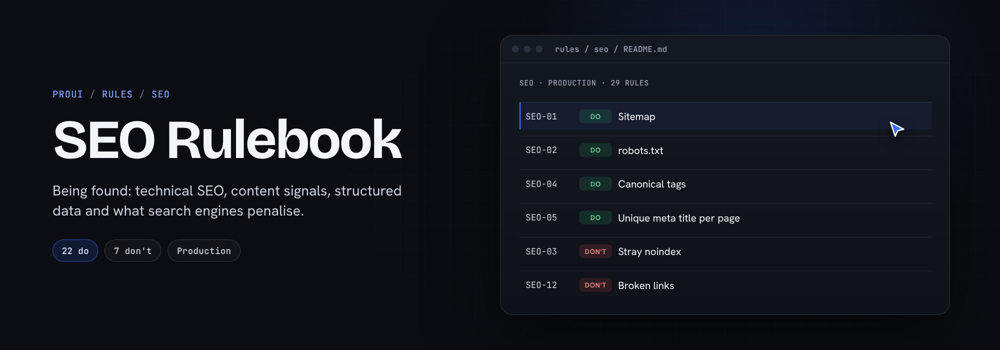

[All rulebooks](../README.md) · Prefix `SEO` · Production · 29 rules

**Being found: technical SEO, content signals, structured data and what search engines penalise.**

```text
Apply the SEO Rulebook (SEO) to this page.
Review this page against SEO-01 to SEO-05.
Why does SEO-01 matter here?
```

## Do · 22

What a finished, professional site does.

| ID | Rule | Details |
| --- | --- | --- |
| `SEO-01` | **Sitemap** | A `sitemap.xml` lists every public page and is linked from robots.txt. |
| `SEO-02` | **robots.txt** | A `robots.txt` allows the public site and blocks private areas. |
| `SEO-04` | **Canonical tags** | One canonical URL per page (`<link rel="canonical">`). |
| `SEO-05` | **Unique meta title per page** | Specific, about 60 characters at most. |
| `SEO-06` | **Unique meta description per page** | About 155 characters, written to earn the click. |
| `SEO-07` | **One H1 per page** | Each page has exactly one H1 that states what the page is about. |
| `SEO-08` | **Logical heading order** | H1 → H2 → H3, no skipped levels for styling reasons. |
| `SEO-09` | **Alt text on meaningful images** | Every meaningful image has alt text; purely decorative images have an empty `alt=""`. |
| `SEO-10` | **Schema markup** | JSON-LD for the relevant types: Organization, Product, Article, FAQPage, BreadcrumbList, LocalBusiness. |
| `SEO-11` | **Internal links** | Related pages link to each other with descriptive anchor text. |
| `SEO-13` | **Clean URL slugs** | `/shop/m1-puffer`, not `/page?id=8273`. |
| `SEO-14` | **HTTPS everywhere** | Every page is served over HTTPS, with a permanent redirect from http. |
| `SEO-15` | **Search Console verified** | The site is verified in Google Search Console and the sitemap is submitted. |
| `SEO-16` | **llms.txt** | An `llms.txt` at the site root gives a short plain description of the site and links to its key pages for AI assistants. |
| `SEO-17` | **Server-rendered content** | Main content and links are in the HTML the server sends (static or server-rendered), not only built by JavaScript in the browser. |
| `SEO-18` | **301 redirects for moved pages** | Changed URLs redirect permanently to the new address; nothing important returns 404 after a redesign. |
| `SEO-19` | **Real 404 status** | Missing pages return HTTP 404 (not 200 with an error message), so they are not indexed as "soft 404s". |
| `SEO-20` | **Descriptive image file names** | `m1-puffer-jacket-black.avif`, not `IMG_2381.jpg`. |
| `SEO-21` | **Breadcrumbs with structured data** | Deeper pages show breadcrumbs and mark them up as BreadcrumbList. |
| `SEO-22` | **Show who is behind the site** | About, contact and author information make the site trustworthy to people and search engines. |
| `SEO-23` | **Local business consistency** | Local businesses keep name, address and phone identical on the site, Google Business Profile and directories, and add LocalBusiness schema with opening hours. |
| `SEO-24` | **Accurate sitemap dates** | `lastmod` in the sitemap changes only when the page content really changes. |

## Don't · 7

What never ships.

| ID | Avoid | Details |
| --- | --- | --- |
| `SEO-03` | **Stray noindex** | Make sure no public page still carries a `noindex` left from development. |
| `SEO-12` | **Broken links** | Check every internal and external link before launch. |
| `SEO-25` | **Intrusive interstitials** | No pop-up that covers the main content right after arriving from search, especially on phones. Legal banners (cookies, age checks) are the exception. |
| `SEO-26` | **Duplicate pages** | No identical content under several URLs (with and without slash, parameters, http and https). Pick one and point canonicals and redirects to it. |
| `SEO-27` | **Keyword stuffing and hidden text** | No repeated keywords for search engines, no text hidden from people. Write for readers. |
| `SEO-28` | **Doorway pages** | No near-identical pages for every city or keyword. One good page per real offer. |
| `SEO-29` | **Orphan pages** | Every page that should rank is linked from at least one other page and listed in the sitemap. |

## How to check

- View source for head tags; validate structured data; Lighthouse SEO.
- Crawl the site for broken links, redirects and noindex.
- Submit the sitemap in Search Console.

## Sources

- [Google Search Essentials](https://developers.google.com/search/docs/essentials)
- [Google spam policies](https://developers.google.com/search/docs/essentials/spam-policies)
- [Schema.org](https://schema.org)

---

Previous: [Launch Essentials Rulebook](../launch/README.md) · Next: [Performance Rulebook](../performance/README.md)

<sub>Generated from `rulebook.json` by `scripts/build-rulebooks.mjs`. To change a rule, edit the JSON and run the script.</sub>
