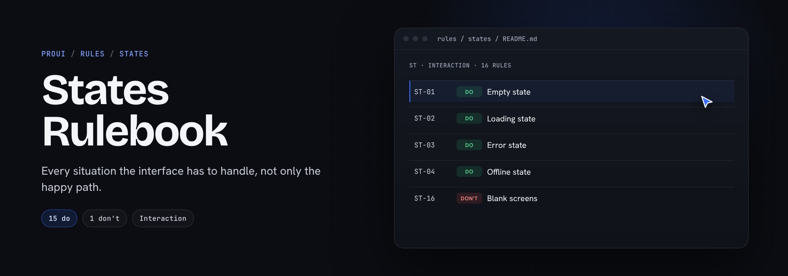

[All rulebooks](../README.md) · Prefix `ST` · Interaction · 21 rules

**Every situation the interface has to handle, not only the happy path.**

```text
Apply the States Rulebook (ST) to this page.
Review this page against ST-01 to ST-05.
Why does ST-01 matter here?
```

## Do · 20

What a finished, professional site does.

| ID | Rule | Details |
| --- | --- | --- |
| `ST-01` | **Empty state** | Before there is any data, explain what this place is for and give one clear action ("Create your first project"). |
| `ST-02` | **Loading state** | Skeletons that match the final layout, disabled and busy buttons, progress where the duration is known. The wait should look active. |
| `ST-03` | **Error state** | Say what happened in plain words and give a way out: retry, go back, contact support. Never only "Something went wrong". |
| `ST-04` | **Offline state** | Tell the user they are offline (a small bar), keep already loaded content visible, queue or disable actions that need the network. |
| `ST-05` | **Slow network** | Show incremental progress and partial content. A spinner that never changes looks frozen; after a few seconds, say that it is still working. |
| `ST-06` | **Zero search results** | Offer a spelling fix, related results, popular items or a way to clear filters. Never a dead end. |
| `ST-07` | **Permission denied** | Explain why access is blocked and how to get it ("Ask an admin", "Allow camera in browser settings"). |
| `ST-08` | **Session expiry** | Save drafts and form input before signing the user out, and restore them after they sign back in. |
| `ST-09` | **Form validation** | Errors appear inline at the exact field, in plain words, after the user leaves the field or submits. Focus moves to the first error. Correct tab order, Enter submits, visible focus rings. |
| `ST-10` | **Success state** | Confirm completion clearly and offer the next step ("Track your order", "Continue shopping"). |
| `ST-11` | **Stale data says so** | When data might be old, show when it was last updated and offer a refresh. |
| `ST-12` | **Partial content** | When part of a page fails, show what loaded and explain what did not, with a retry for that part only. |
| `ST-13` | **Concurrent edits** | When two people can edit the same thing, detect conflicts and let the user choose what to keep instead of silently overwriting. |
| `ST-14` | **First run** | The very first visit to a product area has a short orientation or a useful default, which can be skipped and never comes back unasked. |
| `ST-15` | **Maintenance and rate limits** | Planned downtime and rate limits get their own friendly page or message with a time when it will work again. |
| `ST-17` | **Every request has a timeout and a way out** <sub>HARD RULE</sub> | Every request, in the browser and on the server, has a timeout (10–15 s for normal calls), after which the screen shows what happened and a retry. Reads (GET) retry once or twice with exponential backoff; writes retry only with an idempotency key (`SEC-31`). After about 3 s of waiting, say that it is still working (`ST-05`). Use one shared request helper (`production/RESILIENCE.md`). |
| `ST-18` | **Unexpected answers do not crash the screen** | Before parsing a response, check the status and the `content-type`. Hotel and airport Wi-Fi, proxies and error pages answer with HTML, so `res.json()` throws "Unexpected token <". Show a message that names the likely cause ("Your network is asking you to sign in") and a retry, never a crash or a blank screen. |
| `ST-19` | **The payment result survives a lost connection** <sub>HARD RULE</sub> | After paying, the order status comes from the server (the provider's webhook), not from the browser finishing the redirect. If the connection drops, the success page checks the order again on reconnect and shows the real result. Never show "Payment failed, try again" when the outcome is unknown: say it is being confirmed, so nobody pays twice. |
| `ST-20` | **Links to deleted things land on a clear page** | Shared links, push notifications, emails, bookmarks and search results can point at something that was deleted. They open a page that says so ("This post was deleted") with a way back, keep replies and threads in place with a placeholder, and never crash on missing data. |
| `ST-21` | **Deleting is designed, not an afterthought** <sub>HARD RULE</sub> | For every thing a user can delete, decide before building what happens to everything that points at it (shares, replies, team members, subscriptions, saved cards, caches, reports), whether it can be undone, and how a large delete runs. Cancel subscriptions before deleting accounts, require a replacement before removing the card in use, soft-delete with undo, run big deletes as resumable background jobs, and make deletes idempotent (`production/RESILIENCE.md`). |

## Don't · 1

What never ships.

| ID | Avoid | Details |
| --- | --- | --- |
| `ST-16` | **Blank screens** | A page is never empty white while it loads, fails or has no data. Every wait and every failure shows something useful. |

## How to check

- Throttle the network, go offline, empty the data, send bad input, and screenshot each state.

## Sources

- [NN/g: Error message guidelines](https://www.nngroup.com/articles/error-message-guidelines/)

---

Previous: [Forms and Checkout Rulebook](../forms/README.md) · Next: [Motion Rulebook](../motion/README.md)

<sub>Generated from `rulebook.json` by `scripts/build-rulebooks.mjs`. To change a rule, edit the JSON and run the script.</sub>
