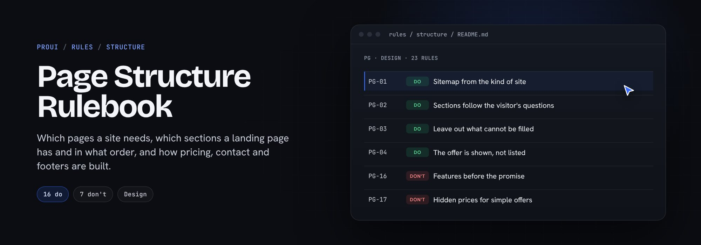

[All rulebooks](../README.md) · Prefix `PG` · Design · 28 rules

**Which pages a site needs, which sections a landing page has and in what order, and how pricing, contact and footers are built.**

```text
Apply the Page Structure Rulebook (PG) to this page.
Review this page against PG-01 to PG-05.
Why does PG-01 matter here?
```

## Do · 20

What a finished, professional site does.

| ID | Rule | Details |
| --- | --- | --- |
| `PG-01` | **Sitemap from the kind of site** | Start from the sitemap for the kind of site in `blueprints/site-types.md` and cut every page the business cannot fill with real content. |
| `PG-02` | **Sections follow the visitor's questions** | Order the landing page as promise, proof, detail, objections, action: hero, proof strip, product or services, how it works, deep proof, pricing, FAQ, final CTA, footer (`blueprints/landing-page.md`). |
| `PG-03` | **Leave out what cannot be filled** | A section without real content is removed, not faked with placeholders, stock quotes or invented numbers. Missing content goes on the list in `DECISIONS.md`. |
| `PG-04` | **The offer is shown, not listed** | Services and features appear with real screenshots, photos, a demo or examples of the result, close to the top of the page. |
| `PG-05` | **The primary action repeats** | The same primary action appears in the header, the hero, after the offer, after pricing and in the final CTA, and as a sticky bar on mobile once the hero button has scrolled away. |
| `PG-06` | **Every page has a next step** | Inner pages (service, feature, case study, about) end with the primary action or a link to the page that closes the decision. |
| `PG-07` | **Proof is specific and named** | Three to five testimonials with name, role and permission, client logos with permission, numbers with source and date. Fewer, specific proofs beat a long wall. |
| `PG-08` | **Services that sell packages get tiers** | When a service is sold in packages, show three named packages built from the real offer, one recommended, same items in the same order, one action per card, add-ons and payment terms below (`blueprints/pricing.md`). |
| `PG-09` | **Prices come from the business** | Use the real prices or "from" prices. When there are none yet, ask the user and mark placeholders in the build; never publish invented figures. |
| `PG-10` | **A pricing page answers the rest** | Subscription and multi-tier products get a pricing page with a billing toggle that shows the saving, a comparison table grouped by category, an FAQ about payment and cancellation, and a route for custom needs. |
| `PG-11` | **Comparison tables work on phones** | On small screens the comparison becomes an accordion per category or a tier switcher, with a sticky row of tier names; the page never scrolls sideways. |
| `PG-12` | **Contact is easy to find** | A page or section labelled Contact, linked from the header and the footer, with phone, email, address and hours as real text, response time, and a short form (`blueprints/contact.md`). |
| `PG-13` | **Company contacts by need** | Companies route contacts by what the visitor needs (sales, support, press, careers, locations), not by the org chart, and always keep one main number and email. |
| `PG-14` | **Footer size matches the site** | Slim for one-page sites, standard for small businesses, fat with four to six labelled columns, contact, newsletter and a legal row for companies, SaaS and shops (`blueprints/footer.md`). |
| `PG-15` | **Legal row in the footer** | Legal name, registration and VAT numbers where required, privacy, terms, cookie settings and the accessibility statement sit in the last row of the footer. |
| `PG-23` | **Footer groups by what people look for** | Group footer links by job: product, company (about, careers, press), resources (help, status, blog), trust (security, compliance), legal. The last row carries ©, privacy, terms, cookie settings and the security contact. Size the footer to the site (`PG-14`); a small site needs only the legal row and contact. |
| `PG-24` | **The cart is a drawer that sells** <sub>HARD RULE</sub> | Adding to the cart opens a cart drawer from the side (a bottom sheet on phones) instead of leaving the page. Top to bottom: the items with variant, quantity and remove; a progress line toward the next free gift or free shipping; two to four products that go with the cart; then a fixed footer with the total and one solid checkout button that never scrolls away. It closes with Escape, the close button or a click outside, and traps focus while open (`AX`). Full layout: `blueprints/cart.md`. |
| `PG-25` | **A free-gift ladder instead of discount codes** <sub>SOFT</sub> | To raise the order value, show tiers of free gifts at the next spend thresholds, spaced about 50–100 USD (1 000–2 000 Kč) apart and starting just above the current average order. Pick gifts that cost little to make, weigh little to ship and look valuable (a cap, socks, a tote, a sample size). Show the next step in words ("Add 450 Kč for a free cap") and a gift that is reached appears in the cart as a line priced "Free". Fashion brands report that gifts move order value and conversion more than a discounted checkout or free shipping; still measure it on your shop. |
| `PG-26` | **One-click add-ons that need no choice** <sub>SOFT</sub> | Products suggested in the cart are complementary and one size (a cap, a bracelet, socks, care products), so a single click adds them without opening a size picker. Show two to four, each with image, name and price, plus an add button. Measure revenue per visitor. When the cart is empty or holds one item, recently viewed products are a good second row. |
| `PG-28` | **Test cart changes on order value, not clicks** <sub>SOFT</sub> | Every cart change (gift tiers, add-ons, button order, copy) ships as an A/B test with a holdout, judged on average order value, conversion rate and revenue per visitor over at least two full weeks, and on returns and complaints after that. A change that only raises clicks is not a win. |

## Don't · 8

What never ships.

| ID | Avoid | Details |
| --- | --- | --- |
| `PG-16` | **Features before the promise** | A features grid as the first thing under the header, before the visitor knows what the product is and who it is for. |
| `PG-17` | **Hidden prices for simple offers** | "Contact us for pricing" on a small-business service or a self-serve product. Keep "contact us" for genuinely custom or enterprise work, and give a starting price when possible. |
| `PG-18` | **Metal-named tiers** | Bronze, Silver, Gold, Platinum. Name tiers after the customer or the size of the job. |
| `PG-19` | **More than one recommended plan** | Two highlighted cards, or a badge on every card. Recommend one. |
| `PG-20` | **Contact only through a form** | A form as the only way to reach a business, or contact details hidden under About. |
| `PG-21` | **Footer as a link dump** | Dozens of unsorted links, keyword lists, tag clouds or a copy of the header with nothing else. |
| `PG-22` | **Every section a different layout trick** | A new effect, layout and component style in each section. One signature moment per page, the rest calm and consistent. |
| `PG-27` | **A paid extra hidden in the checkout button** <sub>HARD RULE</sub> | Never put a paid extra (shipping protection, order insurance, free-returns plans, donations) into the price of the main checkout button and leave the cheaper path as a weaker secondary button such as "Continue without free returns". It is a pre-selected extra payment: banned in the EU by the Consumer Rights Directive (article 22 requires express consent, no default options) and treated by the US FTC as a hidden junk fee. Offer it as its own clearly priced switch above the button, off by default, and keep the checkout button showing the real total of what the person chose. |

## Related anti-slop rules

Don'ts from the [Anti-Slop Rulebook](../anti-slop/README.md) that belong to this subject.

| ID | Avoid |
| --- | --- |
| `SL-09` | Three feature cards in a row |
| `SL-11` | Generic three-tier pricing |
| `SL-17` | Decorative counting |
| `SL-43` | Fake testimonials |
| `SL-45` | No real product demo |
| `NV-07` | A footer that works |
| `PE-02` | CTA above the fold |
| `PE-03` | Sticky mobile CTA |
| `PE-16` | Company details |
| `FO-09` | Full price early |
| `DC-10` | Emphasise the CTA |

## How to check

- Compare the sitemap with `blueprints/site-types.md` and the section order with `blueprints/landing-page.md`.
- Scroll the home page on a phone: the primary action is never more than one screen away.
- Every price, quote, logo and number on the page has a source in `DECISIONS.md`.

## Sources

- [NN/g: Contact Us pages](https://www.nngroup.com/articles/contact-us-pages/)
- [NN/g: Footers 101](https://www.nngroup.com/articles/footers/)
- [Baymard Institute: product page and checkout research](https://baymard.com/research)
- [Orbit Media: website footer best practices](https://www.orbitmedia.com/blog/website-footer-design-best-practices/)

---

Previous: [Layout and Spacing Rulebook](../layout/README.md) · Next: [Images and Media Rulebook](../images/README.md)

<sub>Generated from `rulebook.json` by `scripts/build-rulebooks.mjs`. To change a rule, edit the JSON and run the script.</sub>
