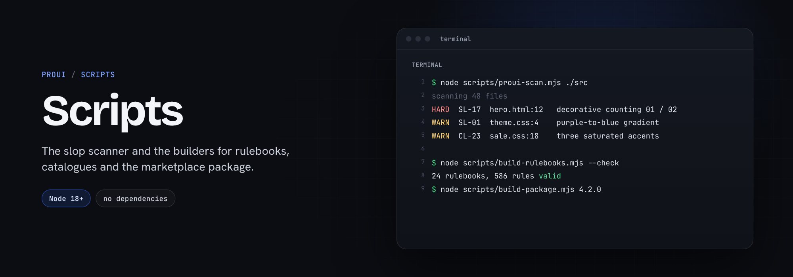

[Back to ProUI](../README.md) · [Rulebooks](../rules/README.md) · [Effects catalogues](../effects/README.md#catalogues)

**Small Node scripts with no dependencies (Node 18 or newer).** One checks your website for slop; the others keep this repository consistent and build the marketplace package.

| Script | What it does |
| --- | --- |
| [proui-scan.mjs](proui-scan.mjs) | scans a website project for slop patterns and hard-rule violations |
| [build-rulebooks.mjs](build-rulebooks.mjs) | builds every rulebook README from its `rulebook.json`; `--check` validates IDs, references and freshness |
| [build-effects.mjs](build-effects.mjs) | builds the effect catalogues from their JSON; `--check` fails if one is out of date |
| [build-package.mjs](build-package.mjs) | builds the marketplace ZIP in `dist/` without the owner's personal files, and fails if any reference to them is left |

## Scan a project

```bash
node scripts/proui-scan.mjs ./src           # readable report
node scripts/proui-scan.mjs ./src --json    # for tools
node scripts/proui-scan.mjs ./src --ci      # exits with 1 when a hard rule is found
```

Silence a false positive with a comment on the same line:

```css
.timeline__marker { border-left: 4px solid var(--accent); } /* proui-ignore SL-49 */
```

## Maintain the repository

```bash
node scripts/build-rulebooks.mjs            # after editing a rulebook.json
node scripts/build-effects.mjs              # after editing a catalogue .json
node scripts/build-rulebooks.mjs --check    # both checks also run in CI
node scripts/build-effects.mjs --check
node scripts/build-package.mjs 4.3.0        # marketplace ZIP
```
