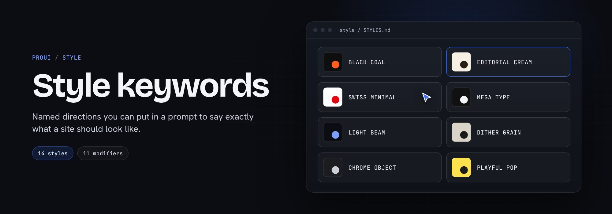

[Back to ProUI](../README.md) · [All styles](STYLES.md) · [Inspiration](../inspiration/README.md)

**Say exactly what a site should look like in two words.** A style keyword is a ready set of palette, type, layout, imagery and motion. Name one in a prompt, add a modifier if you like, and the workflow skips straight to that direction.

```text
Build a site for a ceramics studio in EDITORIAL CREAM + MEGA TYPE, calm.
ProUI workflow, direction BLACK COAL, ACCENT cobalt: portfolio for a photographer.
```

## Keywords

| Keyword | Feels like | Good for |
| --- | --- | --- |
| `BLACK COAL` | near-black monochrome, one hot accent | streetwear, studios, nightlife, bold tech |
| `RED SIGNAL` | black, white and one saturated red in blocks | posters, events, statements |
| `EDITORIAL CREAM` | warm, quiet, expensive | architecture, interiors, hospitality, culture |
| `GALLERY CLASSIC` | museum feel, archive material in modern layout | art, heritage, publishing |
| `POSTER COLLAGE` | collage, torn paper, halftone, overlapping type | music, events, fashion drops |
| `SWISS MINIMAL` | strict grid, white space, small precise type | studios, portfolios, consultancies |
| `MEGA TYPE` | the headline is the image | combines with any palette |
| `LIGHT BEAM` | product in a beam of brand-coloured light | dark tech and SaaS |
| `VOID PARTICLES` | point-cloud typography on black | AI, music, generative brands |
| `CHROME OBJECT` | one glossy 3D centrepiece | launches, hardware, premium tech |
| `DITHER GRAIN` | dither, halftone, noise, ASCII textures | digital craft, developer brands |
| `NOIR PORTRAIT` | large moody portraits, minimal type | fashion, personal brands |
| `PRODUCT CLEAN` | light, precise product UI | fintech, booking, apps |
| `PLAYFUL POP` | bright, illustrated, friendly | kids, food, pets, community |

## Modifiers

`MAXIMAL` · `MINIMAL` · `DARK` · `LIGHT` · `WARM` · `COLD` · `STILL` · `CALM` · `KINETIC` · `MONO` · `ACCENT <colour>`

Each keyword's palette, type, layout, imagery, motion and example pins are in [STYLES.md](STYLES.md), with combinations that work.

## Personal files

| File | What it is |
| --- | --- |
| [MY-STYLE.md](MY-STYLE.md) | personal: my taste, measured from my Pinterest board |
| [PINS.md](PINS.md) | personal: links to my pins, sorted by theme |
