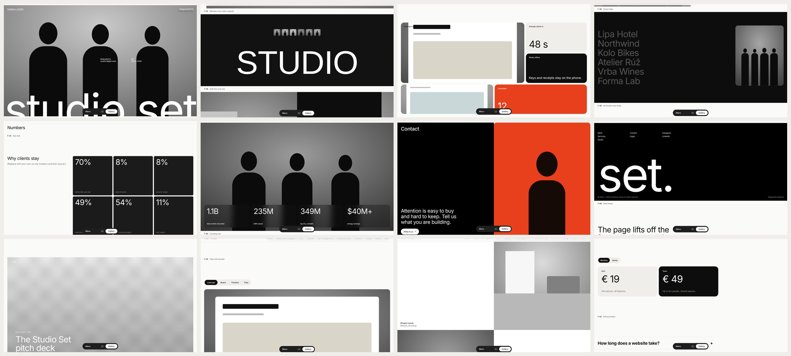

# FRAMER

[Style keywords](../STYLES.md) · [80 sections](sections.md) · [Motion recipes](motion.md) · [Live gallery](gallery/index.html) · [Unanim study](../../inspiration/site-studies/unanim.md)

**The look of the best Framer and studio sites in 2026, made into a style you can ask for.** Big quiet
type, one family in two weights, full-bleed photography, generous space, components that move with
springs and layout animations, and one cinematic scroll moment per page. Built from the study of
[unanim.studio](../../inspiration/site-studies/unanim.md), the [seven reference sites](../../inspiration/site-studies/reference-sites.md),
Skiper UI, the [Annnimate catalogue](../../effects/catalog/annnimate.md) and a grayscale pitch-deck system.

## When to use it

Use the FRAMER style when the request says any of: **"Framer"**, **"Framer look"**, **"Framer Motion"**,
**"component page"**, **"motion components"**, **"like a Framer template"**, **"studio site"**, or names a
section ID (`F-01`…`F-80`). With React, take the motion from [motion.md](motion.md) (`motion/react`);
without React, from the plain-JS [effects](../../effects/fx/README.md#unanim-set). In Framer itself, build
the sections with Framer's own layout and effects, and use a code component only for what Framer cannot do
(the dock, hover members, word split).

## The look

| Part | FRAMER does |
| --- | --- |
| Type | one grotesk, 400 and 500 only (Saans, Host Grotesk, Hanken Grotesk). Size makes hierarchy: 12–13 px labels next to 60–96 px headlines and a wordmark at 45 vw |
| Colour | ink `#0d0d0d`, paper `#fafaf9`, one surface grey `#efeeeb`, one accent used in photography and one block (vermilion `#e8401c` in the demo). The UI itself is black and white |
| Layout | 12 columns, 26 px margins, blocks hung from columns 4–7, first line of statements indented by a third; asymmetric but aligned |
| Surfaces | full-bleed sections that touch; media frames with 20 px radius; cards only when they hold real content (`SL-10`, `SL-51`) |
| Buttons | pills, 44 px high, ink or white; one primary action per screen |
| Imagery | real photography and video, black and white or graded; people as silhouettes for a studio's own brand |
| Motion | springs for UI (no overshoot, `MO-13`), expo-out for reveals, one scroll scene per page, reduced-motion versions |

## Motion system

| Token | Value | Used for |
| --- | --- | --- |
| `ease.out` | `cubic-bezier(.23,1,.32,1)` | hovers and presses (120–200 ms) |
| `ease.rise` | `cubic-bezier(.16,1,.3,1)` | reveals, rising lines (700–900 ms) |
| `ease.sheet` | `cubic-bezier(.32,.72,0,1)` | menus and sheets opening (640 ms) |
| `ease.shut` | `cubic-bezier(.65,0,.35,1)` | closing (260–420 ms, about 35 % faster, `MO-15`) |
| `spring.ui` | stiffness 320, damping 34 | pills, tabs, islands |
| `spring.layout` | stiffness 170, damping 26 | shared elements, cards growing into dialogs |

Signature moments, one per page: recede hero (F-01), word split (F-04), card expand (F-03), section stack
(F-54), horizontal case study (F-39), stacking cards (F-40). Everything else is quiet.

## What FRAMER is not

The generic Framer template look is full of things ProUI forbids, and FRAMER keeps them out: no glowing
orbs or radial halos (`SL-03`, `SL-55`), no "New" chip above the hero (`SL-58`), no icon tile stacks
(`SL-57`), no empty bento (`SL-10`), no marquee filler (`SL-68`), no purple gradients (`SL-01`), no
cursor spotlights (`SL-34`), no fake testimonials (`SL-43`). Glass appears only over real imagery (F-57,
the dock, the deck covers).

## Build order with FRAMER

1. Pick the hero (F-01 to F-10) that fits what the visitor came for (`modes/`).
2. Pick one signature scroll moment for the page; the other sections stay calm.
3. Fill the page from the groups: proof, features, work, process, numbers, pricing, CTA, footer.
4. Use the deck sections (F-71 to F-80) for investor pages, case studies and annual reports.
5. Replace every placeholder picture and every bracketed text with real content before launch.

## Files

| File | What |
| --- | --- |
| [sections.md](sections.md) | the 80 sections with prompts, motion and phone behaviour |
| [motion.md](motion.md) | Framer Motion recipes: tokens, blur lines, recede hero, dock, hover members, shared elements, tabs, stacks, filter |
| [gallery/](gallery/index.html) | all 80 sections live in plain HTML, CSS and JS, using the shared [fx](../../effects/fx/README.md) |

Optional: [interface sounds](../../sounds/README.md) for hover and click, only when sound is asked for.
