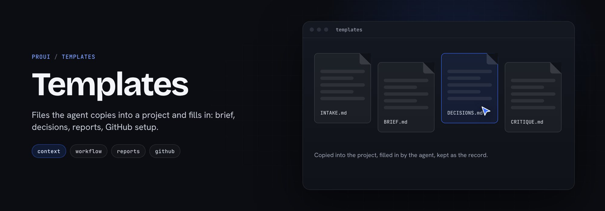

[Back to ProUI](../README.md) · [Workflow](../workflow/README.md) · [Commands](../commands/README.md)

**Files the agent copies into a project and fills in.** They turn a conversation into a record: what the site is, what was decided and why, what a review found. Because the record lives in the project, any later session can continue from it.

| Folder | Files | Filled in by |
| --- | --- | --- |
| [context/](context/) | [PRODUCT.md](context/PRODUCT.md) (who it is for, what must stay true), [DESIGN.md](context/DESIGN.md) (the visual system as built) | `ProUI init`, `ProUI document`, the workflow |
| [workflow/](workflow/) | [INTAKE.md](workflow/INTAKE.md), [BRIEF.md](workflow/BRIEF.md), [DIRECTIONS.md](workflow/DIRECTIONS.md), [DECISIONS.md](workflow/DECISIONS.md) | the intake questions, the brief, the direction checkpoint and the running record |
| [reports/](reports/) | [CRITIQUE.md](reports/CRITIQUE.md), [AUDIT.md](reports/AUDIT.md) | `ProUI critique`, `ProUI audit` |
| [github/](github/README.md) | CI, quality and Pages workflows, Lighthouse budgets, Dependabot, PR and issue templates, dotfiles, `security.txt` | `ProUI ship` |

## Where they end up

```text
your-project/
├── PRODUCT.md
├── DESIGN.md
└── proui/
    ├── BRIEF.md
    ├── RESEARCH.md
    ├── research/           screenshots for you to see, not committed
    └── DECISIONS.md        the running record; ProUI continue starts here
```
