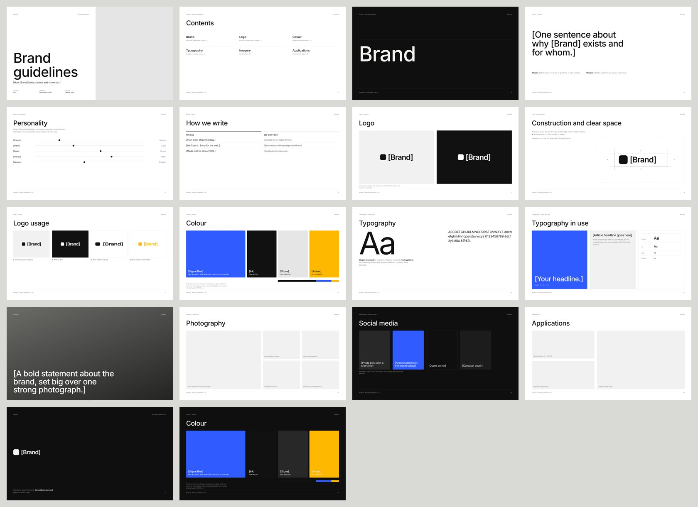

[Templates](../README.md) · [Design system stage](../../workflow/WORKFLOW.md)

# Brand guidelines template

A 17-page brand book at 16:9 in one HTML file, written for ProUI. Use it when a client needs their brand
written down at the end of a project, or when the Design system stage produces a brand worth handing over.

| Page | What it holds |
| --- | --- |
| 1 Cover | name, one line, version, date, owner |
| 2 Contents | six sections with page numbers |
| 3 Divider | a section title page (copy it for Logo, Colour, Typography…) |
| 4 Purpose | why the brand exists, mission, promise |
| 5 Personality | five sliders between honest opposites |
| 6 Voice | what we say and what we never say (`CP-03`) |
| 7 Logo | primary logo on light and on dark |
| 8 Construction | clear space and minimum size |
| 9 Usage | two correct and two wrong uses |
| 10 Colour | swatches with HEX, RGB and OKLCH, and the proportions bar (`CL-05`) |
| 11 Typography | specimen, glyphs with Czech accents, licences (`TY-20`, `TY-27`) |
| 12 Type in use | headline card, article card, type scale |
| 13 Imagery | one statement over a full-bleed photograph |
| 14 Photography | art direction grid with what to shoot and what to avoid |
| 15 Social media | four 4:5 post types |
| 16 Applications | business card, signage, website |
| 17 Back | contact for brand questions and the files |

## How to use it

1. Copy `index.html` into the project's `proui/brand/` folder.
2. Change the variables at the top (`--accent`, `--accent-2`, `--display`, `--text`) and load the brand's
   fonts; replace every `[bracketed]` text and the grey placeholders with real logos and photographs.
3. Add or remove pages by copying a `<section class="page">`; add `dark` to a page's class for the dark
   version, or open `index.html?theme=dark` for the whole book in dark.
4. Export: open it in Chrome, Print → Save as PDF, margins None, background graphics on. Each section prints
   as one 1600 × 900 page.

The layouts are ProUI's own. They follow the page types every brand book needs (the same list the
commercial brand-guideline templates sell), so nothing here copies a paid product.
