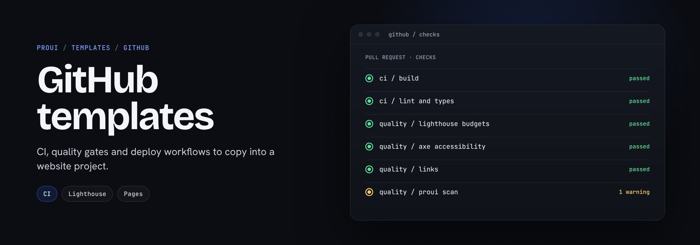

[Templates](../README.md) · [GitHub guide](../../workflow/GITHUB.md) · [GitHub Workflow Rulebook](../../rules/github/README.md)

**Everything a website repository needs to check itself.** These files are copied into a project during `ProUI ship`. They assume a Node build that outputs static files to `dist/` (Vite, Astro, Eleventy, or plain HTML with a build step); change `dist` and the scripts to fit the stack.

## The files

| Template | Copy to | Does |
| --- | --- | --- |
| `workflows/ci.yml` | `.github/workflows/ci.yml` | install, lint, type-check, test, build on every push and PR (`GH-10`) |
| `workflows/quality.yml` | `.github/workflows/quality.yml` | Lighthouse CI budgets, axe accessibility check, link check, ProUI scan (`GH-11`) |
| `workflows/pages.yml` | `.github/workflows/pages.yml` | deploy `dist/` to GitHub Pages from `main` (`GH-13`); skip if the host is Vercel, Netlify or Cloudflare |
| `lighthouserc.json` | `lighthouserc.json` | score budgets for Lighthouse CI |
| `dependabot.yml` | `.github/dependabot.yml` | weekly npm and Actions updates (`GH-14`) |
| `release.yml` | `.github/release.yml` | categories for generated release notes (`GH-15`) |
| `pull_request_template.md` | `.github/pull_request_template.md` | PR checklist (`GH-08`) |
| `ISSUE_TEMPLATE/*` | `.github/ISSUE_TEMPLATE/` | bug and feature templates (`GH-16`) |
| `gitignore.template` | `.gitignore` | `GH-03` |
| `editorconfig.template` | `.editorconfig` | `GH-05` |
| `env.example.template` | `.env.example` | `GH-04` |
| `security.txt.template` | `public/.well-known/security.txt` | `SEC-18` |

## Before you copy

The project's `package.json` should have `lint`, `typecheck` (if TypeScript), `test` (if any) and `build` scripts.
