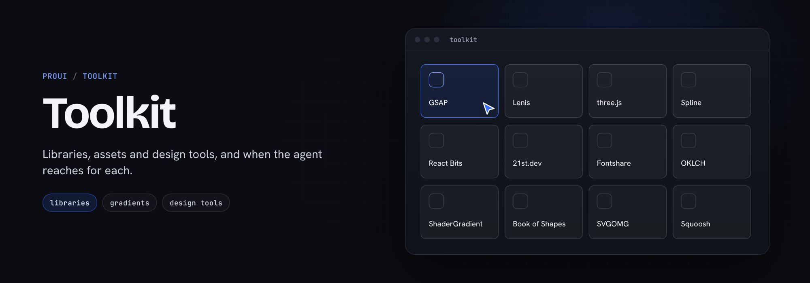

[Back to ProUI](../README.md) · [Effects library](../effects/README.md) · [Inspiration](../inspiration/README.md)

**The libraries, assets and design tools ProUI reaches for, and when.** Every tool here has a job in a specific stage of the workflow, so the agent does not pull in a library because it is popular.

| Guide | What it covers |
| --- | --- |
| [TOOLKIT.md](TOOLKIT.md) | GSAP, Lenis, React Bits, 21st.dev, Codrops, Spline, three.js, SVGL, SVG Doodles, Fontshare: install code, licences, guardrails |
| [gradients.md](gradients.md) | Balsa UI Gradient Studio, Pryzm Studio, ShaderGradient, the OKLCH picker and how to use them |
| [shapes-and-backgrounds.md](shapes-and-backgrounds.md) | Book of Shapes, Hero Patterns, Get Waves, SVGOMG and pattern guidelines |
| [design-tools.md](design-tools.md) | tools by project stage: brand and logos, typography, colour, icons, 3D, motion, mockups, utilities |

## Guidelines

| Website | Good for |
| --- | --- |
| [Apple Human Interface Guidelines](https://developer.apple.com/design/human-interface-guidelines) | design principles, typography, colour, layout, accessibility |
| [Microsoft Fluent 2](https://fluent2.microsoft.design) | spacing system, type ramp, tokens, elevation for product UI |
| [Impeccable](https://github.com/pbakaus/impeccable) | the open-source design skill ProUI takes the most inspiration from |
| [OpenDesign](https://open-design.ai) | one design-system file per brand, design as code |

## Research

| Website | Good for |
| --- | --- |
| [Mobbin](https://mobbin.com) | real app and website screens, flows, dashboards (paid login) |
| [Dark](https://dark.design) | dark websites by category |
| [Recent](https://recent.design) | current brand, web and motion work |
| [Saved](https://saved.design) | interface, 3D and typography details |
| [Designeer](https://designeer.xyz) | components, motion, 3D |
| [Dribbble](https://dribbble.com) | concepts for 3D, scroll and product reveals |
| [Godly](https://godly.website), [Awwwards](https://www.awwwards.com), [Land-book](https://land-book.com), [SiteInspire](https://www.siteinspire.com), [Lapa Ninja](https://www.lapa.ninja), [httpster](https://httpster.net) | extra galleries when the main ones are thin |

## Building

| Website | Good for |
| --- | --- |
| [Fontshare](https://fontshare.com), [Google Fonts](https://fonts.google.com), [Fontsource](https://fontsource.org) | free quality fonts |
| [GSAP](https://gsap.com), [Made With GSAP](https://madewithgsap.com), [Lenis](https://lenis.dev) | animation and smooth scroll |
| [Motion Primitives](https://motion-primitives.com), [Aceternity UI](https://ui.aceternity.com/components), [React Bits](https://reactbits.dev/get-started/index), [21st.dev 3D](https://21st.dev/community/components/s/3d) | ready components (catalogues in the [effects library](../effects/README.md)) |
| [Codrops](https://tympanus.net/codrops) | creative effect tutorials |
| [Spline](https://spline.design), [three.js](https://threejs.org) | 3D |
| [SVGL](https://svgl.app), [SVG Doodles](https://svgdoodles.com) | brand logos and hand-drawn accents |
| [Balsa UI Gradient Studio](https://balsa-ui.com/tools/gradient-studio), [Pryzm Studio](https://pryzm.design/studio), [ShaderGradient](https://shadergradient.co) | signature gradients and backgrounds |
| [Book of Shapes](https://bookofshapes.com), [Hero Patterns](https://heropatterns.com), [Get Waves](https://getwaves.io) | patterns, dividers, shapes |
| [OKLCH](https://oklch.com), [Realtime Colors](https://www.realtimecolors.com), [Who Can Use](https://www.whocanuse.com) | picking colours and checking contrast |
| [Phosphor](https://phosphoricons.com), [Tabler Icons](https://tabler.io/icons), [Iconoir](https://iconoir.com) | icon sets beyond the default |
| [minitools.design](https://minitools.design) | directory of small design tools |

## Finishing

| Website | Good for |
| --- | --- |
| [shots.so](https://shots.so) | real screenshots in device frames |
| [ray.so](https://ray.so) | code snippets as images |
| [Squoosh](https://squoosh.app), [SVGOMG](https://jakearchibald.github.io/svgomg/) | image and SVG compression |
| [glTF Report](https://gltf.report), [Poly Haven](https://polyhaven.com) | compressing 3D models, free HDRIs and textures |
| [tldraw](https://tldraw.com) | quick wireframes |

More tools by stage, including the ones without a website of their own: [design-tools.md](design-tools.md).
