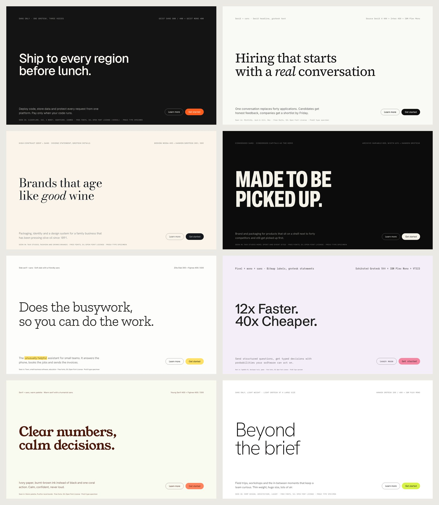
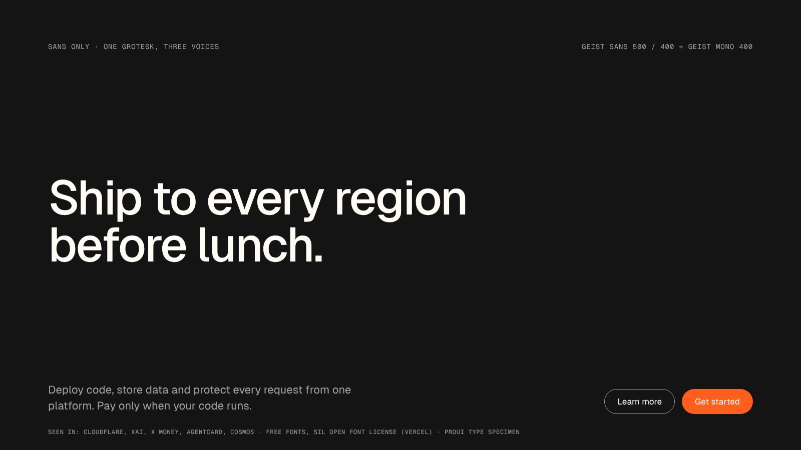
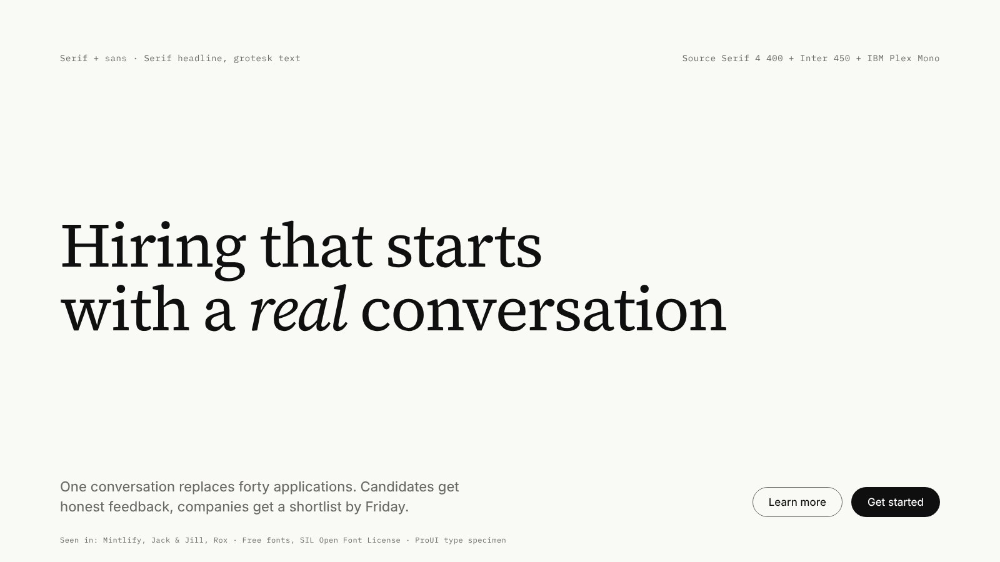
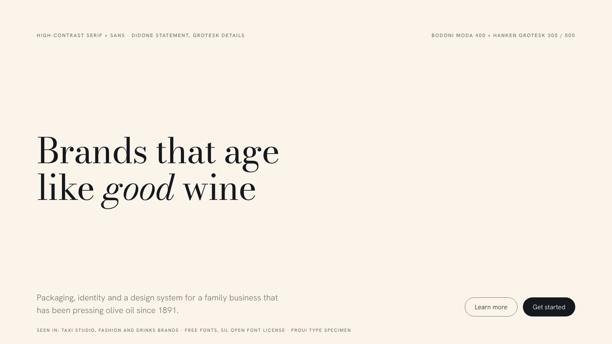
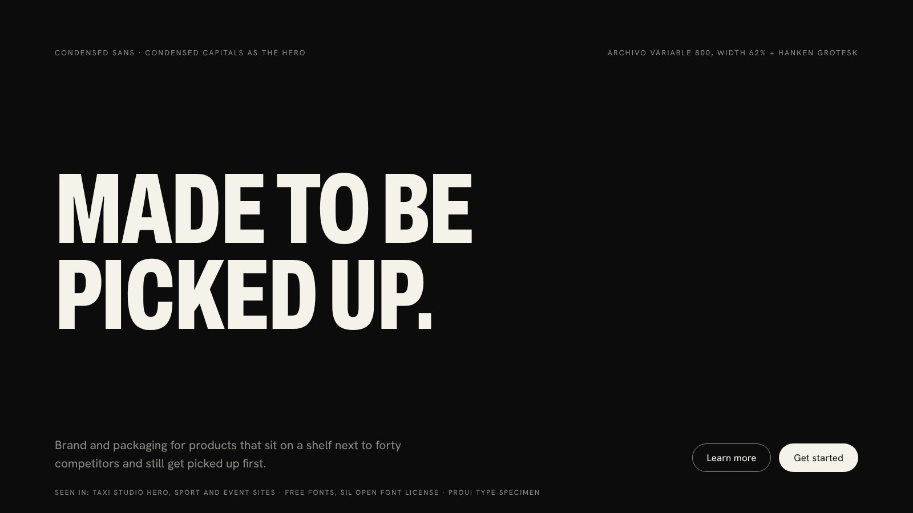
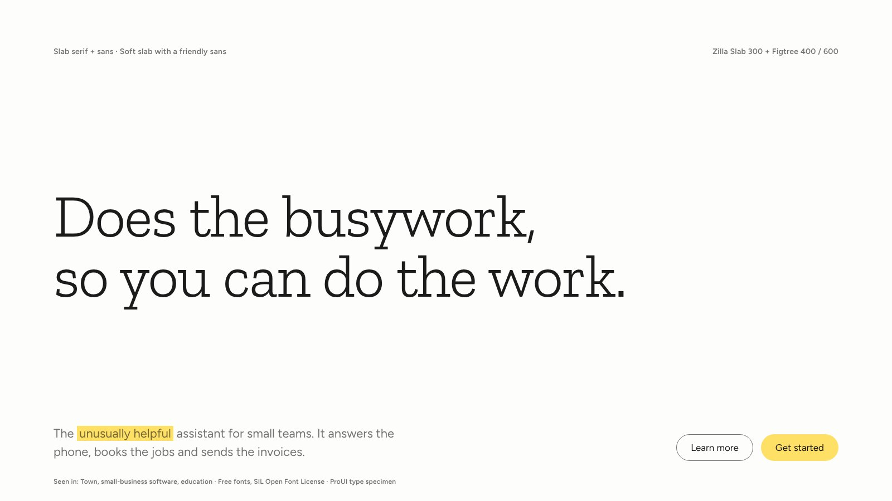
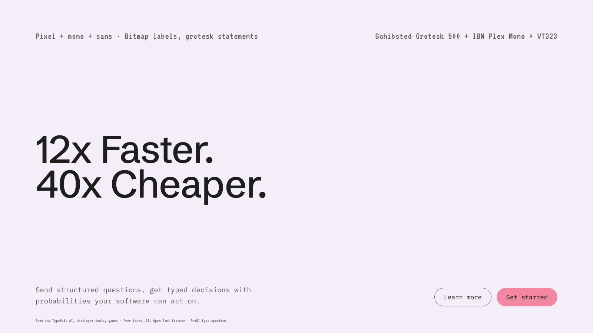
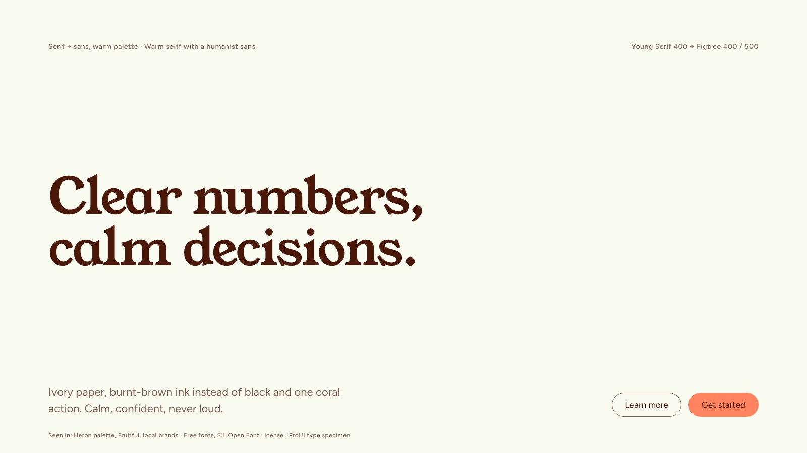
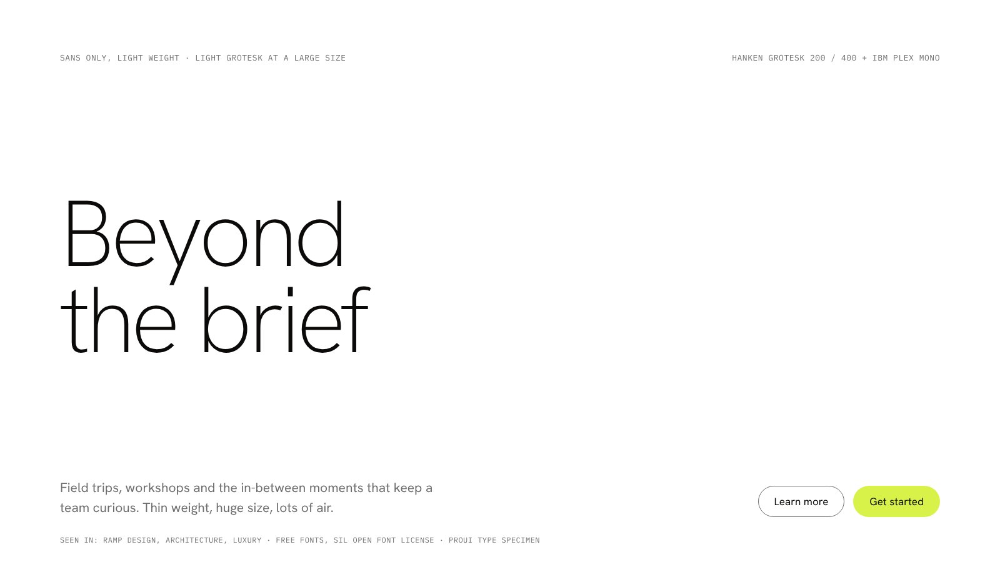

# Typography

> How fonts work together on websites that look expensive: what the 2026 reference sites actually load, why their pairs work, which free fonts give the same feel, which faces suit which kind of site, and how to check a pair before building. Every specimen below uses free fonts only.

[Back to ProUI](../README.md) · [Type pairing method](../blueprints/type-pairing.md) · [Typography Rulebook](../rules/typography/README.md) · [Site studies](../inspiration/site-studies/README.md)



## Contents

| Section | What it answers |
| --- | --- |
| [How fonts play together](#how-fonts-play-together) | the roles in a type system and the four systems the studied sites use |
| [What the reference sites use](#what-the-reference-sites-use) | measured fonts, sizes and tracking from 17 live sites, with free alternatives |
| [Specimens](#specimens) | eight free pairings rendered as real hero sections |
| [Which type for which site](#which-type-for-which-site) | kind of site → system → free fonts |
| [Platform fonts](#platform-fonts) | what iOS, Android, Windows and the web use by default |
| [Well-known web fonts](#well-known-web-fonts) | the faces everyone recognises, and when they are still right |
| [Checking a pair](#checking-a-pair) | the test every pairing must pass before the build |
| [Licences and cheap alternatives](#licences-and-cheap-alternatives) | free sources, trial fonts, what to buy |

## How fonts play together

A website rarely needs more than three voices. Each one has a job:

| Voice | Job | Typical settings seen on the reference sites |
| --- | --- | --- |
| **Display** | headlines, the brand's personality | 48–176 px, weight 300–500 (rarely bold), tracking −1 % to −7 %, line height 0.85–1.05 |
| **Text** | paragraphs, UI, buttons | 14–24 px, weight 400–500, tracking 0 to −0.5 %, line height 1.4–1.6, secondary text at 55–66 % opacity |
| **Accent** (mono, pixel, handwriting) | labels, numbers, code, small notes | 11–15 px, often uppercase with +4 % to +16 % tracking |

The display and text voices relate in one of four ways. Every studied site uses one of them, and none uses more than one:

| System | How it works | Feels | Studied sites |
| --- | --- | --- | --- |
| **One grotesk family** | the same sans for everything; hierarchy from size, weight and opacity only | engineered, calm, confident | Cloudflare, xAI, X Money, Agentcard, Cosmos, Fruitful, Brik, Heron, Ramp design, Shopify Editions |
| **Serif display + sans text** | a serif carries the headline, a neutral grotesk carries everything else | warm, human, editorial, premium | Mintlify, Jack & Jill, Rox, Taxi Studio, Town |
| **Mono as the third voice** | a monospace for labels, numbers and metadata next to either system | technical, precise, "built by engineers" | Mintlify, Cloudflare, TypeSafe, Cosmos, xAI, Ramp design, Brik, Agentcard (pixel) |
| **Expressive accent** | condensed capitals, a pixel face or handwriting used for a few words only | memorable, playful, art-directed | Taxi Studio (condensed), TypeSafe (bitmap), Town (handwriting) |

What the expensive-looking sites have in common:

- **Regular weights at large sizes.** Display weights sit between 300 and 500. Size and space create the hierarchy, not boldness. Cosmos is the exception, and it compensates with very tight tracking.
- **Tight display tracking.** Headlines run −1 % (xAI) to −7 % (Brik) tracking. Body text stays at 0.
- **Muted secondary text by opacity.** Lead paragraphs are the text colour at 55–66 % opacity, not a different grey hue, so they stay in the same colour family.
- **Two families, three at most.** Ten of the seventeen sites load one family plus a mono.
- **Emphasis by contrast.** xAI greys out the last word ("for everything you **build.**"), Rox mutes the second line, Jack & Jill and Mintlify switch to a serif for the headline only. None of them uses a gradient on text.

## What the reference sites use

Measured in the browser on 21 November 2026 (computed styles and the `@font-face` rules each site loads). Free alternatives are suggestions with a similar structure and feel, not copies.

| Site | Display | Text | Accent | Free alternative |
| --- | --- | --- | --- | --- |
| Mintlify | ABC Arizona Flare, 40 px, 400, −2 % | Inter | Paper Mono | Source Serif 4 or Literata + Inter + IBM Plex Mono |
| Cloudflare | STK Bureau Sans 500, 56 px, −2.5 % | same | Apercu Mono Pro | Geist Sans + Geist Mono |
| Jack & Jill | Marist 400, 72 px, −2.5 % | ABC Diatype 400/500 | none | Source Serif 4 + Inter |
| Fruitful | PP Neue Montreal 500, 68 px, −1 % | Figtree | Source Serif 4 for quotes | Hanken Grotesk 500 + Figtree |
| Rox | Season Mix 420, 56 px, −2 % | Geist | none | Literata or Source Serif 4 + Geist Sans |
| Shopify Editions | (each cover is art-directed) | Inter Variable 500, 14 px, −1 % | none | Inter |
| Town | Material Upright (soft slab), 80 px, very light | ABC Diatype | a handwriting face | Zilla Slab 300 + Figtree + a free script for notes |
| TypeSafe | Die Grotesk C Medium, up to 150 px, line height 0.8 | Die Grotesk C | LisaTerminal (bitmap), JetBrains Mono, Fragment Mono | Schibsted Grotesk + VT323 + IBM Plex Mono |
| Taxi Studio | AG Book condensed capitals; Lust Text 300 for statements | Akzidenz-Grotesk BE | none | Archivo (width 62 %) + Bodoni Moda + Hanken Grotesk |
| Agentcard | Neue Haas Grotesk Display 500, 72 px, −5.5 % | Inter 400, 19 px | Geist Pixel | Inter Display or Hanken Grotesk + Inter + Geist Pixel |
| Cosmos | Cosmos Oracle (based on ABC Oracle) 700, 72 px, −4 % | same | Basis Grotesque Mono | Hanken Grotesk 700 + IBM Plex Mono |
| Heron | Season Sans 400, 103 px, −3 % | Season Sans | Season Mix | Hanken Grotesk 400 + Young Serif for accents |
| xAI | xVf (custom variable) 450, 60 px, −1 % | same, 13 px | Geist Mono | Inter + Geist Mono |
| X Money | xVF Display 500, 48 px, −1 % | xVF, 13 px | xMono | Inter + Geist Mono |
| Brik | HAL Matex Book 400, 130 px, −7 % | same | Proto Mono | Hanken Grotesk 400 + Geist Mono |
| Ramp design | TWK Lausanne 300, 144 px, −1.5 to −4.5 % | same | IBM Plex Mono | Hanken Grotesk 200–300 + IBM Plex Mono |
| Mobbin | (stylesheets did not load in the test browser) | | | |

> [!WARNING]
> One reference site served font files named "TRIAL" on its production homepage. Trial versions are licensed for testing only. ProUI never ships a trial font; it uses a free font or asks the user to buy the licence (`TY-27`).

## Specimens

Each specimen is a full 1600 × 900 hero rendered with free fonts (SIL Open Font License). The copy is original. The source is in [`specimens/src`](specimens/src/).

<table>
  <tr>
    <td width="50%"><br><b>One grotesk, three voices.</b> Geist Sans 500/400 and Geist Mono. Near-black warm background, cream text, one orange action. For SaaS, infrastructure and developer tools.</td>
    <td width="50%"><br><b>Serif headline, grotesk text.</b> Source Serif 4 (with a real italic for one word) and Inter. For hiring, documentation, B2B with a human voice.</td>
  </tr>
  <tr>
    <td><br><b>Didone statement.</b> Bodoni Moda and light Hanken Grotesk on cream. For fashion, drinks, hotels, agencies with a premium position.</td>
    <td><br><b>Condensed capitals as the hero.</b> Archivo at width 62 %, weight 800. One line, once per page. For agencies, sport, events.</td>
  </tr>
  <tr>
    <td><br><b>Soft slab and a friendly sans.</b> Zilla Slab 300 and Figtree, one marker highlight. For small-business software, education, community.</td>
    <td><br><b>Bitmap labels, grotesk statements.</b> Schibsted Grotesk, IBM Plex Mono, VT323 for labels. For developer tools, AI models, games.</td>
  </tr>
  <tr>
    <td><br><b>Warm serif and a humanist sans.</b> Young Serif and Figtree in burnt-brown ink on ivory. For finance that wants to feel calm, local brands, food.</td>
    <td><br><b>Light grotesk at a large size.</b> Hanken Grotesk 200 at 150 px with tight tracking and IBM Plex Mono. For architecture, portfolios, design teams, luxury.</td>
  </tr>
</table>

## Which type for which site

| Kind of site | System | Free fonts that work | Avoid |
| --- | --- | --- | --- |
| SaaS, infrastructure, developer tools | one grotesk + mono | Geist Sans + Geist Mono; Inter + JetBrains Mono; IBM Plex Sans + Plex Mono | a decorative serif on product UI |
| AI product with a human angle (hiring, assistants) | serif display + sans | Source Serif 4 / Literata + Inter; Young Serif + Figtree | a robotic mono everywhere |
| Fintech, banking | one grotesk; serif only for quotes | Hanken Grotesk + Figtree; Inter + IBM Plex Mono for numbers | playful scripts, very thin weights for numbers |
| Agency, studio, portfolio | expressive display + quiet grotesk | Bodoni Moda + Hanken Grotesk; Archivo condensed + Hanken; Hanken 200 at large sizes | three expressive faces at once |
| Fashion, luxury, hotel, drinks | high-contrast serif + light sans | Bodoni Moda + Hanken Grotesk 300; Source Serif 4 Display + Inter | heavy weights, tight boxes, rounded sans |
| Local business (trades, clinic, restaurant) | warm serif or friendly sans | Young Serif + Figtree; Zilla Slab + Figtree; Figtree alone | condensed capitals, mono, pixel faces |
| Editorial, blog, documentation | serif for reading or serif headlines | Literata / Source Serif 4 for long text + Inter for UI | display faces for paragraphs |
| E-shop | one grotesk, tabular numbers for prices | Inter, Hanken Grotesk, Figtree | more than two families |
| Kids, games, community | rounded or pixel accents, readable text | Figtree + VT323 for a few labels | pixel or handwriting for paragraphs |
| Public sector, healthcare | maximum legibility | Atkinson Hyperlegible Next, Inter, Source Sans 3 | thin weights, low contrast, all caps |

## Platform fonts

Apps and some sites use the system font of the device. It loads instantly and feels native, but it does not carry a brand.

| Platform | System UI font | Notes |
| --- | --- | --- |
| Apple (macOS, iOS, iPadOS) | SF Pro, SF Compact, New York (serif), SF Mono | licensed for Apple platforms only; on the web use `-apple-system` / `system-ui`, never self-host |
| Android, Google | Roboto, Roboto Flex; Google Sans in Google's own products | Roboto is free (OFL) |
| Windows | Segoe UI, Segoe UI Variable | system font, not for self-hosting |
| Web, cross-platform | `system-ui` stack, or a self-hosted brand font | brand sites self-host one or two families |

```css
/* native stack for app-like interfaces */
font-family: system-ui, -apple-system, "Segoe UI", Roboto, "Helvetica Neue", Arial, sans-serif;
```

## Well-known web fonts

These faces are everywhere. They are good fonts; the problem is that a headline set in one of them looks like every other generated site. ProUI keeps them for text and UI, and chooses a display face with more character (`SL-59`).

| Font | Kind | Still the right choice for |
| --- | --- | --- |
| Inter | neo-grotesk | text and UI almost anywhere; set the display in something else |
| Geist Sans / Geist Mono | grotesk + mono | developer and product sites; free from Vercel |
| Roboto, Open Sans, Lato | humanist / neo-grotesk | long text in apps and dashboards |
| Montserrat, Poppins | geometric | rarely; they read as template |
| DM Sans, Plus Jakarta Sans, Manrope, Outfit | geometric / grotesk | text when the brand is friendly |
| Space Grotesk, Syne | quirky grotesk | small labels only |
| Playfair Display, Cormorant, Fraunces, Instrument Serif | display serif | rarely; most "AI landing page" serifs come from this list |
| Source Serif 4, Literata, Newsreader | text serif | long reading, editorial |
| IBM Plex (Sans, Serif, Mono), JetBrains Mono | superfamily, mono | technical brands, numbers, code |

## Checking a pair

A pairing is only chosen after it passes this test, rendered with the real headline and copy (`TY-26`):

| Check | Passes when |
| --- | --- |
| **Roles** | every face has one job (display, text, accent) and there are no more than three |
| **Contrast** | the two faces are clearly different (serif vs sans, or very different widths or weights); two similar grotesks look like a mistake |
| **Shared proportions** | x-heights are close (within about 10 %) so mixed lines sit on the same visual size |
| **Era and mood** | both fit the brief: a 1960s grotesk with a 1990s web font looks accidental |
| **Weights exist** | the text face has 400 and 500 or 600, and a real italic if the copy needs emphasis |
| **Languages** | every glyph the site needs exists (Czech: á č ď é ě í ň ó ř š ť ú ů ý ž and their capitals) |
| **Numbers** | tabular figures exist for prices, tables and counters |
| **Sizes** | display at 3–6 × the body size on desktop; the scale still works at 360 px |
| **Tracking** | display −1 % to −5 %, body 0, uppercase labels +4 % to +12 % |
| **Specimen** | the hero, a paragraph, a button, a price and a label, in light and dark, side by side for two or three candidates |
| **Weight on the wire** | two families, at most four files on first load, WOFF2, `font-display: swap`, a metric-matched fallback |

```text
Specimen test string
Hero:    the real headline, two lines
Body:    the real first paragraph
UI:      Get started · Book a call · 1 290 Kč / měsíc
Label:   PRICING · STATUS · 21. 11. 2026
Czech:   Příliš žluťoučký kůň úpěl ďábelské ódy
```

## Licences and cheap alternatives

| Source | Licence | Notes |
| --- | --- | --- |
| [Google Fonts](https://fonts.google.com) | SIL OFL mostly | free for any use; self-host the files instead of loading from Google for privacy (`PE`) |
| [Fontsource](https://fontsource.org) | same as each font | npm packages of open fonts, easy self-hosting |
| [Fontshare](https://www.fontshare.com) | free for personal and commercial use | Satoshi, General Sans, Cabinet Grotesk, Switzer, Gambetta, Zodiak and more |
| [Geist](https://vercel.com/font) | SIL OFL | Geist Sans, Geist Mono, Geist Pixel |
| [Velvetyne](https://velvetyne.fr), [Collletttivo](https://www.collletttivo.it) | open licences | expressive display faces |
| Commercial foundries (Dinamo, Pangram Pangram, Klim, Commercial Type, Grilli Type, Colophon) | paid desktop and web licences | buy for the domain and expected traffic; many offer trial files for testing only |

When the brief needs a commercial face, ProUI names it, suggests the free alternative from the table above for the build, and lists the licence as something the client buys before launch.
