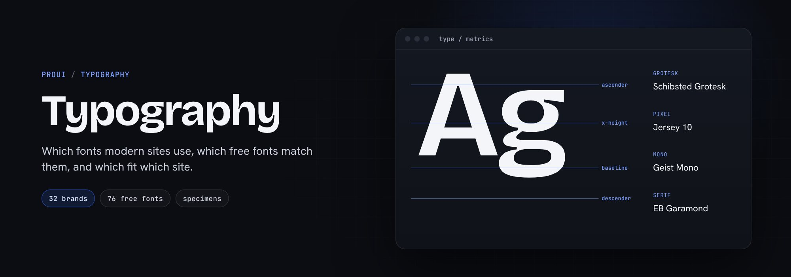

[Back to ProUI](../README.md) · [Reference tables](reference.md) · [Type pairing method](../blueprints/type-pairing.md) · [Typography Rulebook](../rules/typography/README.md)

**Which fonts modern websites use, which free fonts give the same feel, and which fit which kind of site.** Every font shown here is free for commercial use. The detailed tables live in [reference.md](reference.md).

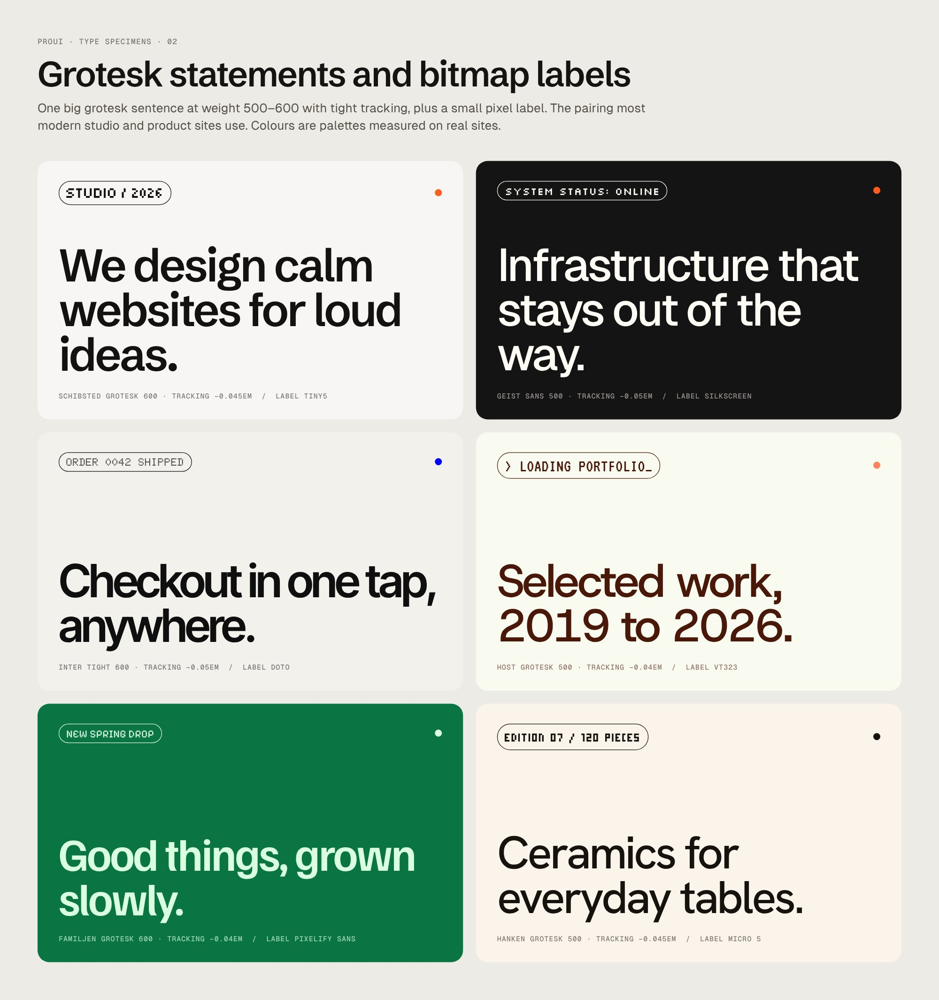

## The short version

1. **Start with a grotesk.** Most modern sites use one sans family for everything: Apple, Google, Linear, Vercel, GitHub, Zalando, Prada.
2. **Make headlines big, not bold.** Weight 500–600, tracking −2 % to −5 %, line height around 1.
3. **Add one accent voice at most.** A mono or pixel font for labels and numbers, or a serif for statements.
4. **Two families, three at most.** Body text stays at 16 px or more.
5. **Check Czech and the licence** before you build (`TY-26`, `TY-27`).

## Pick by kind of site

- **SaaS, developer tools:** Geist + Geist Mono, or Inter + JetBrains Mono
- **Studio, portfolio, agency:** Schibsted Grotesk or Host Grotesk + a pixel label (Jersey 10, Tiny5, VT323)
- **E-shop:** Inter Tight for headlines, Inter for everything else; Zalando Sans or Archivo also work
- **Fashion and luxury:** EB Garamond or Bodoni Moda + Manrope or Inter Tight; Jost for a Futura look
- **Sport and sales:** Oswald, Anton or Barlow Condensed capitals + Barlow
- **Editorial, blog:** Newsreader or Source Serif 4 + Familjen Grotesk
- **Friendly apps, booking, travel:** Figtree, Plus Jakarta Sans or Google Sans Flex
- **Finance, B2B:** Manrope or Hanken Grotesk + IBM Plex Mono for numbers

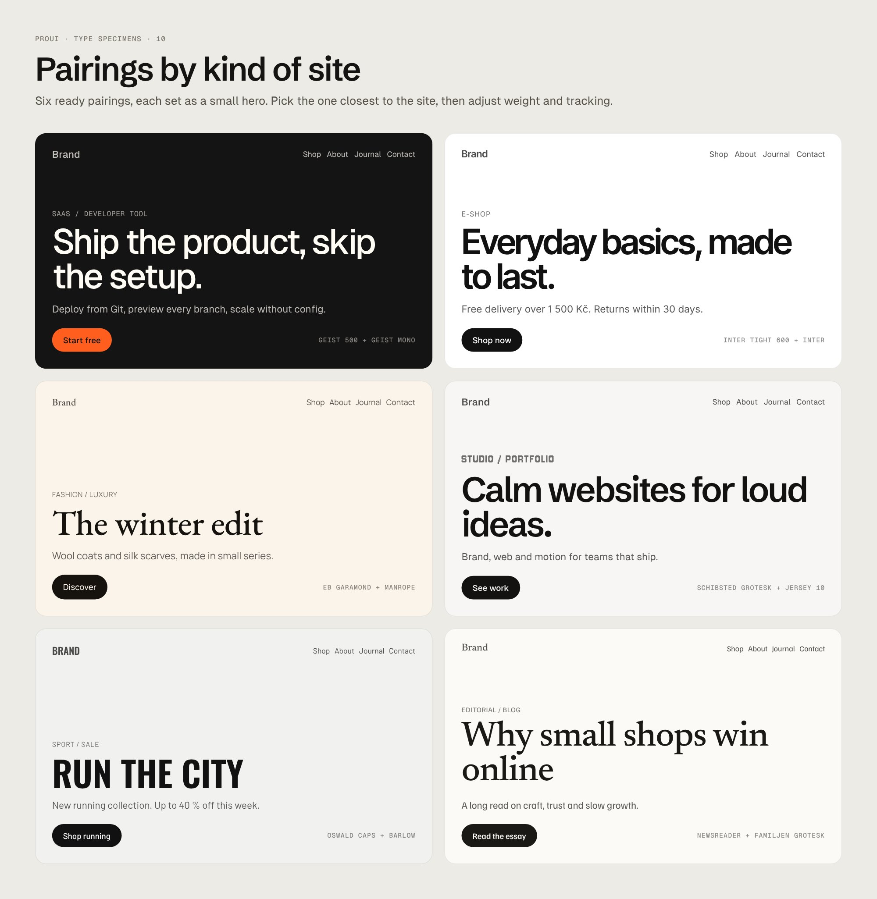

## Saans and the Unanim type system

[unanim.studio](../inspiration/site-studies/unanim.md) runs its whole brand on **Saans** by Displaay Type
Foundry, in two weights only: **400 for everything big** (the 711 px wordmark included) and **500 for
small UI labels**. Nothing is bold. Hierarchy comes from size: 12–13 px labels sit next to a word that is
half the screen tall.

Saans is a commercial font: buy a licence from Displaay before using it in a build (`TY-27`); trial files
are for testing only. These free fonts give the same feel, shown below in the same system (Inter, Geist and Instrument Sans would also work but are overused, `SL-59`):

| Font | Closeness | Notes |
| --- | --- | --- |
| **Host Grotesk** | closest | similar open shapes and rounded terminals; 400 and 500 cover everything |
| **Hanken Grotesk** | neutral | safest for small UI, slightly colder |
| **Albert Sans** | warmer | softer curves, good for long indented statements |
| **Onest** | technical | when the studio also ships product UI; good Cyrillic |

The system, whichever font you use:

```css
:root { --font: "Saans", "Host Grotesk", sans-serif; }
body  { font: 400 15px/1.5 var(--font); letter-spacing: -.007em; }
.ui   { font-size: 13px; line-height: 15px; font-weight: 500; -webkit-font-smoothing: auto; }
.menu { font-size: 17px; line-height: 15px; font-weight: 500; }
.statement { font-size: clamp(32px, 3.4vw, 52px); line-height: 1.05; letter-spacing: -.02em; text-indent: 28%; }
.wordmark  { font-size: 49vw; line-height: 1; letter-spacing: -.03em; font-weight: 400; white-space: nowrap; }
```

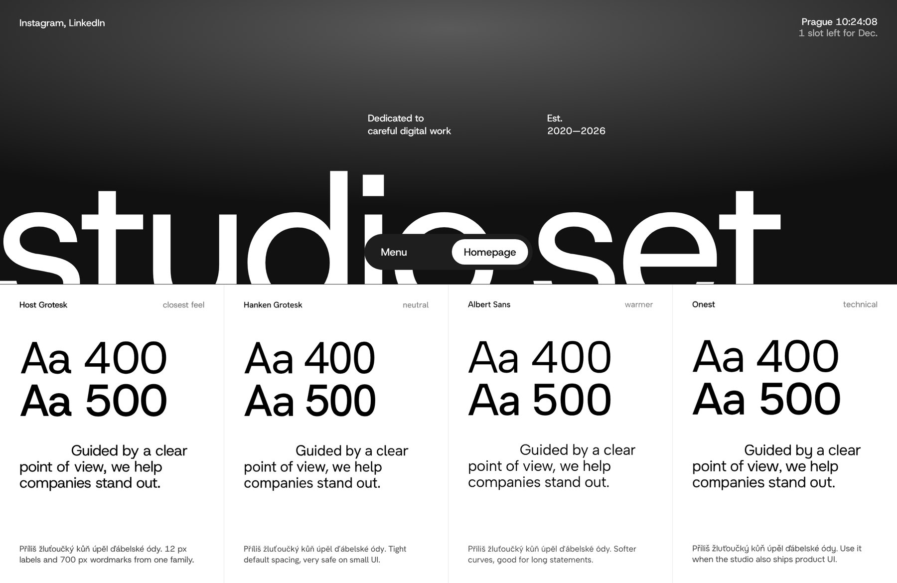

## Grotesks

The default for modern websites. Neutral ones (Inter, Geist) for interfaces, characterful ones (Schibsted, Host, Familjen, Bricolage) for big statements.

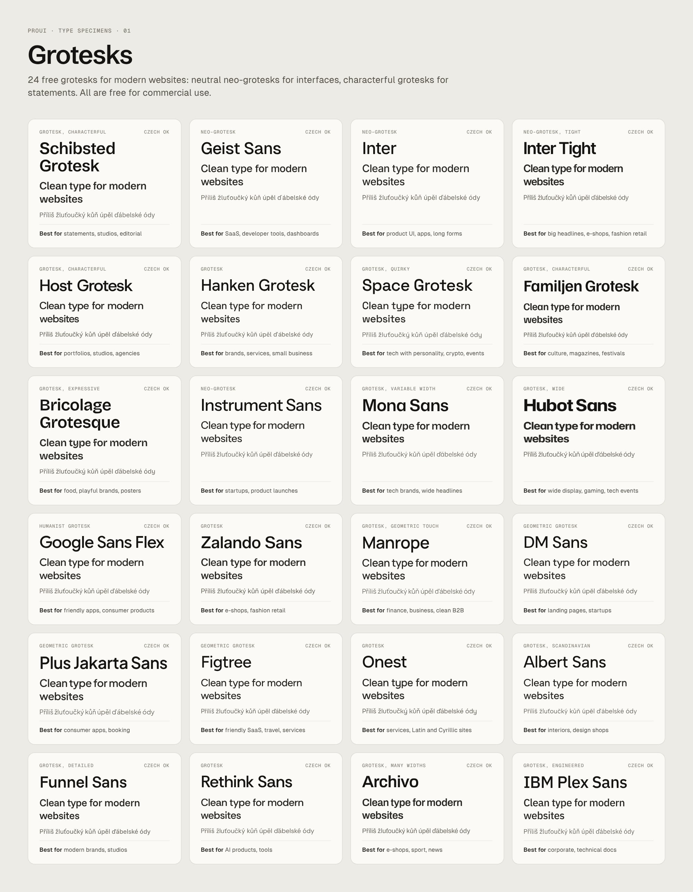

## Bitmap and pixel labels

For tags, counters, order numbers and status lines, always in capitals next to a grotesk. Never for paragraphs. Silkscreen, DotGothic16 and Workbench have no Czech characters.

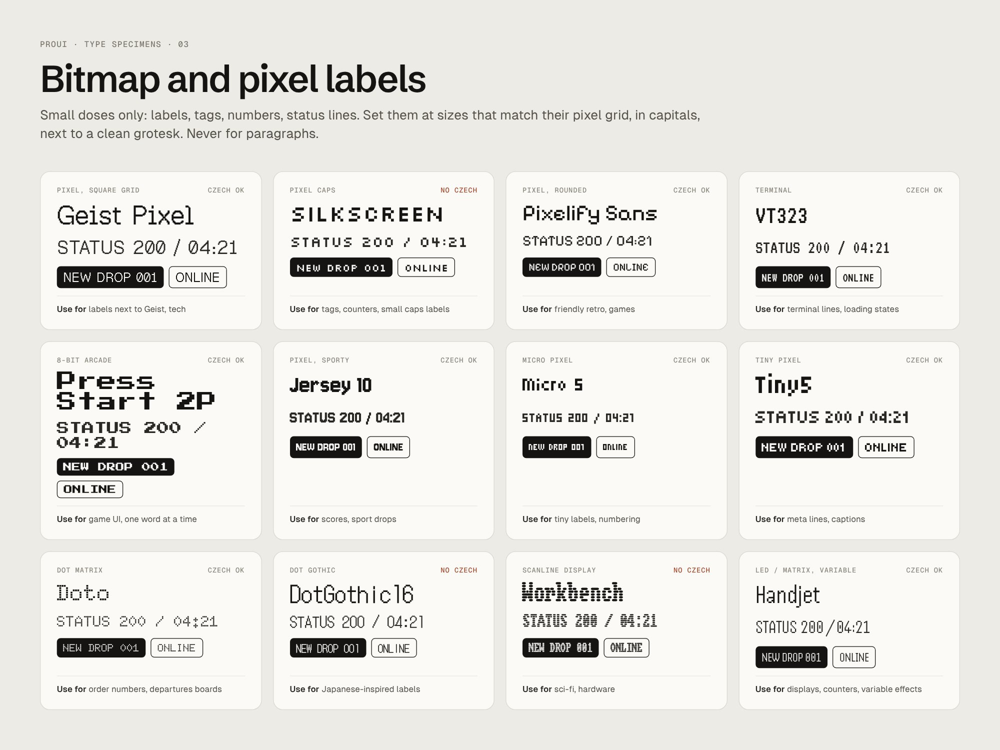

## Mono

For prices, code, dates and small uppercase labels. One mono per site.

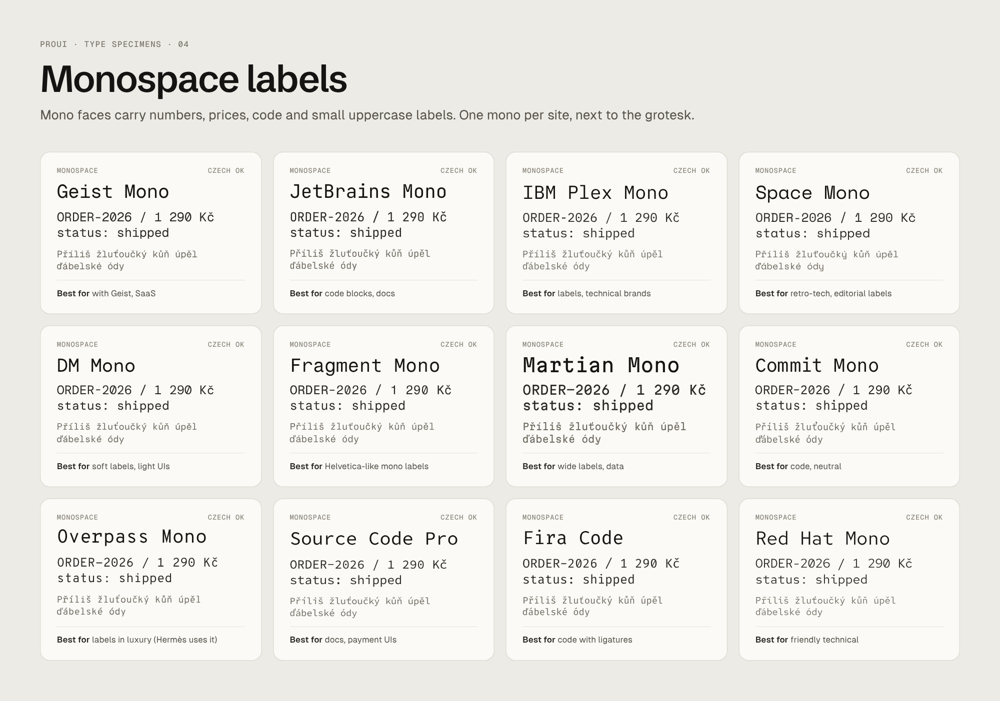

## Serifs for fashion, luxury and editorial

A serif carries the statement; a plain grotesk carries prices, sizes and navigation.

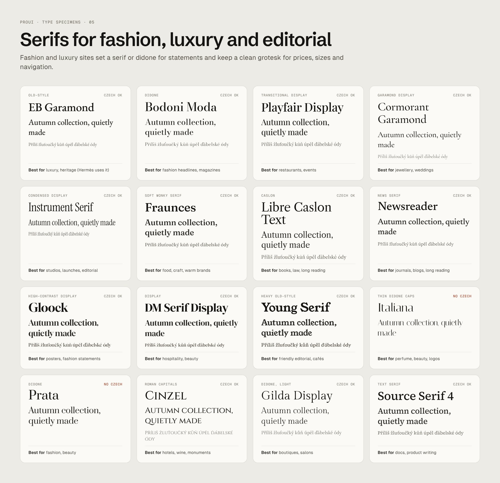

## Condensed, geometric and display

Condensed capitals sell sport and sales. Geometric sans reads as fashion and architecture. Headlines only.

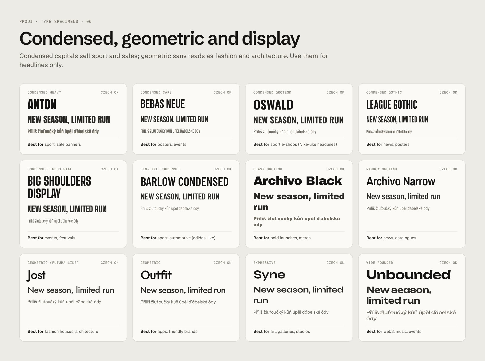

## What big brands use

Measured on the live sites in November 2026. Where the brand font is free it is shown as is; otherwise a free font with a similar feel. Full numbers (sizes, weights, tracking) are in [reference.md](reference.md#what-big-brands-use).

**Free brand fonts you can use today:** Google Sans Flex (Google), Mona Sans and Hubot Sans (GitHub), Geist and Geist Pixel (Vercel), Zalando Sans (Zalando), Inter (Linear), Roboto (Alza). Hermès uses EB Garamond, Manrope and Overpass Mono, all free.

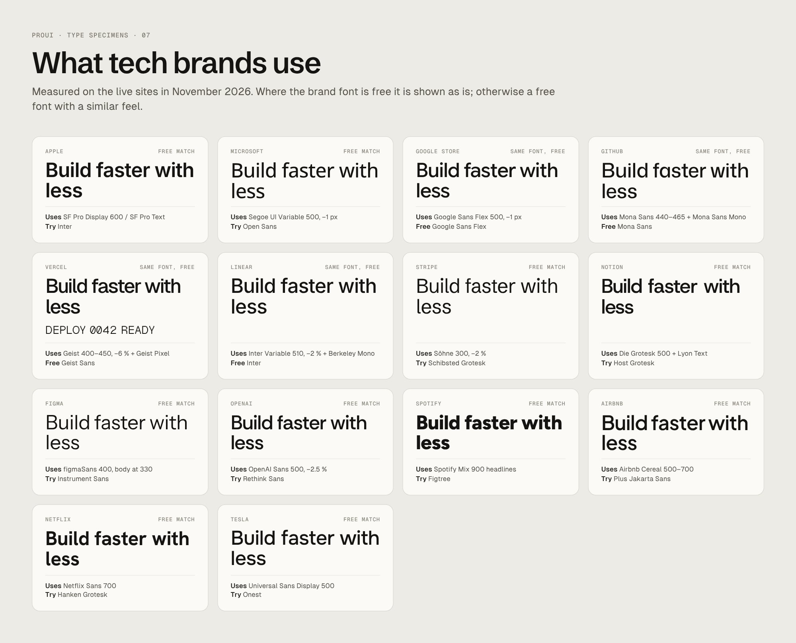

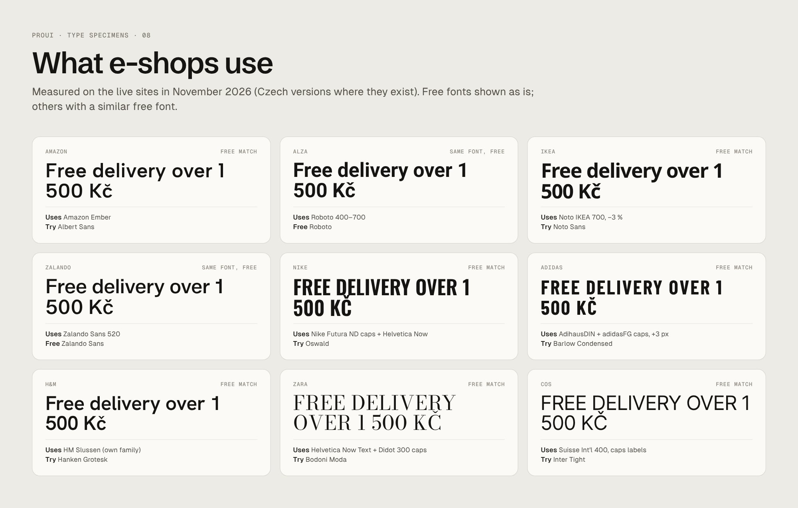

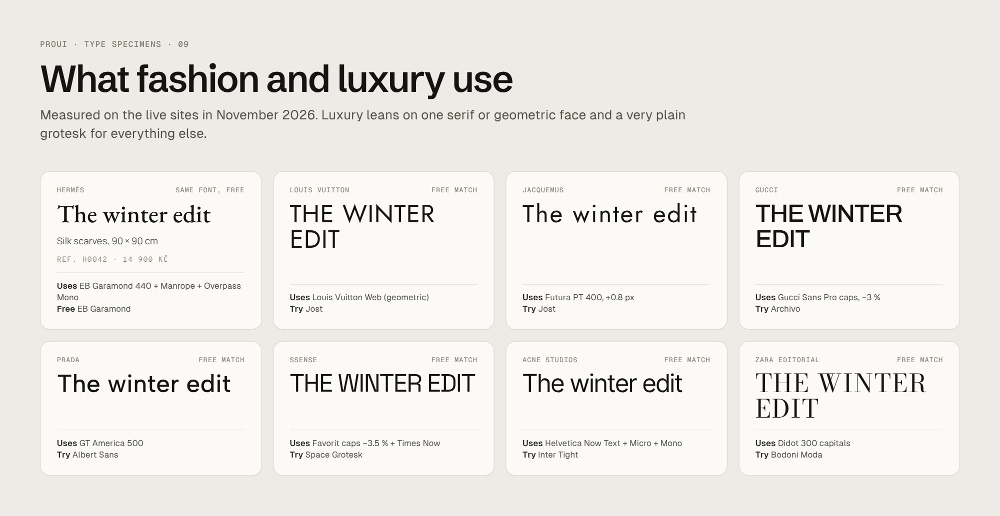

## Before you build

- Set the real headline, a paragraph, a button, a price and a label in the chosen fonts, side by side.
- Type `Příliš žluťoučký kůň úpěl ďábelské ódy` and check that no letter falls back to another font.
- Self-host WOFF2 files (Fontsource or the foundry), load only the weights you use, `font-display: swap`.
- Never ship a trial font. Paid fonts are bought for the domain before launch; build with the free match until then.

Where to get free fonts: [Google Fonts](https://fonts.google.com), [Fontsource](https://fontsource.org) (npm packages), [Fontshare](https://www.fontshare.com) (Satoshi, General Sans, Switzer), [Geist](https://vercel.com/font).

The sheets are rendered from open-licence fonts with original sample text; the generator is in [`specimens/src`](specimens/src/). Brand names identify the sites measured; no logos or brand fonts are included.
