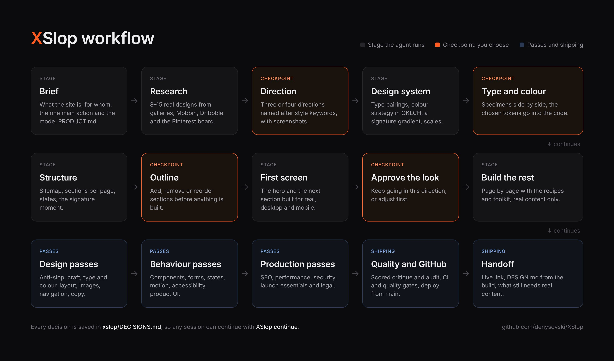

# Workflow

> How XSlop takes a request from a short brief to a live site, and how the site lives on GitHub.

[Back to XSlop](../README.md)



| File | What it covers |
| --- | --- |
| [WORKFLOW.md](WORKFLOW.md) | every stage, checkpoint and pass in order, what the agent shows you and when it waits |
| [GITHUB.md](GITHUB.md) | repository, branches, commits, pull requests, CI, quality gates, deploy, releases |

```text
XSlop workflow: portfolio for a ceramics studio      run everything, stop at checkpoints
XSlop workflow, direction BLACK COAL: ...            skip the direction checkpoint
XSlop workflow, fast: ...                            one combined checkpoint
XSlop workflow, decide yourself: ...                 no stops, every choice recorded
XSlop continue                                       resume from xslop/DECISIONS.md
XSlop pass security                                  run one pass on an existing site
```
