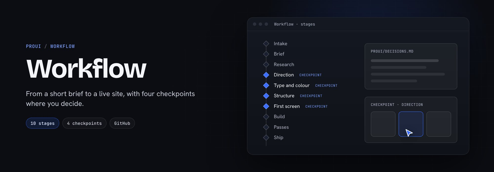
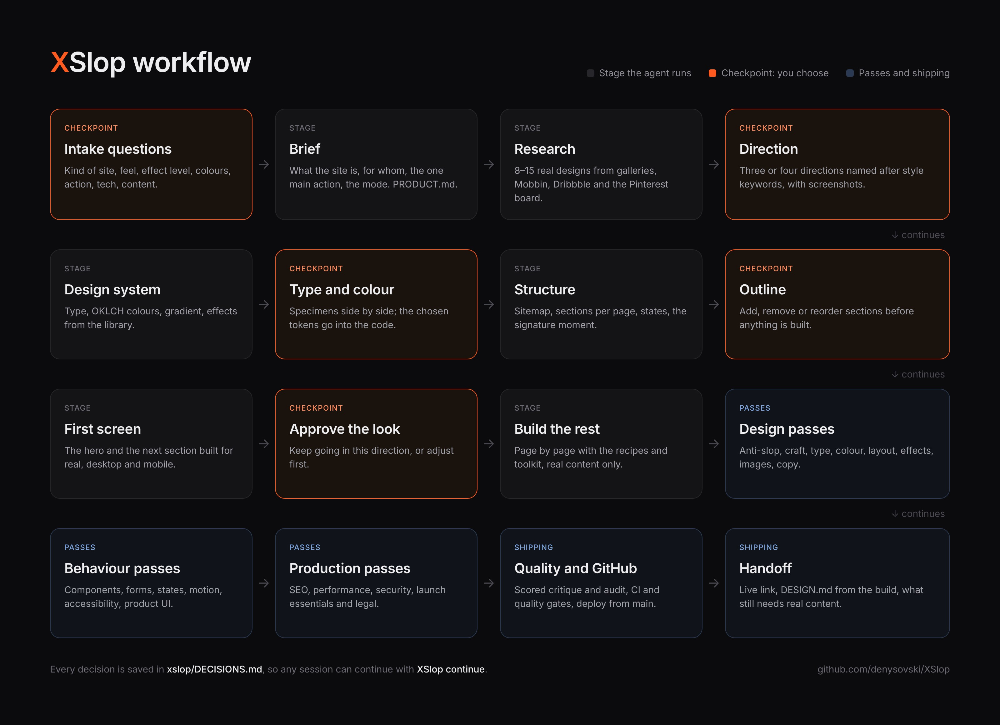

[Back to ProUI](../README.md) · [Commands](../commands/README.md) · [Templates](../templates/README.md)

**From a short brief to a live site, in stages you can follow.** The agent asks a few questions, researches, shows you options, builds, checks its own work against every rulebook and ships. It stops at four checkpoints where the decision is yours, and writes every choice into `proui/DECISIONS.md` so any later session can pick up where the last one stopped.



## Read next

| Guide | What it covers |
| --- | --- |
| [WORKFLOW.md](WORKFLOW.md) | every stage, checkpoint and pass in order: what the agent shows you and when it waits |
| [GITHUB.md](GITHUB.md) | repository, branches, commits, pull requests, CI, quality gates, deploy and releases |

## The four checkpoints

| Checkpoint | You choose |
| --- | --- |
| Direction | one of three or four visual directions, or a mix |
| Type and colour | the font pairing, the palette and the effect kit |
| Outline | the pages and sections, before anything is built |
| First screen | the real hero, before the rest of the site follows it |

## Ways to run it

```text
ProUI workflow: portfolio for a ceramics studio      run everything, stop at each checkpoint
ProUI workflow, direction BLACK COAL: ...            skip the direction checkpoint
ProUI workflow, fast: ...                            one combined checkpoint
ProUI workflow, decide yourself: ...                 no stops, every choice recorded
ProUI continue                                       resume from proui/DECISIONS.md
ProUI pass security                                  run one production pass on its own
```
